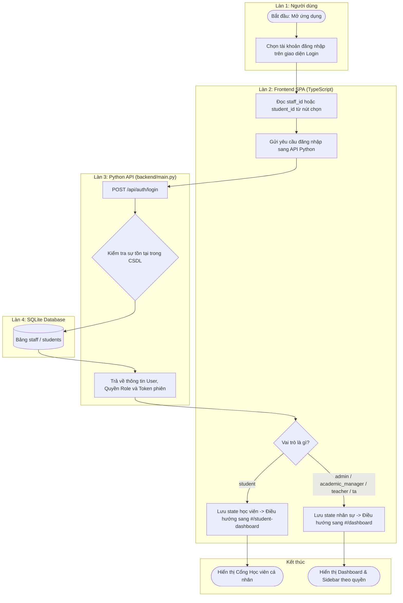
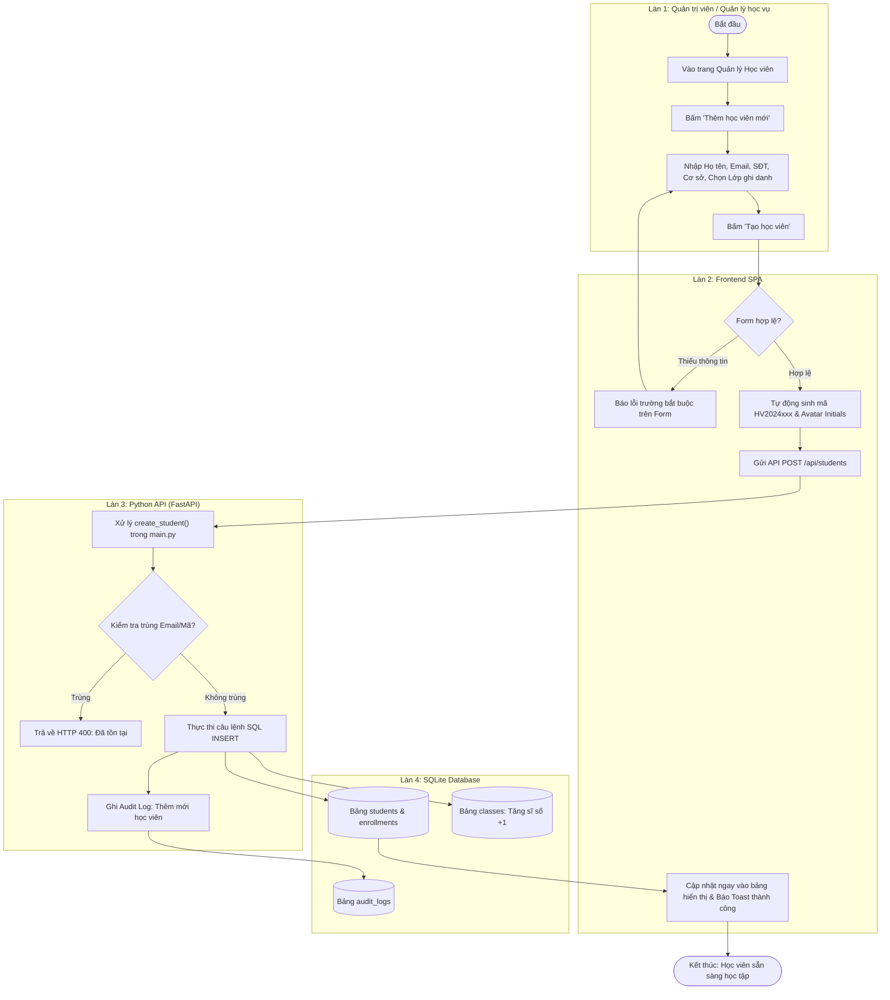
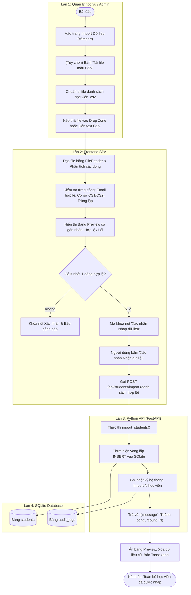
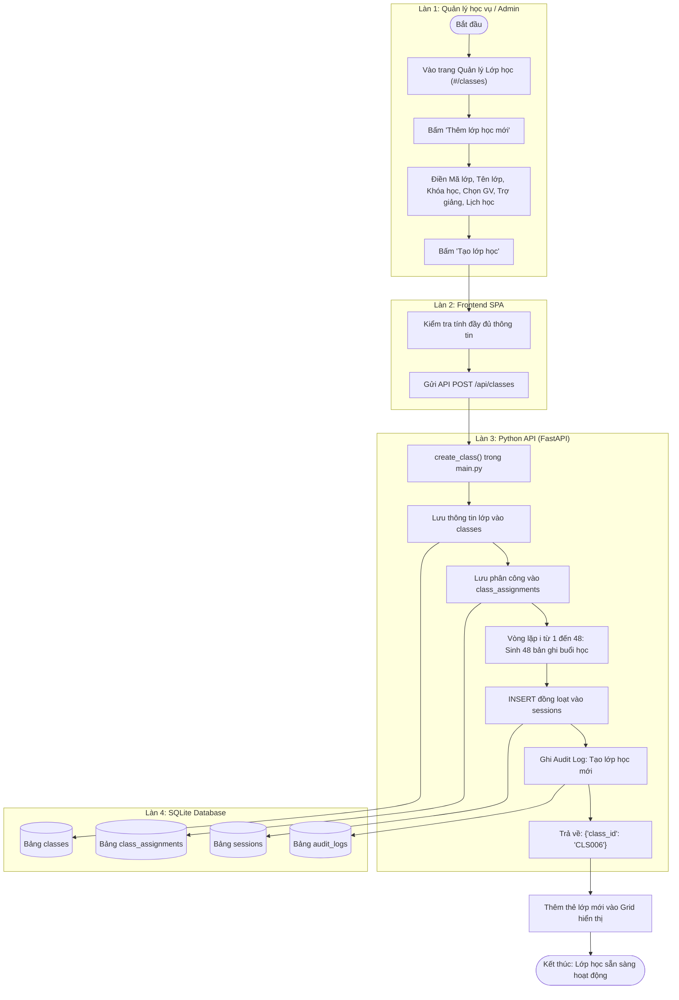
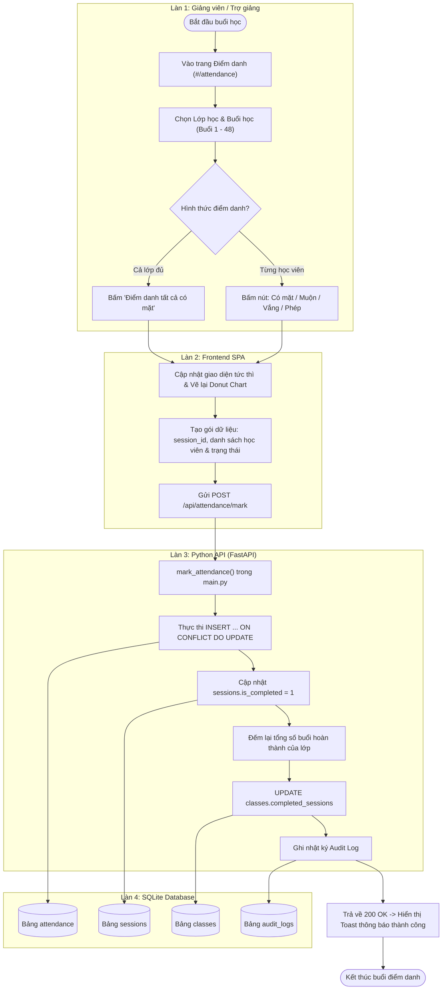
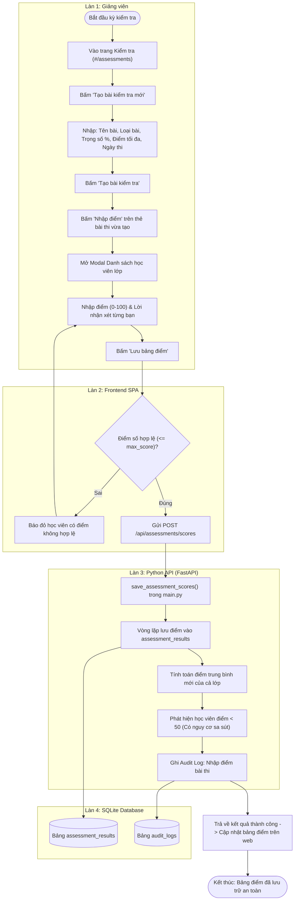
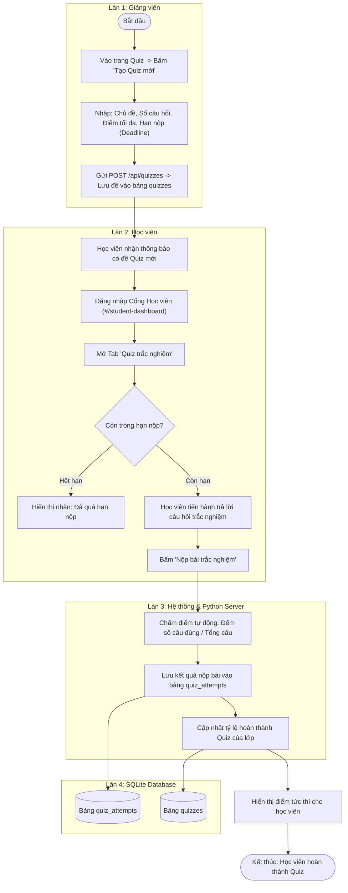
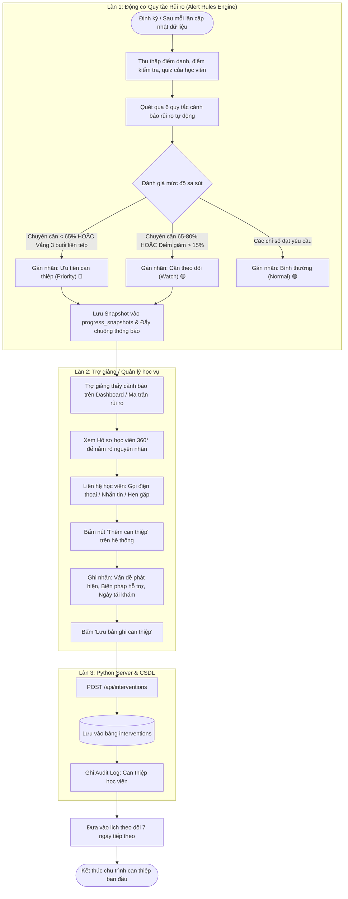
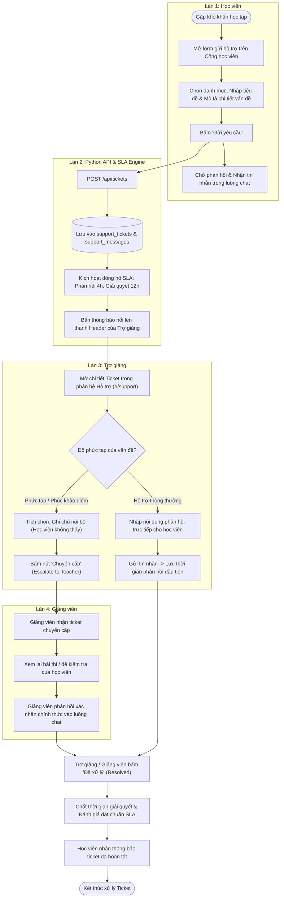
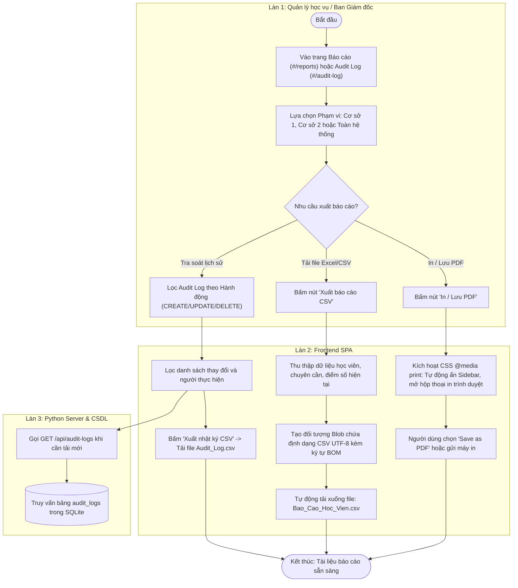

# BỘ TÀI LIỆU SƠ ĐỒ QUY TRÌNH NGHIỆP VỤ BPMN - HỆ THỐNG EDUTRACK

> **Tài liệu Mô hình hóa Quy trình Nghiệp vụ (Business Process Model and Notation - BPMN 2.0)**  
> **Dự án:** Hệ thống Quản lý Tiến độ Học tập & Can thiệp Rủi ro Học viên EduTrack  
> **Kiến trúc:** Python FastAPI Backend + SQLite + TypeScript Vite Frontend SPA  
> **Ngày phát hành:** 05/11/2026

---

## MỤC LỤC 10 QUY TRÌNH BPMN CHUẨN HÓA

1. [BPMN 01: Quy trình Đăng nhập, Xác thực & Phân bổ Không gian Làm việc](#bpmn-01-quy-trinh-dang-nhap-xac-thuc--phan-bo-khong-gian-lam-viec)
2. [BPMN 02: Quy trình Tiếp nhận & Xếp lớp Học viên Thủ công](#bpmn-02-quy-trinh-tiep-nhan--xep-lop-hoc-vien-thu-cong)
3. [BPMN 03: Quy trình Nhập Dữ liệu Học viên Hàng loạt (Batch CSV/Excel Import)](#bpmn-03-quy-trinh-nhap-du-lieu-hoc-vien-hang-loat-batch-csvexcel-import)
4. [BPMN 04: Quy trình Khởi tạo Lớp học, Phân công Giảng dạy & Sinh Lịch 48 Buổi](#bpmn-04-quy-trinh-khoi-tao-lop-hoc-phan-cong-giang-day--sinh-lich-48-buoi)
5. [BPMN 05: Quy trình Điểm danh Buổi học & Tự động Cập nhật Chuyên cần](#bpmn-05-quy-trinh-diem-danh-buoi-hoc--tu-dong-cap-nhat-chuyen-can)
6. [BPMN 06: Quy trình Tổ chức Kiểm tra, Nhập điểm & Đánh giá Năng lực](#bpmn-06-quy-trinh-to-chuc-kiem-tra-nhap-diem--danh-gia-nang-luc)
7. [BPMN 07: Quy trình Tạo Đề Quiz & Học viên Nộp bài Trắc nghiệm](#bpmn-07-quy-trinh-tao-de-quiz--hoc-vien-nop-bai-trac-nghiem)
8. [BPMN 08: Quy trình Giám sát Học tập, Quét Cảnh báo Sa sút & Thực hiện Can thiệp](#bpmn-08-quy-trinh-giam-sat-hoc-tap-quet-canh-bao-sa-sut--thuc-hien-can-thiep)
9. [BPMN 09: Quy trình Tiếp nhận, Xử lý & Chuyển cấp Vé Hỗ trợ Học viên theo Chuẩn SLA](#bpmn-09-quy-trinh-tiep-nhan-xu-ly--chuyen-cap-ve-ho-tro-hoc-vien-theo-chuan-sla)
10. [BPMN 10: Quy trình Xuất Báo cáo Đa chiều, In ấn PDF & Kiểm toán Audit Trail](#bpmn-10-quy-trinh-xuat-bao-cao-da-chieu-in-an-pdf--kiem-toan-audit-trail)

---

## BPMN 01: Quy trình Đăng nhập, Xác thực & Phân bổ Không gian Làm việc

---

## BPMN 02: Quy trình Tiếp nhận & Xếp lớp Học viên Thủ công

---

## BPMN 03: Quy trình Nhập Dữ liệu Học viên Hàng loạt (Batch CSV/Excel Import)

---

## BPMN 04: Quy trình Khởi tạo Lớp học, Phân công Giảng dạy & Sinh Lịch 48 Buổi

---

## BPMN 05: Quy trình Điểm danh Buổi học & Tự động Cập nhật Chuyên cần

---

## BPMN 06: Quy trình Tổ chức Kiểm tra, Nhập điểm & Đánh giá Năng lực

---

## BPMN 07: Quy trình Tạo Đề Quiz & Học viên Nộp bài Trắc nghiệm

---

## BPMN 08: Quy trình Giám sát Học tập, Quét Cảnh báo Sa sút & Thực hiện Can thiệp

---

## BPMN 09: Quy trình Tiếp nhận, Xử lý & Chuyển cấp Vé Hỗ trợ Học viên theo Chuẩn SLA

---

## BPMN 10: Quy trình Xuất Báo cáo Đa chiều, In ấn PDF & Kiểm toán Audit Trail

