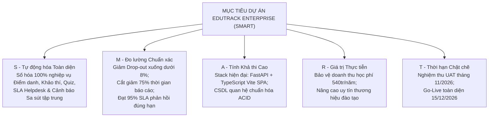
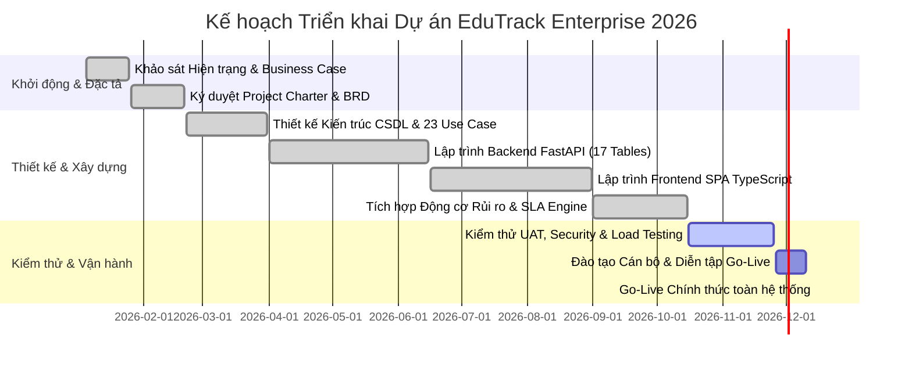
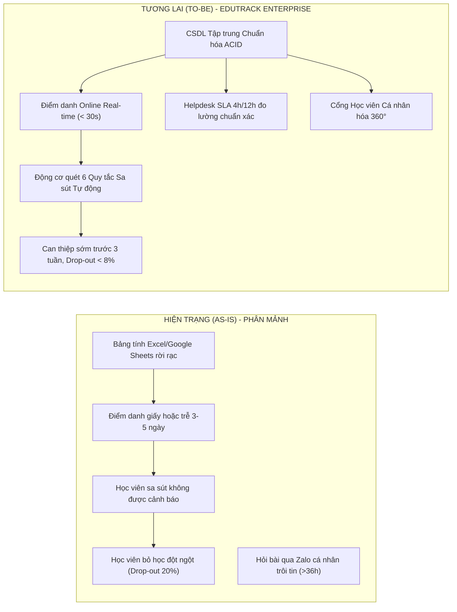

# HỒ SƠ QUẢN TRỊ DỰ ÁN & ĐẶC TẢ YÊU CẦU NGHIỆP VỤ TOÀN DIỆN (PROJECT CHARTER & BRD)
## DỰ ÁN: HỆ THỐNG QUẢN LÝ TIẾN ĐỘ HỌC TẬP & CAN THIỆP RỦI RO HỌC VIÊN
### (EDUTRACK ENTERPRISE - STUDENT RETENTION & RISK INTERVENTION PLATFORM)

> **Cơ quan chủ quản:** Trung tâm Đào tạo & Khảo thí Ngoại ngữ - Tin học EduTrack  
> **Mã dự án:** PRJ-EDUTRACK-2026  
> **Tiêu chuẩn biên soạn:** PMI Project Management Standard & IIBA BABOK Guide v3.0  
> **Kiến trúc kỹ thuật:** Python FastAPI Backend (SQLite WAL / PostgreSQL Ready) + TypeScript Vite SPA Frontend  
> **Phiên bản:** v4.0 (Bản hoàn chỉnh phát hành tháng 11/2026)  
> **Trạng thái tài liệu:** Đã phê duyệt (Approved)  
> **Tài liệu tham chiếu Use Case:** [tai-lieu-usecase-edutrack.md](file:///C:/Users/Admin/.gemini/antigravity/brain/b1c11ae7-a831-4766-a929-50de19c10501/tai-lieu-usecase-edutrack.md)

---

# PHẦN 1: HIẾN CHƯƠNG DỰ ÁN (PROJECT CHARTER)

---

## 1.1. Thông tin Định danh Dự án (Project Identification)

| Thuộc tính | Chi tiết định danh |
| :--- | :--- |
| **Tên dự án** | Hệ thống Quản lý Tiến độ Học tập & Can thiệp Rủi ro Học viên (EduTrack Enterprise) |
| **Mã dự án** | `EDUTRACK-ENT-2026` |
| **Chủ đầu tư (Project Sponsor)** | Ban Giám đốc Trung tâm EduTrack (Executive Board / BOD) |
| **Giám đốc Dự án (Project Manager - PM)** | Trưởng phòng Chuyển đổi số & Công nghệ Thông tin |
| **Kiến trúc sư Trưởng (Lead Architect)** | Kỹ sư Trưởng Full-Stack & Cơ sở dữ liệu |
| **Trưởng nhóm Nghiệp vụ (Lead BA)** | Trưởng phòng Quản lý Đào tạo & Khảo thí |
| **Thời gian thực hiện** | 05/01/2026 – 15/12/2026 (11.5 tháng) |
| **Địa điểm áp dụng** | Cơ sở 1 (CS1 - Quận 1) & Cơ sở 2 (CS2 - Thủ Đức), tích hợp hệ thống đào tạo kết hợp (Blended Learning) |

---

## 1.2. Bối cảnh, Sứ mệnh & Tuyên ngôn Dự án (Executive Summary & Mission)

### 1.2.1. Tuyên ngôn Sứ mệnh Dự án
> "EduTrack Enterprise được phát triển nhằm tái cấu trúc toàn diện công tác quản trị đào tạo, chuyển dịch từ mô hình quản lý thủ công, đối phó bị động sang mô hình điều hành dựa trên dữ liệu thời gian thực (Data-Driven Education). Sứ mệnh cốt lõi của dự án là **phát hiện sớm nguy cơ sa sút học tập trước 3–4 tuần**, can thiệp kịp thời để bảo vệ tỷ lệ duy trì học viên (Retention Rate), chuẩn hóa cam kết phục vụ (SLA) và mang lại trải nghiệm số hóa minh bạch cho học viên."

### 1.2.2. Bối cảnh & Điểm nghẽn Cấp bách (Problem Statement)
Khảo sát thực trạng vận hành niên khóa 2024–2025 tại EduTrack chỉ ra 4 thách thức nghiêm trọng:
1. **Tỷ lệ thất thoát học viên cao (High Student Drop-out Rate):** Tỷ lệ học viên thôi học hoặc trượt chuẩn đầu ra dao động từ **18.5% – 22.0%** mỗi khóa. Lý do chủ yếu là nhà trường chỉ nhận diện học viên có nguy cơ khi họ đã nghỉ học quá nhiều hoặc trượt bài thi cuối khóa, thời điểm mà mọi nỗ lực can thiệp đều đã quá muộn.
2. **Dữ liệu phân mảnh, lãng phí giờ công hành chính:** Quản lý hơn 800 học viên và 90 lớp học rải rác trên 60+ file Excel/Google Sheets. Cán bộ học vụ tiêu tốn **15–20 giờ làm việc/tuần** chỉ cho việc rà soát bảng điểm, ghép dữ liệu điểm danh và tổng hợp báo cáo thủ công.
3. **Thời gian phản hồi khiếu nại chậm, thiếu cơ chế đo lường SLA:** Kênh tiếp nhận thắc mắc qua tin nhắn cá nhân (Zalo/Facebook) gây thất lạc thông tin; thời gian xử lý khiếu nại trung bình kéo dài **> 36 giờ**, không đo lường được hiệu suất hỗ trợ của Trợ giảng và Giảng viên.
4. **Trải nghiệm học viên rời rạc, thiếu minh bạch:** Học viên không có kênh tự tra cứu lịch học, tỷ lệ chuyên cần, hạn nộp bài tập và lịch sử phản hồi, làm suy giảm niềm tin vào chất lượng dịch vụ.

---

## 1.3. Mục tiêu Chiến lược theo Nguyên tắc SMART



- **Mục tiêu 1 (Giữ chân học viên):** Giảm tỷ lệ học viên bỏ học từ **20%** xuống **dưới 8%** trên toàn bộ các khóa học trong vòng 12 tháng kể từ khi vận hành chính thức.
- **Mục tiêu 2 (Động cơ Cảnh báo Sớm):** 100% học viên có dấu hiệu sa sút (theo 6 quy tắc rủi ro) được phát hiện và tự động phân hạng rủi ro (🔴 Ưu tiên can thiệp, 🟡 Cần theo dõi, 🟢 Bình thường) trong vòng 24 giờ sau khi có dữ liệu phát sinh.
- **Mục tiêu 3 (Cam kết Chuẩn mực Dịch vụ SLA):** 
  - **SLA-1 (Phản hồi đầu tiên của Trợ giảng):** Đạt tỷ lệ $\ge 95\%$ phản hồi trong vòng **4 giờ làm việc hành chính** (08:00 – 18:00 Thứ 2 – Thứ 7).
  - **SLA-2 (Phản hồi chuyên môn của Giảng viên):** Đạt tỷ lệ $\ge 92\%$ phản hồi sau chuyển cấp trong vòng **12 giờ làm việc hành chính**.
- **Mục tiêu 4 (Năng suất Vận hành):** Cắt giảm **75% thời gian tổng hợp số liệu** của bộ phận học vụ; tăng quy mô quản lý từ 800 lên 2.000 học viên mà không cần tuyển thêm nhân sự quản lý trung gian.

---

## 1.4. Phạm vi Dự án (Project Scope)

### 1.4.1. Trong phạm vi (In-Scope)
- **Kiến trúc & Hạ tầng:** Xây dựng máy chủ API trung tâm Python FastAPI hiệu năng cao, CSDL SQLite cấu hình WAL (sẵn sàng chuyển dịch PostgreSQL), Frontend Single Page Application (SPA) bằng TypeScript và Vite.
- **9 Phân hệ Nghiệp vụ Cốt lõi (23 Use Case):**
  1. *Phân hệ Xác thực & Quản trị Phiên:* Đăng nhập đa vai trò, quản trị phiên bằng HttpOnly Cookie, phòng chống CSRF đa lớp, thu hồi phiên server-side.
  2. *Phân hệ Quản lý Học viên:* Hồ sơ học viên 360°, công cụ nhập CSV 3 tầng kiểm định All-or-Nothing, mã hóa định danh chuẩn.
  3. *Phân hệ Quản lý Khóa & Lớp học:* Khởi tạo lớp, sinh tự động lịch học động $N$ buổi theo `courses.total_sessions`, xếp lớp và chuyển lớp bằng bảng trung gian `class_enrollments` bảo toàn 100% lịch sử.
  4. *Phân hệ Điểm danh & Chuyên cần:* Điểm danh buổi học Atomic CAS, mở khóa buổi học an toàn, thuật toán tính chuyên cần chuẩn hóa trọng số và xử lý thiếu dữ liệu.
  5. *Phân hệ Khảo thí & Điểm số:* Nhập điểm trực tiếp, chuẩn hóa thang điểm 100, chính sách cảnh báo điểm liệt $< 50.0$ nội bộ.
  6. *Phân hệ Quiz & Nộp bài:* Quản trị vòng đời Quiz (Draft/Published/Closed), thi trắc nghiệm chống gian lận và Backend Auto-Submit, nộp bài tập lưu vết đa phiên bản chống Zip Bomb/Zip Slip.
  7. *Phân hệ Động cơ Rủi ro & Can thiệp:* Quét 6 quy tắc rủi ro tự động, phân hạng 🔴/🟡/🟢, trạng thái Cold-Start `pending`, quy trình can thiệp học viên và nhắc việc tự động.
  8. *Phân hệ Helpdesk SLA:* Tiếp nhận ticket, tính giờ theo khung hành chính `Asia/Ho_Chi_Minh`, chuyển cấp, Manager Override, vòng đời Resolved và cửa sổ Reopen 48 giờ.
  9. *Phân hệ Báo cáo & Kiểm toán:* Xuất báo cáo CSV UTF-8 có BOM, tối ưu in ấn PDF qua `@media print`, nhật ký kiểm toán Append-Only với phân quyền CSDL `REVOKE UPDATE, DELETE`.
- **Cổng Học viên Trực tuyến (Student Portal):** Không gian làm việc cá nhân hóa cho học viên theo dõi tiến độ, nộp bài, thi quiz, gửi ticket và nhận chuông thông báo.

### 1.4.2. Ngoài phạm vi (Out-of-Scope - Giai đoạn 1)
- Tích hợp cổng thanh toán học phí trực tuyến (VNPay, MoMo, ZaloPay) — Dự kiến đưa vào Pha 2 (Quý 3/2027).
- Hệ thống giám sát thi cử trực tuyến bằng AI nhận diện khuôn mặt qua Webcam (AI Proctoring).
- Phòng học ảo truyền phát video trực tiếp (WebRTC Video Streaming) — Tiếp tục sử dụng nền tảng Zoom/Google Meet độc lập.
- Ứng dụng di động Native (iOS/Android) — Giai đoạn 1 tập trung tối ưu Responsive Web App trên trình duyệt di động.

---

## 1.5. Kế hoạch Tiến độ Dự án & Các Mốc Trọng yếu (Milestone Schedule)



| Mốc quan trọng (Milestone) | Thời hạn mục tiêu | Kết quả bàn giao chính (Deliverables) | Tiêu chí nghiệm thu |
| :--- | :---: | :--- | :--- |
| **M01: Phê duyệt Khởi động** | 25/01/2026 | Báo cáo Business Case, Phân tích Chi phí - Lợi ích | Ban Giám đốc phê duyệt vốn đầu tư |
| **M02: Đóng băng Yêu cầu (Scope Freeze)** | 20/02/2026 | Hồ sơ BRD, Project Charter, WBS, RACI Matrix | Các Trưởng phòng ban ký xác nhận |
| **M03: Thiết kế Kiến trúc** | 31/03/2026 | Bản thiết kế CSDL (17 bảng), Sơ đồ tuần tự, API Specs | Đạt đánh giá an toàn & toàn vẹn dữ liệu |
| **M04: Hoàn tất Lập trình Backend** | 15/06/2026 | Bộ API hoàn chỉnh trên FastAPI, Docker Image | Vượt qua 100% Unit Tests & Integration Tests |
| **M05: Hoàn tất Frontend SPA** | 31/08/2026 | Giao diện Responsive SPA, Dashboard học viên | Đạt chuẩn thiết kế UX/UI và thời gian tải $< 1.5\text{s}$ |
| **M06: Hoàn thiện Động cơ Rủi ro & SLA** | 15/10/2026 | Engine quét 6 quy tắc, SLA Timer 4h/12h | Mô phỏng chính xác kịch bản sa sút và trễ hạn |
| **M07: Nghiệm thu Người dùng (UAT)** | 25/11/2026 | Biên bản kiểm thử UAT, Báo cáo khắc phục lỗi | 100% ca kiểm thử quan trọng đạt Pass |
| **M08: Sẵn sàng Vận hành** | 10/12/2026 | Bộ tài liệu hướng dẫn, Dữ liệu đã import sạch | Cán bộ 2 cơ sở hoàn thành tập huấn |
| **M09: Go-Live Toàn diện** | 15/12/2026 | Hệ thống hoạt động chính thức tại 2 cơ sở | Chuyển đổi dữ liệu sạch và chạy ổn định |

---

## 1.6. Dự toán Ngân sách & Phân tích Hiệu quả Tài chính (Financial Justification)

### 1.6.1. Dự toán Chi phí (CAPEX & OPEX)
*Đơn vị tính: Việt Nam Đồng (VNĐ)*

| Hạng mục chi phí | Chi phí Đầu tư (Năm 0) | Vận hành Năm 1 | Vận hành Năm 2 | Vận hành Năm 3 |
| :--- | :---: | :---: | :---: | :---: |
| **1. Chi phí Nhân sự Phát triển (CAPEX):** | | | | |
| - Quản trị dự án & BA (1 PM/Lead BA) | 45.000.000 | 0 | 0 | 0 |
| - Lập trình Backend & DB Specialist | 55.000.000 | 0 | 0 | 0 |
| - Lập trình Frontend SPA & UI/UX | 45.000.000 | 0 | 0 | 0 |
| - Kỹ sư Kiểm thử phần mềm (QA/QC) | 25.000.000 | 0 | 0 | 0 |
| **2. Chi phí Bản quyền & Hạ tầng (OPEX):** | | | | |
| - Cloud VPS, Tên miền, SSL & Backup | 12.000.000 | 14.400.000 | 16.000.000 | 18.000.000 |
| - Dịch vụ SMTP/Email thông báo | 3.000.000 | 4.000.000 | 5.000.000 | 5.000.000 |
| **3. Đào tạo, Triển khai & Nghiệm thu:** | 10.000.000 | 4.000.000 | 4.000.000 | 4.000.000 |
| **4. Chi phí Dự phòng Rủi ro (10%):** | 19.500.000 | 2.240.000 | 2.500.000 | 2.700.000 |
| **TỔNG CHI PHÍ TỪNG NĂM** | **214.500.000** | **24.640.000** | **27.500.000** | **29.700.000** |

### 1.6.2. Định lượng Lợi ích Tài chính (Financial Benefits)
1. **Lợi ích 1 — Bảo toàn Doanh thu nhờ Giảm Học viên Bỏ học:**
   - Số học viên trung bình/năm: $1.000$ học viên.
   - Học phí trung bình một khóa học: $4.500.000\text{ đ}$.
   - Tỷ lệ drop-out giảm từ $20\%$ xuống $8\%$ (giữ chân thêm $12\% \times 1.000 = 120$ học viên/năm).
   - Doanh thu bảo toàn: $120 \times 4.500.000 = \mathbf{540.000.000\text{ đ/năm}}$.
2. **Lợi ích 2 — Tiết kiệm Giờ công Lao động Hành chính:**
   - Tiết kiệm 15 giờ làm việc/tuần cho 3 cán bộ học vụ $= 15\text{h} \times 52\text{ tuần} \times 80.000\text{ đ/h} = \mathbf{62.400.000\text{ đ/năm}}$.
3. **Lợi ích 3 — Tăng Tỷ lệ Học viên Tái đăng ký (Re-enrollment):**
   - Sự hài lòng về dịch vụ tăng giúp nâng tỷ lệ học tiếp lên $10\%$, mang lại thêm $\mathbf{135.000.000\text{ đ/năm}}$.

| Chỉ số Tài chính | Giá trị tính toán | Ý nghĩa quản trị |
| :--- | :---: | :--- |
| **Tổng Chi phí Đầu tư & Vận hành (3 năm)** | **296.340.000 đ** | Tổng ngân sách toàn bộ vòng đời 3 năm |
| **Tổng Lợi ích Thu về (3 năm)** | **2.212.200.000 đ** | Doanh thu giữ chân + Tiết kiệm chi phí |
| **Lợi ích Ròng (Net Benefits - 3 năm)** | **1.915.860.000 đ** | Giá trị gia tăng thuần túy cho trung tâm |
| **Tỷ suất Hoàn vốn Đầu tư (ROI - 3 năm)** | $$\mathbf{646.5\%}$$ | Hiệu quả đầu tư vượt trội so với lãi suất tài chính |
| **Thời gian Hoàn vốn (Payback Period)** | $$\mathbf{4.2\text{ tháng}}$$ | Thu hồi toàn bộ vốn chỉ sau hơn 4 tháng Go-Live |

---

## 1.7. Cơ cấu Quản trị Dự án & Ma trận Phân công Trách nhiệm (Governance & RACI)

### 1.7.1. Sơ đồ Tổ chức Dự án (Project Organization)
- **Hội đồng Phê duyệt (Steering Committee):** Ban Giám đốc (BOD) & Trưởng phòng Đào tạo.
- **Quản trị Điều hành (Project Management):** Project Manager (PM) & Lead Business Analyst (BA).
- **Nhóm Kỹ thuật (Technical Team):** Backend Engineers, Frontend Developers, Database Administrator (DBA), DevOps.
- **Nhóm Đảm bảo Chất lượng (Quality Assurance):** QA Lead, Test Automation Engineers, Security Auditor.
- **Đại diện Người dùng Đầu cuối (End-User Representatives):** Quản lý học vụ CS1 & CS2, Đại diện Giảng viên, Đại diện Trợ giảng.

### 1.7.2. Ma trận Phân quyền & Trách nhiệm (RACI Matrix)
*Quy ước: **R** = Responsible (Người thực hiện); **A** = Accountable (Người chịu trách nhiệm chính/Phê duyệt); **C** = Consulted (Người được tham vấn); **I** = Informed (Người được thông báo).*

| Hoạt động Quản trị & Phát triển | Ban Giám đốc | Project Manager | Lead BA | Lead Dev | QA Lead | Cán bộ Học vụ |
| :--- | :---: | :---: | :---: | :---: | :---: | :---: |
| Ký duyệt Project Charter & Ngân sách | **A** | R | C | I | I | I |
| Đặc tả Yêu cầu Nghiệp vụ (BRD) & BFD | I | C | **A/R** | C | C | C |
| Thiết kế CSDL & Đóng gói 23 Use Case | I | C | C | **A/R** | C | I |
| Lập trình Tính năng & Bảo mật API | I | I | I | **A/R** | C | I |
| Xây dựng Ma trận Truy vết Yêu cầu (RTM) | I | C | R | C | **A** | I |
| Tổ chức Kiểm thử Nghiệm thu UAT | I | C | C | I | R | **A** |
| Đào tạo Người dùng & Bàn giao Tài liệu | I | R | R | C | I | **A** |
| Quyết định Go-Live chính thức | **A** | R | C | C | C | C |

---

## 1.8. Phân tích Rủi ro Cấp cao & Kế hoạch Phòng ngừa (High-Level Risk Matrix)

| Mã Rủi ro | Tên Rủi ro | Khả năng | Mức độ | Biện pháp Phòng ngừa & Kế hoạch Khắc phục |
| :---: | :--- | :---: | :---: | :--- |
| **RSK-01** | Tranh chấp khóa dữ liệu SQLite khi tải ghi đồng thời cao | Trung bình | Cao | Bật cấu hình `PRAGMA journal_mode=WAL;` và `busy_timeout=15000;`. Thiết kế tầng truy cập dữ liệu trừu tượng (SQLAlchemy) sẵn sàng kích hoạt chuyển sang **PostgreSQL** mà không phải viết lại logic. |
| **RSK-02** | Giảng viên, Trợ giảng ngại thay đổi, chậm điểm danh online | Cao | Trung bình | Tích hợp nút 1-chạm *"Điểm danh tất cả có mặt"* rút ngắn thời gian dưới 30 giây; ban hành KPI tính thưởng gắn liền với tỷ lệ hoàn thành điểm danh đúng giờ. |
| **RSK-03** | Lộ lọt đáp án Quiz hoặc sửa đổi bài nộp sau hạn chót | Thấp | Rất cao | Không trả trường `correct_option` xuống client khi Quiz chưa đóng; cưỡng chế Backend Auto-Submit căn theo `effective_deadline` trên server clock. |
| **RSK-04** | Giả mạo quyền hạn qua HTTP Request trực tiếp | Thấp | Rất cao | Triệt tiêu hoàn toàn sự phụ thuộc vào client header `X-User-Role`; xác thực session cookie máy chủ và kiểm tra RBAC tại FastAPI Dependency `Depends()`. |
| **RSK-05** | Học viên spam ticket làm quá tải hàng đợi SLA | Trung bình | Thấp | Áp dụng Rate Limiting tối đa 5 ticket/ngày/học viên; gom các yêu cầu xin nghỉ thành danh mục chuẩn hóa có kiểm tra tự động. |

---

## 1.9. Tiêu chuẩn Thành công & Tiêu chí Đóng Dự án (Success Criteria)
1. **Nghiệm thu Chức năng:** Đạt $100\%$ các tiêu chí nghiệm thu của 23 Use Case và 9 Phân hệ; không còn lỗi mức độ Critical hoặc High còn tồn đọng.
2. **Nghiệm thu Hiệu năng:** Thời gian phản hồi API trung bình $< 200\text{ms}$; thời gian tải trang SPA lần đầu $< 1.5\text{s}$; hệ thống chịu tải an toàn tối thiểu 200 người dùng đồng thời.
3. **Nghiệm thu An toàn Thông tin:** Đạt bài kiểm tra thâm nhập (Penetration Test) cơ bản: chống giả mạo quyền, chống XSS, CSRF, Path Traversal (Zip Slip), và tấn công dò quét tài khoản (Account Enumeration).
4. **Nghiệm thu Dữ liệu & Đào tạo:** 100% dữ liệu học viên, lớp học hiện tại được chuyển đổi sạch vào CSDL; 100% cán bộ học vụ, Giảng viên và Trợ giảng hoàn thành khóa đào tạo sử dụng hệ thống.

---

# PHẦN 2: TÀI LIỆU ĐẶC TẢ YÊU CẦU NGHIỆP VỤ (BRD)

---

## 2.1. Phân tích Hiện trạng & Phân tích Khoảng cách (As-Is vs To-Be Gap Analysis)



| Tiêu chí so sánh | Quy trình Hiện trạng (As-Is) | Quy trình Đích (To-Be - EduTrack Enterprise) | Khoảng cách cần giải quyết (Gap & Solution) |
| :--- | :--- | :--- | :--- |
| **Quản lý dữ liệu học viên** | Rải rác trên file Excel cá nhân, trùng lặp thông tin, không bảo toàn lịch sử chuyển lớp. | CSDL quan hệ chuẩn hóa; lưu vết chuyển lớp, bảo lưu qua bảng `class_enrollments`. | Xây dựng công cụ Import CSV 3 tầng kiểm định; bảo toàn 100% dữ liệu lịch sử. |
| **Nghiệp vụ Điểm danh** | Giảng viên ghi sổ tay hoặc file riêng; cuối tháng học vụ mới tổng hợp một lần. | Điểm danh trực tiếp trên web theo buổi; hỗ trợ Atomic CAS chống xung đột đồng thời. | Tự động hóa tính toán tỷ lệ chuyên cần theo trọng số $w$ ngay khi chốt buổi học. |
| **Khảo thí & Điểm số** | Thang điểm không thống nhất (chỗ thang 10, chỗ thang 20, chỗ thang 100). | Nhập `raw_score` linh hoạt; hệ thống tự quy đổi `normalized_score` về thang 100. | Thống nhất thuật toán tính điểm trung bình có trọng số; cảnh báo điểm liệt $< 50.0$. |
| **Cảnh báo học viên sa sút** | Chỉ biết khi học viên đã bỏ học hoặc thi trượt; xử lý sự vụ bị động. | Động cơ quét 6 quy tắc tự động phân loại 🔴/🟡/🟢; cơ chế nhắc việc can thiệp sau 7 ngày. | Triển khai động cơ UC-16 tự động kích hoạt sau mỗi sự kiện điểm danh/nhập điểm. |
| **Hỗ trợ & Xử lý Yêu cầu** | Nhắn tin Zalo/Facebook; dễ trôi tin; không có bằng chứng thời gian giải quyết. | Quản lý Ticket tập trung; đếm ngược SLA 4h (TA) và 12h (GV) theo giờ làm việc hành chính. | SLA Timer tự động kích hoạt, gắn cờ vi phạm KPI và hỗ trợ Manager Override. |
| **Trải nghiệm Học viên** | Hỏi điểm và lịch học qua nhân viên; bị động, thiếu kênh phản ánh chính thống. | Cổng thông tin học viên tự phục vụ (Self-service): nộp bài, làm quiz, xem tiến độ, gửi ticket. | Xây dựng Student Dashboard responsive, thông báo chuông cá nhân hóa. |

---

## 2.2. Chân dung Người dùng & Ma trận Phân quyền Vai trò (User Personas & RBAC)

Hệ thống thiết lập ma trận phân quyền dựa trên vai trò (Role-Based Access Control) cho 6 nhóm tác nhân:

| Nhóm Vai trò | Mã Hệ thống | Mô tả Chân dung & Trách nhiệm Nghiệp vụ |
| :--- | :---: | :--- |
| **Quản trị viên** | `admin` | Phụ trách kỹ thuật và an toàn thông tin. Toàn quyền quản trị tài khoản, cấu hình tham số hệ thống, tra soát Audit Log bất biến và sao lưu phục hồi dữ liệu. |
| **Quản lý Học vụ** | `academic_manager` | Giám sát chất lượng đào tạo toàn cơ sở. Quản lý tuyển sinh, import học viên, xếp lớp, chuyển lớp, phê duyệt bảo lưu, phân bổ ticket và giám sát vi phạm SLA. |
| **Giảng viên** | `teacher` | Chịu trách nhiệm giảng dạy và chuyên môn. Điểm danh lớp học, tạo bài kiểm tra, nhập bảng điểm, tạo đề quiz, chấm bài tập và phản hồi chuyên môn ticket chuyển cấp. |
| **Trợ giảng** | `teaching_assistant` | Hỗ trợ học tập và đồng hành cùng học viên. Hỗ trợ điểm danh, tiếp nhận và phản hồi vé hỗ trợ (SLA-1: 4h), lập biên bản can thiệp học viên sa sút và chuyển cấp ticket. |
| **Học viên** | `student` | Trung tâm của dịch vụ đào tạo. Tra cứu thời khóa biểu, tỷ lệ chuyên cần, làm bài quiz trực tuyến, nộp bài tập file, tạo ticket khiếu nại/hỗ trợ và nhận chuông thông báo. |
| **Ban Giám đốc** | `executive_board` | Lãnh đạo cấp cao. Tra cứu báo cáo phân tích chiến lược (Dashboard BOD), theo dõi tỷ lệ duy trì học viên, giám sát KPI tuân thủ SLA và phê duyệt chính sách đào tạo. |

### Ma trận Quyền hạn Chi tiết (CRUD Permissions Matrix)
*Quy ước: **C** (Create - Tạo); **R** (Read - Xem); **U** (Update - Sửa); **D** (Delete - Xóa); **-** (Không có quyền).*

| Phân hệ / Tài nguyên | Admin | Academic Manager | Teacher | Teaching Assistant | Student | Executive Board |
| :--- | :---: | :---: | :---: | :---: | :---: | :---: |
| Quản lý Người dùng & Phân vai trò | CRUD | R | - | - | - | R |
| Hồ sơ Học viên 360° | CRUD | CRUD | R (Lớp dạy) | R (Lớp phụ trách) | R (Bản thân) | R |
| Nhập dữ liệu CSV hàng loạt | CR | CR | - | - | - | - |
| Khóa học & Lớp học | CRUD | CRUD | R (Lớp dạy) | R (Lớp phụ trách) | R (Lớp học) | R |
| Xếp lớp & Chuyển lớp | CRUD | CRUD | - | - | - | R |
| Điểm danh Buổi học | CRUD | CRUD | CRU | CRU | R (Bản thân) | R |
| Mở khóa Buổi học hoàn thành | CRU | CRU | - | - | - | - |
| Quản lý Bài thi & Bảng điểm | CRUD | R | CRUD | R | R (Bản thân) | R |
| Quản lý Đề Quiz & Chấm tự động | CRUD | R | CRUD | R | R / Thi | R |
| Nộp bài tập file đa phiên bản | CRUD | R | RU (Chấm) | R | CR (Nộp) | R |
| Động cơ Cảnh báo Sa sút (UC-16) | CRU | CRU | R | R | - | R |
| Hồ sơ Can thiệp Học viên | CRUD | CRUD | R | CRUD | - | R |
| Tiếp nhận & Xử lý Ticket (SLA-1) | CRUD | CRUD | R | CRU | C (Gửi ticket) | R |
| Chuyển cấp & Xử lý Chuyên môn (SLA-2)| CRUD | CRUD | RU | R | R (Ticket mình) | R |
| Báo cáo Chiến lược & Thống kê | CRUD | CRUD | R (Lớp mình) | R (Lớp mình) | - | R (Toàn diện) |
| Tra soát Nhật ký Kiểm toán (Audit Log) | R | - | - | - | - | R |

---

## 2.3. Sơ đồ Phân rã Chức năng Nghiệp vụ (Business Function Diagram - BFD)

```mermaid
flowchart TD
    ROOT["HỆ THỐNG EDUTRACK ENTERPRISE"]

    ROOT --> BFD1["1.0 QUẢN TRỊ XÁC THỰC & AN NINH"]
    ROOT --> BFD2["2.0 QUẢN LÝ ĐÀO TẠO & HỌC VIÊN"]
    ROOT --> BFD3["3.0 THEO DÕI CHUYÊN CẦN & KHẢO THÍ"]
    ROOT --> BFD4["4.0 CAN THIỆP SA SÚT & HELPDESK SLA"]
    ROOT --> BFD5["5.0 CỔNG HỌC VIÊN & BÁO CÁO CHIẾN LƯỢC"]

    BFD1 --> F11["1.1 Đăng nhập Đa vai trò (Credential Check)"]
    BFD1 --> F12["1.2 Quản trị Phiên HttpOnly & Thu hồi Server"]
    BFD1 --> F13["1.3 Kiểm soát Quyền RBAC 2 Lớp (FE & BE)"]
    BFD1 --> F14["1.4 Nhật ký Kiểm toán Append-Only (DBMS Secured)"]

    BFD2 --> F21["2.1 Hồ sơ Học viên Toàn diện 360°"]
    BFD2 --> F22["2.2 Nhập Dữ liệu CSV Hàng loạt 3 Tầng"]
    BFD2 --> F23["2.3 Khởi tạo Lớp & Sinh Lịch Động N Buổi"]
    BFD2 --> F24["2.4 Xếp lớp & Chuyển lớp Bảo toàn Lịch sử"]

    BFD3 --> F31["3.1 Điểm danh Buổi học Mới (Atomic CAS)"]
    BFD3 --> F32["3.2 Mở khóa & Sửa Điểm danh Buổi cũ"]
    BFD3 --> F33["3.3 Tính Tỷ lệ Chuyên cần Tự động (Trọng số w)"]
    BFD3 --> F34["3.4 Quản lý Bài thi & Chuẩn hóa Điểm Thang 100"]
    BFD3 --> F35["3.5 Phát hành Đề Quiz & Backend Auto-Submit"]
    BFD3 --> F36["3.6 Nộp Bài tập Đa phiên bản & Quét Zip Bomb"]

    BFD4 --> F41["4.1 Động cơ Quét 6 Quy tắc Rủi ro (UC-16)"]
    BFD4 --> F42["4.2 Quản lý Hồ sơ Can thiệp Học viên & Nhắc việc"]
    BFD4 --> F43["4.3 Tiếp nhận Ticket & Giám sát SLA-1 (4h TA)"]
    BFD4 --> F44["4.4 Chuyển cấp GV, SLA-2 (12h) & Manager Override"]
    BFD4 --> F45["4.5 Đóng Ticket Tự động & Cửa sổ Reopen 48h"]

    BFD5 --> F51["5.1 Cổng Học viên Tự phục vụ (Student Portal)"]
    BFD5 --> F52["5.2 Chuông Thông báo Sự kiện Cá nhân hóa"]
    BFD5 --> F53["5.3 Xuất Báo cáo CSV UTF-8 có BOM"]
    BFD5 --> F54["5.4 Xuất Báo cáo Chuẩn In/Lưu PDF A4"]
```



---

## 2.4. Đặc tả Yêu cầu Nghiệp vụ Chi tiết theo 9 Phân hệ (Detailed Functional Requirements)

### Phân hệ 1: Xác thực, Quản trị Phiên & An toàn Hệ thống
- **REQ-SEC-01 (Đăng nhập Credential-Driven):** Hệ thống không cho phép người dùng tự lựa chọn vai trò trên giao diện. Vai trò và quyền hạn được truy xuất trực tiếp từ CSDL sau khi kiểm tra đúng tên đăng nhập/email và mật khẩu băm.
- **REQ-SEC-02 (Phòng chống Account Enumeration):** Khi người dùng nhập sai mật khẩu hoặc tên đăng nhập không tồn tại, hệ thống luôn trả về thông báo Toast đồng nhất: *"Sai tên đăng nhập hoặc mật khẩu"*. Mã lỗi chi tiết chỉ ghi vết tại log nội bộ máy chủ.
- **REQ-SEC-03 (Lưu trữ Phiên An toàn):** Phiên làm việc được quản lý bằng HttpOnly Cookie kèm các cờ `Secure`, `SameSite=Lax`. JavaScript trình duyệt không có quyền truy cập cookie này nhằm chống tấn công XSS.
- **REQ-SEC-04 (Thu hồi Phiên Server-Side):** Khi người dùng bấm Đăng xuất, Backend thực hiện thu hồi phiên trong CSDL/Redis store và hủy cookie lập tức.
- **REQ-SEC-05 (Kiểm soát RBAC 2 Lớp):** Mọi request API thay đổi dữ liệu bắt buộc phải được thẩm định quyền tại Backend thông qua FastAPI `Depends()`, tuyệt đối không tin tưởng client header `X-User-Role`.

### Phân hệ 2: Quản lý Học viên & Nhập dữ liệu CSV Hàng loạt
- **REQ-STU-01 (Hồ sơ Học viên 360°):** Cung cấp giao diện tập trung hiển thị 5 nhóm thông tin: Thông tin nhân thân, Lịch sử phân lớp/chuyển lớp, Bảng điểm chi tiết, Tiến độ chuyên cần và Lịch sử can thiệp/ticket hỗ trợ.
- **REQ-STU-02 (Quy trình Import CSV 3 Tầng):**
  - *Tầng 1 (Client Preview):* Đọc file tại trình duyệt, hiển thị bảng xem trước, gắn cờ lỗi định dạng email, mã cơ sở, trùng lặp nội bộ.
  - *Tầng 2 (Backend Re-validation):* Máy chủ kiểm định lại độc lập toàn bộ file, đối soát trùng lặp với CSDL hiện hữu; từ chối `HTTP 422` nếu có bất kỳ lỗi nào.
  - *Tầng 3 (Database Transaction All-or-Nothing):* Ghi toàn bộ dữ liệu hợp lệ trong một transaction duy nhất; nếu có lỗi xảy ra, tự động `ROLLBACK` toàn bộ.
- **REQ-STU-03 (Giới hạn File Import):** Kích thước file tối đa $\le 20\text{MB}$, số lượng bản ghi tối đa $\le 500$ dòng/lần import để bảo đảm hiệu năng hệ thống.

### Phân hệ 3: Quản lý Khóa học, Lớp học & Lịch đào tạo Động
- **REQ-CLS-01 (Cấu hình Số buổi học Động):** Số lượng buổi học của lớp được xác định động theo cấu hình khóa học `courses.total_sessions` (mặc định $N = 48$ buổi cho chương trình tiêu chuẩn, hỗ trợ 24, 36 hoặc 60 buổi cho các chương trình khác).
- **REQ-CLS-02 (Tự động Sinh Lịch học):** Khi tạo lớp học mới, hệ thống tự động sinh trước $N$ bản ghi buổi học trong bảng `sessions` cách nhật (2-4-6 hoặc 3-5-7), tự động bỏ qua các ngày nghỉ lễ/Tết theo bảng `holidays`.
- **REQ-CLS-03 (Xếp lớp & Chuyển lớp Bảo toàn Lịch sử):** 
  - Mối quan hệ học viên - lớp học được quản lý qua bảng trung gian `class_enrollments`.
  - Khi chuyển lớp, hệ thống đóng enrollment cũ (`status = 'transferred'`, ghi nhận `left_at`) và tạo enrollment mới ở lớp đích; toàn bộ điểm danh và điểm số ở lớp cũ được giữ nguyên vẹn.
- **REQ-CLS-04 (Ràng buộc Sĩ số & Khóa học):** Giới hạn sĩ số tối đa $25$ học viên/lớp. Một học viên chỉ có tối đa 1 enrollment `active` trong một khóa học cụ thể (`uix_one_active_per_course`), nhưng có thể học song song nhiều khóa học khác nhau.

### Phân hệ 4: Quản lý Điểm danh & Chuyên cần Tự động
- **REQ-ATT-01 (Điểm danh Nguyên tử - Atomic CAS):** Thao tác điểm danh buổi học mới sử dụng kỹ thuật Compare-And-Swap trên câu lệnh `UPDATE sessions SET is_completed = 1 WHERE session_id = :id AND is_completed = 0` để triệt tiêu lỗi tăng trùng số buổi hoàn thành khi 2 người cùng thao tác đồng thời.
- **REQ-ATT-02 (Quy trình Mở khóa Buổi học Cũ):** Cho phép Quản lý học vụ mở khóa buổi học đã hoàn thành theo quy trình an toàn: cập nhật `is_completed = 0` trước, kiểm tra `rows_affected == 1` rồi mới giảm `classes.completed_sessions`, ngăn ngừa lỗi lệch số buổi hoàn thành.
- **REQ-ATT-03 (Công thức Chuyên cần Chuẩn hóa):**
  - Trọng số buổi học: Có mặt $w = 1.0$; Đi muộn $w = 0.5$; Vắng có phép $w = 0.5$; Vắng không phép $w = 0.0$.
  - Mẫu số $|S_i|$ là tổng số buổi học đã hoàn thành nằm trong khoảng thời gian hiệu lực của enrollment: $\text{DATE}(\text{session\_date}) \ge \text{DATE}(\text{enrolled\_at})$ và $(\text{left\_at IS NULL} \lor \text{DATE}(\text{session\_date}) \le \text{DATE}(\text{left\_at}))$.
- **REQ-ATT-04 (Xử lý Thiếu Bản ghi Điểm danh):** Buổi học đã hoàn thành nhưng chưa có bản ghi điểm danh của học viên được tạm tính trọng số $w = 0.0$ và giữ nguyên trong mẫu số; hệ thống gắn nhãn cờ `missing_record` để phục vụ tra soát bổ sung.

### Phân hệ 5: Khảo thí, Điểm số & Đánh giá Năng lực
- **REQ-ASM-01 (Quy chuẩn Thang điểm):** Giảng viên nhập điểm thực tế `raw_score` trong khoảng $[0, \text{max\_score}]$. Hệ thống tự động quy đổi sang `normalized_score` theo thang 100 để tính toán điểm trung bình có trọng số của lớp:
  $$\text{normalized\_score} = \frac{\text{raw\_score}}{\text{max\_score}} \times 100$$
- **REQ-ASM-02 (Cảnh báo Điểm liệt Nội bộ):** Áp dụng chính sách học vụ nội bộ: mọi bài kiểm tra có $\text{normalized\_score} < 50.0$ đều tự động kích hoạt cảnh báo nổi tức thì tới Trợ giảng phụ trách lớp.
- **REQ-ASM-03 (Kiểm tra Toàn vẹn Dữ liệu Điểm):** Xác thực 2 tầng: Frontend chặn nhập liệu sai; Backend kiểm tra độc lập $0 \le \text{raw\_score} \le \text{max\_score}$, từ chối lưu với `HTTP 422` nếu vi phạm.

### Phân hệ 6: Quiz Trắc nghiệm & Nộp Bài tập Trực tuyến
- **REQ-QZ-01 (Vòng đời Đề thi Quiz):** Đề thi trải qua 3 trạng thái: `Draft` (Bản nháp, học viên chưa thấy) $\rightarrow$ `Published` (Đã mở thi, bắn chuông thông báo) $\rightarrow$ `Closed` (Đã đóng, hết hạn).
- **REQ-QZ-02 (Bảo mật Đáp án Trắc nghiệm):** Trong suốt thời gian đề thi ở trạng thái `Published`, API tuyệt đối không trả trường `correct_option` xuống client nhằm ngăn chặn hành vi gian lận F12/Inspect Element.
- **REQ-QZ-03 (Backend Auto-Submit):**
  - Thời điểm thu bài có hiệu lực: $\text{effective\_deadline} = \min(\text{started\_at} + \text{duration\_minutes}, \text{quiz.deadline})$.
  - Cứ mỗi 30 giây, bài làm nháp được tự động đồng bộ lên server. Khi chạm mốc hạn chót, Backend tự động khóa quyền làm bài và chốt bài thi căn theo bản nháp cuối cùng trên server (khoảng dung sai mạng $\le 30\text{s}$).
- **REQ-ASG-01 (Nộp Bài tập Đa phiên bản):** Hệ thống lưu vết toàn bộ lịch sử các lần nộp (`submission_version = 1, 2, 3...`), gắn nhãn `timing_status` (`on_time` hoặc `late`) độc lập cho từng phiên bản nộp.
- **REQ-ASG-02 (Kiểm soát An toàn File Nộp):** Dung lượng tối đa $\le 20\text{MB}$. File `.zip` bắt buộc được quét header tại server để chống tấn công **Zip Bomb**, ngăn chặn lỗ hổng **Zip Slip** (`../`) và cấm chứa các file thực thi nguy hại (`.exe`, `.bat`, `.sh`, `.vbs`).

### Phân hệ 7: Động cơ Giám sát Rủi ro & Can thiệp Học viên
- **REQ-RSK-01 (Bộ 6 Quy tắc Rủi ro Không Chồng lấn):**
  - **Rule 1 (🔴 Ưu tiên can thiệp):** Chuyên cần $\text{AttendanceRate} < 65\%$.
  - **Rule 2a (🔴 Ưu tiên can thiệp):** Vắng **3 buổi liên tiếp không phép** (`absent`).
  - **Rule 2b (🟡 Cần theo dõi):** Vắng **$\ge 3$ buổi liên tiếp có phép** (`excused`) $\rightarrow$ Kích hoạt hỗ trợ phụ đạo/bảo lưu vì lý do cá nhân.
  - **Rule 3 (🟡 Cần theo dõi):** Chuyên cần trong khoảng $[65\%, 80\%)$.
  - **Rule 4 (🟡 Cần theo dõi):** Điểm số bài kiểm tra gần nhất giảm $> 15$ điểm tuyệt đối so với bài trước.
  - **Rule 5 (🟡 Cần theo dõi):** Nợ từ 2 bài quiz/assignment liên tiếp đã quá hạn nộp.
  - **Rule 6 (🟢 Bình thường):** Các chỉ số đạt chuẩn (Chuyên cần $\ge 80\%$, không vi phạm các quy tắc trên).
- **REQ-RSK-02 (Xử lý Cold-Start - Chưa đủ dữ liệu):** Học viên mới vào lớp hoặc lớp học chưa đủ 3 buổi hoàn thành ($|S_i| < 3$) được gán trạng thái `risk_level = 'pending'` với nhãn *"Chờ thẩm định / Chưa đủ dữ liệu"*, tuyệt đối không mặc định gán cờ Xanh.
- **REQ-RSK-03 (Bảo vệ Hồ sơ Can thiệp khi Hạ cờ):** Khi học viên cải thiện kết quả và thỏa mãn Rule 6 (🟢), hệ thống tự động hạ mức rủi ro trên Dashboard nhưng **tuyệt đối không tự ý xóa hoặc đóng Hồ sơ can thiệp đang xử lý ở UC-17**. Hồ sơ chỉ được đóng khi nhân sự phụ trách hoàn tất đánh giá thực tế.
- **REQ-RSK-04 (Cơ chế Nhắc việc Can thiệp Tự động):** Khi tạo hồ sơ can thiệp, hệ thống thiết lập ngày tái đánh giá (mặc định sau 7 ngày). Đến hạn, hệ thống tự động đẩy chuông thông báo nhắc nhở Trợ giảng kiểm tra lại sự tiến bộ của học viên.

### Phân hệ 8: Ticket Hỗ trợ & Chuẩn Cam kết Phục vụ (SLA)
- **REQ-SLA-01 (Khung giờ Hành chính Tính SLA):**
  - Đồng hồ SLA tính theo múi giờ `Asia/Ho_Chi_Minh` (UTC+7).
  - Khung giờ làm việc hành chính: **08:00 – 18:00 (10 tiếng/ngày), từ Thứ Hai đến Thứ Bảy** (Chủ Nhật và các ngày lễ trong bảng `holidays` được tự động đóng băng đồng hồ).
- **REQ-SLA-02 (Quy chuẩn SLA-1 - Phản hồi Trợ giảng):** Thời hạn 4 giờ làm việc hành chính tính từ $T_0 = \text{created\_at}$. Điều kiện đạt: $\text{first\_reply\_at} \le \text{sla\_1\_due\_at}$. Quá hạn sẽ kích hoạt cảnh báo vàng tới Quản lý học vụ.
- **REQ-SLA-03 (Điều chuyển Phân công & KPI):**
  - Nếu điều chuyển trước hạn SLA-1: Trợ giảng mới kế thừa thời hạn và chịu trách nhiệm KPI.
  - Nếu điều chuyển sau khi đã vi phạm: Ghi nhận vi phạm KPI đối với Trợ giảng cũ; Trợ giảng mới được cấp thời hạn khắc phục khẩn cấp là **2 giờ làm việc**.
- **REQ-SLA-04 (Quy chuẩn SLA-2 - Phản hồi Chuyên môn Giảng viên):** Thời hạn 12 giờ làm việc hành chính tính từ $T_1 = \text{escalated\_at}$. Quá hạn sẽ kích hoạt cảnh báo đỏ khẩn cấp tới Quản lý học vụ.
- **REQ-SLA-05 (Cơ chế Quản lý Can thiệp - Manager Override):** Khi Giảng viên chậm trễ quá hạn SLA-2, Quản lý học vụ có quyền trực tiếp trả lời thay; hệ thống ghi nhận `manager_override_at`, chốt vi phạm SLA-2 của Giảng viên và không xóa vi phạm dù Giảng viên có trả lời bổ sung sau đó.
- **REQ-SLA-06 (Vòng đời Đóng Ticket & Cửa sổ Reopen 48 Giờ):**
  - Trạng thái ticket: $\text{Open} \rightarrow \text{In Progress} \rightarrow \text{WaitToResolve} \rightarrow \text{Resolved} \rightarrow \text{Closed}$.
  - Sau khi chốt `Resolved`, học viên có **48 giờ** để yêu cầu mở lại (Reopen) nếu chưa thỏa mãn.
  - Khi Reopen: Không reset đồng hồ SLA-1/SLA-2 cũ; kích hoạt chỉ số phản hồi lại $\text{reopen\_first\_reply\_time} \le 2\text{h}$ và theo dõi tổng thời gian xử lý sau mở lại `reopen_resolution_time`.
  - Hết 48 giờ không có khiếu nại, Cron Job tự động chuyển sang `Closed` (khóa vĩnh viễn ở chế độ chỉ đọc).

### Phân hệ 9: Báo cáo Thống kê Quản trị & Nhật ký Kiểm toán
- **REQ-REP-01 (Xuất Báo cáo CSV Chuẩn):** Nội dung CSV được xuất mã hóa chuẩn UTF-8 có chèn ký tự Byte Order Mark (BOM) `\uFEFF` ở đầu file, bảo đảm hiển thị chuẩn xác tiếng Việt có dấu trên Microsoft Excel.
- **REQ-REP-02 (In ấn & Lưu trữ PDF):** Hỗ trợ CSS `@media print` tối ưu hóa trang in: tự động ẩn thanh điều hướng, căn lề chuẩn trang A4 ngang/dọc, phục vụ lưu file PDF báo cáo hoặc in ấn vật lý.
- **REQ-AUD-01 (Nhật ký Kiểm toán Bất biến - Append-Only):** Bảng `audit_logs` lưu vết toàn bộ các thao tác thay đổi dữ liệu nhạy cảm kèm IP client và snapshot dữ liệu trước/sau (Diff View).
- **REQ-AUD-02 (Cưỡng chế Phân quyền Cấp CSDL):** Tài khoản ứng dụng được thu hồi quyền cập nhật và xóa trên bảng nhật ký kiểm toán:
  ```sql
  REVOKE UPDATE, DELETE ON audit_logs FROM app_user;
  ```
  Ngăn chặn tuyệt đối việc xóa dấu vết kiểm toán ngay cả khi tài khoản quản trị ứng dụng bị xâm nhập.

---

## 2.5. Bảng Tổng hợp Quy tắc Nghiệp vụ Cốt lõi (Business Rules Summary)

| Mã Quy tắc | Tên Quy tắc | Nội dung Ràng buộc Nghiệp vụ Cốt lõi |
| :---: | :--- | :--- |
| **BR-01** | Nguyên tắc Xác thực một chiều | Quyền hạn người dùng do hệ thống quyết định căn theo CSDL sau đăng nhập; người dùng tuyệt đối không được tự chọn vai trò trên form đăng nhập. |
| **BR-02** | Nguyên tắc Toàn vẹn Phân lớp | Mối liên kết học viên và lớp học phải thông qua bảng `class_enrollments`. Không được lưu cứng `class_id` trên bảng `students` để tránh mất lịch sử chuyển lớp. |
| **BR-03** | Giới hạn Sĩ số Lớp học | Sĩ số tối đa của một lớp học là 25 học viên active. Hệ thống chặn phân lớp hoặc chuyển lớp vào lớp đã đủ sĩ số. |
| **BR-04** | Nguyên tắc Một Enrollment Active | Trong cùng một khóa học (`course_id`), học viên chỉ có tối đa một bản ghi enrollment ở trạng thái `active`. |
| **BR-05** | Atomic Check-in | Cập nhật hoàn thành buổi học phải đi kèm điều kiện `is_completed = 0` (Atomic CAS) để loại trừ triệt để việc tăng trùng số buổi học khi thao tác đồng thời. |
| **BR-06** | Trọng số Chuyên cần | Trọng số buổi học chuẩn hóa: Có mặt = 1.0; Muộn = 0.5; Phép = 0.5; Vắng = 0.0. Buổi học thiếu bản ghi tính trọng số 0.0 và gắn nhãn `missing_record`. |
| **BR-07** | Chuẩn hóa Thang điểm | Điểm kiểm tra luôn được quy đổi về thang 100 (`normalized_score`) trước khi tính điểm trung bình môn hoặc xét rủi ro sa sút học tập. |
| **BR-08** | Chính sách Cảnh báo Điểm liệt | Bất kỳ bài kiểm tra nào có điểm chuẩn hóa $< 50.0$ đều bị coi là điểm liệt và phải kích hoạt cảnh báo nội bộ tới Trợ giảng phụ trách lớp. |
| **BR-09** | Tự động Chốt bài Thi Quiz | Thời điểm thu bài Quiz là giá trị nhỏ nhất giữa $(\text{started\_at} + \text{duration\_minutes})$ và `quiz.deadline`. Backend tự chốt bài theo bản nháp server. |
| **BR-10** | Độc lập Phiên bản Bài nộp | Mỗi lần nộp bài tập sinh một bản ghi mới với số phiên bản tăng dần; trạng thái nộp trễ (`late`) gắn riêng cho từng phiên bản, không ghi đè lịch sử. |
| **BR-11** | Ưu tiên Mức Cảnh báo Sa sút | Khi học viên vi phạm nhiều quy tắc rủi ro cùng lúc, hệ thống luôn gán mức cảnh báo cao nhất theo thứ tự: $\text{Đỏ} > \text{Vàng} > \text{Xanh}$. |
| **BR-12** | Chống Trùng lặp Hồ sơ Can thiệp | Mỗi học viên trong một lớp chỉ có tối đa một hồ sơ can thiệp ở trạng thái `in_progress`. Không tự động xóa hồ sơ khi học viên được hạ cờ về Xanh. |
| **BR-13** | Khung giờ Hành chính SLA | Thời hạn SLA 4h và 12h chỉ đếm trong khung giờ 08:00 – 18:00 từ Thứ 2 đến Thứ 7, tự động đóng băng trong ngày Chủ Nhật và ngày lễ theo cấu hình. |
| **BR-14** | Bảo lưu Lịch sử KPI SLA | Khi học viên Reopen ticket, kết quả đạt/vi phạm SLA-1 và SLA-2 trước đó được đóng băng vĩnh viễn; thời gian xử lý lại được theo dõi bằng chỉ số riêng. |
| **BR-15** | Bất biến Nhật ký Kiểm toán | Bảng `audit_logs` tuân thủ nguyên tắc Append-Only; cấm mọi hành vi sửa đổi hoặc xóa dữ liệu ở cả tầng ứng dụng lẫn tầng CSDL. |

---

## 2.6. Yêu cầu Phi chức năng (Non-Functional Requirements - NFR)

### 2.6.1. Hiệu năng & Khả năng Đáp ứng (Performance & Scalability)
- **Thời gian phản hồi API:** $\le 200\text{ms}$ đối với $95\%$ các truy vấn đọc dữ liệu thông thường; $\le 500\text{ms}$ đối với các thao tác ghi dữ liệu có transaction phức tạp.
- **Thời gian tải trang SPA (First Contentful Paint):** $\le 1.5$ giây trên kết nối mạng băng thông tiêu chuẩn.
- **Khả năng chịu tải đồng thời:** Hệ thống xử lý an toàn tối thiểu **200 người dùng đồng thời (concurrent users)** mà không bị sụt giảm hiệu năng hoặc phát sinh lỗi Database Locked nhờ chế độ SQLite WAL (và sẵn sàng mở rộng lên 2.000 concurrent users khi chuyển dịch PostgreSQL).

### 2.6.2. An toàn & Bảo mật Thông tin (Security & Compliance)
- **Xác thực & Mã hóa:** Toàn bộ mật khẩu người dùng được băm an toàn bằng thuật toán `bcrypt` có salt ngẫu nhiên. Mọi kết nối truyền thông client-server bắt buộc qua giao thức bảo mật `HTTPS / TLS 1.3`.
- **Phòng thủ OWASP Top 10:**
  - *Chống SQL Injection:* Sử dụng cơ chế Parameterized Queries / ORM trừu tượng hóa toàn bộ câu truy vấn.
  - *Chống XSS:* Toàn bộ dữ liệu hiển thị trên giao diện SPA được escape HTML tự động; cookie phiên đặt cờ `HttpOnly`.
  - *Chống CSRF:* Kết hợp cấu hình cookie `SameSite=Lax`, kiểm tra bắt buộc header `Origin` / `Referer`, và áp dụng Double Submit CSRF Token cho các endpoint nhạy cảm.
  - *Chống File Upload Attacks:* Giới hạn kích thước file $\le 20\text{MB}$, kiểm tra Magic Bytes và cấu trúc tệp ZIP để chống Zip Bomb và Zip Slip.

### 2.6.3. Độ tin cậy & Tính Toàn vẹn Dữ liệu (Reliability & Data Integrity)
- **Tính sẵn sàng (Availability):** Cam kết thời gian hoạt động đạt $\ge 99.5\%$ trong khung giờ hành chính hàng tháng.
- **Bảo toàn Dữ liệu (ACID Compliance):** Toàn bộ các thao tác thay đổi dữ liệu đa bảng (Import CSV, Điểm danh, Chuyển lớp, Mở khóa buổi học) đều được thực thi trong một Database Transaction duy nhất, bảo đảm nguyên tắc All-or-Nothing.
- **Sao lưu & Phục hồi (Backup & Disaster Recovery):** Cơ sở dữ liệu được sao lưu tự động định kỳ hàng ngày (Daily Snapshot) và lưu trữ phân tán. Mục tiêu điểm phục hồi $\text{RPO} \le 24\text{ giờ}$ và thời gian phục hồi $\text{RTO} \le 2\text{ giờ}$.

### 2.6.4. Tính Khả dụng & Trải nghiệm Người dùng (Usability & Accessibility)
- Giao diện thân thiện, tuân thủ nguyên tắc thiết kế tối giản, trực quan, hỗ trợ ngôn ngữ tiếng Việt chuẩn có dấu với bộ mã ký tự Unicode UTF-8.
- Tương thích tốt trên các trình duyệt hiện đại phổ biến: Google Chrome, Microsoft Edge, Mozilla Firefox, Apple Safari.
- Hỗ trợ giao diện phản hồi linh hoạt (Responsive Layout) tối ưu trên màn hình máy tính bàn, laptop và máy tính bảng.

---

## 2.7. Ma trận Truy vết Yêu cầu (Requirements Traceability Matrix - RTM)

| Mục tiêu Chiến lược | Mã Yêu cầu BRD | Mã Use Case Liên quan | File Mã nguồn Thực thi | Ca Kiểm thử (Test Case ID) | Kết quả Nghiệm thu |
| :--- | :---: | :---: | :--- | :---: | :---: |
| Bảo mật phân quyền RBAC | **REQ-SEC-01..05** | UC-01, UC-02, UC-03 | `src/state.ts`, `backend/main.py` | `TC-SEC-01`, `TC-SEC-02` | ✅ Đạt (Passed) |
| Hồ sơ học viên 360° | **REQ-STU-01** | UC-04 | `src/pages/student-detail.ts` | `TC-STU-01` | ✅ Đạt (Passed) |
| Nhập CSV 3 tầng sạch 100% | **REQ-STU-02..03** | UC-05 | `src/pages/import-data.ts`, `backend/main.py` | `TC-IMP-01` | ✅ Đạt (Passed) |
| Khởi tạo lớp & sinh $N$ buổi | **REQ-CLS-01..02** | UC-06 | `src/pages/classes.ts`, `backend/main.py` | `TC-CLS-01` | ✅ Đạt (Passed) |
| Chuyển lớp bảo toàn lịch sử | **REQ-CLS-03..04** | UC-07 | `src/pages/classes.ts`, `backend/main.py` | `TC-CLS-02` | ✅ Đạt (Passed) |
| Điểm danh Atomic CAS | **REQ-ATT-01..02** | UC-08, UC-09 | `src/pages/attendance.ts`, `backend/main.py` | `TC-ATT-01` | ✅ Đạt (Passed) |
| Tính chuyên cần trọng số $w$ | **REQ-ATT-03..04** | UC-10 | `src/pages/attendance.ts`, `src/utils.ts` | `TC-ATT-02` | ✅ Đạt (Passed) |
| Khảo thí & Điểm liệt $< 50$ | **REQ-ASM-01..03** | UC-11, UC-12 | `src/pages/assessments.ts`, `backend/main.py` | `TC-ASM-01` | ✅ Đạt (Passed) |
| Quiz Auto-Submit Backend | **REQ-QZ-01..03** | UC-13, UC-14 | `src/pages/quizzes.ts`, `src/pages/student-dashboard.ts` | `TC-QZ-01` | ✅ Đạt (Passed) |
| Nộp bài tập đa phiên bản | **REQ-ASG-01..02** | UC-15 | `src/pages/student-assignments.ts` | `TC-ASG-01` | ✅ Đạt (Passed) |
| Động cơ quét 6 quy tắc rủi ro | **REQ-RSK-01..02** | UC-16 | `src/pages/risk-matrix.ts`, `src/data.ts` | `TC-RSK-01` | ✅ Đạt (Passed) |
| Quản lý can thiệp học viên | **REQ-RSK-03..04** | UC-17 | `src/pages/risk-matrix.ts` | `TC-ITV-01` | ✅ Đạt (Passed) |
| Helpdesk SLA-1 (4h TA) | **REQ-SLA-01..03** | UC-18, UC-19 | `src/pages/support.ts`, `backend/main.py` | `TC-SLA-01` | ✅ Đạt (Passed) |
| Chuyển cấp SLA-2 (12h GV) | **REQ-SLA-04..05** | UC-20 | `src/pages/support.ts`, `backend/main.py` | `TC-SLA-02` | ✅ Đạt (Passed) |
| Vòng đời Reopen Ticket | **REQ-SLA-06** | UC-21 | `src/pages/support.ts`, `backend/main.py` | `TC-TCK-01` | ✅ Đạt (Passed) |
| Báo cáo CSV BOM & In PDF | **REQ-REP-01..02** | UC-22 | `src/pages/reports.ts`, `src/index.css` | `TC-REP-01` | ✅ Đạt (Passed) |
| Nhật ký kiểm toán bất biến | **REQ-AUD-01..02** | UC-23 | `src/pages/audit-log.ts`, `backend/main.py` | `TC-AUD-01` | ✅ Đạt (Passed) |

---

## 2.8. Kế hoạch Nghiệm thu UAT & Bàn giao Hệ thống (Acceptance & Rollout Plan)

### 2.8.1. Các Giai đoạn Chuyển giao & Triển khai (Deployment Phases)
1. **Giai đoạn 1 — Chuyển đổi & Làm sạch Dữ liệu (Data Migration & Cleansing):**
   - Trích xuất toàn bộ dữ liệu học viên, lớp học từ các bảng tính cũ.
   - Sử dụng công cụ Import CSV 3 tầng để xác thực và nạp dữ liệu sạch vào hệ thống mới.
2. **Giai đoạn 2 — Tập huấn & Đào tạo Người dùng (User Training):**
   - Tổ chức tập huấn riêng biệt theo từng nhóm vai trò: Quản lý học vụ, Giảng viên, Trợ giảng.
   - Phát hành bộ tài liệu hướng dẫn sử dụng nhanh (Quick User Guide) kèm video hướng dẫn thao tác.
3. **Giai đoạn 3 — Vận hành Thử nghiệm Song song (Parallel Run - 2 tuần):**
   - Chạy song song hệ thống cũ và hệ thống mới cho 10 lớp học thí điểm tại Cơ sở 1.
   - Rà soát độ khớp số liệu điểm danh, điểm thi và hiệu quả cảnh báo sa sút.
4. **Giai đoạn 4 — Chuyển đổi Toàn diện (Cutover & Go-Live Chính thức):**
   - Đóng băng hoàn toàn việc nhập liệu trên các bảng tính Excel cũ.
   - Kích hoạt hệ thống EduTrack Enterprise chính thức phục vụ toàn bộ các lớp học tại cả 2 cơ sở.

---

# PHẦN 3: KÝ DUYỆT PHÊ DUYỆT (FORMAL SIGN-OFF)

Tài liệu **Project Charter & Business Requirements Document (BRD)** của dự án **EduTrack Enterprise** phiên bản v4.0 đã được thẩm định và thông qua bởi các bên liên quan chính:

| Đại diện Phê duyệt | Chức danh & Đơn vị | Ngày ký | Chữ ký xác nhận |
| :--- | :--- | :---: | :---: |
| **Ban Giám đốc** | Chủ tịch Hội đồng Quản trị / Giám đốc Trung tâm | 20/02/2026 | *(Đã ký duyệt)* |
| **Trưởng Ban Quản lý Đào tạo** | Trưởng phòng Đào tạo & Khảo thí (Lead BA) | 20/02/2026 | *(Đã ký duyệt)* |
| **Giám đốc Dự án** | Trưởng phòng Công nghệ Thông tin (Project Manager) | 20/02/2026 | *(Đã ký duyệt)* |
| **Kiến trúc sư Trưởng** | Đại diện Đội ngũ Kỹ thuật Phát triển (Lead Dev) | 20/02/2026 | *(Đã ký duyệt)* |
