# TÀI LIỆU QUY TRÌNH NGHIỆP VỤ HỆ THỐNG EDUTRACK ENGLISH (BPMN 2.0 TOÀN DIỆN)
> **Phiên bản:** 3.0 — Bản Phát hành Chuẩn hóa Hệ Thống Toàn Quyền  
> **Áp dụng cho các Tác nhân (Actors):** Ban Giám đốc (BOD), Quản trị viên (Admin), Quản lý Học vụ (Academic Manager), Giảng viên (Teacher), Trợ giảng (Teaching Assistant), Học viên (Student).  
> **Kiến trúc hệ thống:** SPA Frontend (TypeScript + Vite), Backend RESTful API (FastAPI Python), Cơ sở dữ liệu quan hệ (SQLite/PostgreSQL) với kiểm soát phân quyền RBAC 2 lớp và cơ chế Audit Trail.

---

## MỤC LỤC
1. [Tổng quan Kiến trúc Phân quyền & Ma trận Tác nhân](#1-tổng-quan-kiến-trúc-phân-quyền--ma-trận-tác-nhân)
2. [BPMN 01: Đăng nhập, Xác thực Đa vai trò & Điều hướng Không gian](#bpmn-01-đăng-nhập-xác-thực-đa-vai-trò--điều-hướng-không-gian-rbac)
3. [BPMN 02: Tiếp nhận Hồ sơ & Xếp lớp Học viên Thủ công](#bpmn-02-tiếp-nhận-hồ-sơ--xếp-lớp-học-viên-thủ-công)
4. [BPMN 03: Nhập Dữ liệu Học viên Hàng loạt (Batch CSV Import 3 Tầng)](#bpmn-03-nhập-dữ-liệu-học-viên-hàng-loạt-batch-csv-import-3-tầng)
5. [BPMN 04: Khởi tạo Lớp học, Phân công Giảng dạy & Sinh Lịch Tự động](#bpmn-04-khởi-tạo-lớp-học-phân-công-giảng-dạy--sinh-lịch-tự-động)
6. [BPMN 05: Điểm danh Buổi học, Cập nhật Chuyên cần & Chốt Tiến độ Lớp](#bpmn-05-điểm-danh-buổi-học-cập-nhật-chuyên-cần--chốt-tiến-độ-lớp)
7. [BPMN 06: Tổ chức Khảo thí, Nhập điểm Rubric & Cảnh báo Điểm liệt](#bpmn-06-tổ-chức-khảo-thí-nhập-điểm-rubric--cảnh-báo-điểm-liệt)
8. [BPMN 07: Tạo Đề Quiz & Học viên Thi Trắc nghiệm Tương tác](#bpmn-07-tạo-đề-quiz--học-viên-thi-trắc-nghiệm-tương-tác)
9. [BPMN 08: Giám sát Sa sút Học tập (Risk Matrix) & Thực thi Can thiệp](#bpmn-08-giám-sát-sa-sút-học-tập-risk-matrix--thực-thi-can-thiệp)
10. [BPMN 09: Tiếp nhận, Phân luồng & Xử lý Ticket Hỗ trợ (SLA 4h / 12h)](#bpmn-09-tiếp-nhận-phân-luồng--xử-lý-ticket-hỗ-trợ-sla-4h--12h)
11. [BPMN 10: Xuất Báo cáo Hiệu suất Trung tâm, In PDF & Audit Trail](#bpmn-10-xuất-báo-cáo-hiệu-suất-trung-tâm-in-pdf--audit-trail)
12. [BPMN 11: Học viên Vào Lớp bằng Mã Mời (Join Class by Code)](#bpmn-11-học-viên-vào-lớp-bằng-mã-mời-join-class-by-code)
13. [BPMN 12: Học viên Học Unit Bài giảng, Ôn Flashcard & Xin Nghỉ Bù](#bpmn-12-học-viên-học-unit-bài-giảng-ôn-flashcard--xin-nghỉ-bù)
14. [BPMN 13: Học viên Nộp Bài tập Trực tuyến & Giảng viên Chấm Điểm 4 Tiêu chí](#bpmn-13-học-viên-nộp-bài-tập-trực-tuyến--giảng-viên-chấm-điểm-4-tiêu-chí)
15. [BPMN 14: Điểm danh Chuỗi (Streak) & Hoàn thành Nhiệm vụ Ngày (Gamification)](#bpmn-14-điểm-danh-chuỗi-streak--hoàn-thành-nhiệm-vụ-ngày-gamification)

---

## 1. TỔNG QUAN KIẾN TRÚC PHÂN QUYỀN & MA TRẬN TÁC NHÂN

Hệ thống **EduTrack English** được thiết kế dựa trên mô hình kiểm soát truy cập dựa trên vai trò (Role-Based Access Control - RBAC) kết hợp bảo mật 2 lớp:
1. **Frontend Route & Layout Guard:** Nhận diện `user.role` từ Token/Local Session để định tuyến chính xác không gian giao diện:
   - Giao diện Gamified Violet Pastel (`#F8F6FF`, `#6C47D9`) chuyên biệt dành riêng cho **Học viên (Student)**.
   - Giao diện Quản trị & Nghiệp vụ Sư phạm Warm Minimalist (`#FAF7F2`, `#A93226`) dành cho **Admin, Academic Manager, Teacher, Teaching Assistant, BOD**.
2. **Backend API Dependency Injection:** FastAPI `Depends(get_current_user)` thẩm định tính hợp lệ của JWT Bearer Token, kiểm tra quyền hạn (Role Scope) trước mọi thao tác ghi/đọc CSDL. Mọi hành vi làm thay đổi trạng thái dữ liệu đều được lưu vết tự động vào bảng bất biến `audit_logs`.

### Ma trận Phân quyền Nghiệp vụ (Actor Permission Matrix)
| Nghiệp vụ chính | BOD | Admin | QL Học vụ | Giảng viên | Trợ giảng | Học viên |
| :--- | :---: | :---: | :---: | :---: | :---: | :---: |
| Xem Dashboard & Báo cáo trung tâm | Toàn diện (Chỉ đọc) | Toàn diện | Học vụ & Lớp | Lớp phụ trách | Lớp trợ giảng | Cá nhân & Lớp tham gia |
| Quản lý Khóa học & Lớp học | Chỉ xem | Toàn quyền | Toàn quyền | Xem lớp & Cấu hình | Xem lớp | Tham gia qua mã / Được xếp |
| Điểm danh & Chốt buổi học | Chỉ xem | Toàn quyền | Toàn quyền | Lớp phụ trách | Lớp trợ giảng | Xem kết quả chuyên cần |
| Khảo thí, Chấm điểm Rubric | Chỉ xem | Toàn quyền | Toàn quyền | Chấm lớp phụ trách | Chấm bài được giao | Xem điểm & Lịch sử phúc khảo |
| Soạn đề & Quản lý Quiz | Chỉ xem | Toàn quyền | Soạn đề | Soạn đề cho lớp | Phối hợp | Làm bài đếm giờ |
| Quét Sa sút & Lập Can thiệp | Xem tổng hợp | Toàn quyền | Toàn quyền | Xem & Cập nhật log | Hỗ trợ tương tác | Không truy cập |
| Hệ thống Hỗ trợ Học vụ (Ticket) | Giám sát SLA | Toàn quyền | Điều phối | Xử lý cấp 2 (12h) | Xử lý cấp 1 (4h) | Tạo ticket & Phản hồi |
| Gamification & Học tập Trực tuyến | — | — | — | — | — | Streak, Quests, XP, Flashcard |

---

## BPMN 01: ĐĂNG NHẬP, XÁC THỰC ĐA VAI TRÒ & ĐIỀU HƯỚNG KHÔNG GIAN (RBAC)

### Mô tả Quy trình
Quy trình đảm bảo bất kỳ người dùng nào khi truy cập vào hệ thống đều phải xác minh danh tính qua JWT Token. Dựa trên vai trò được cấp, hệ thống tự động phân tách trải nghiệm người dùng: Học viên được chuyển vào Không gian Học tập Tương tác Gamified Violet, trong khi Cán bộ / Giảng viên được chuyển vào Bảng điều khiển Nghiệp vụ Warm Minimalist.

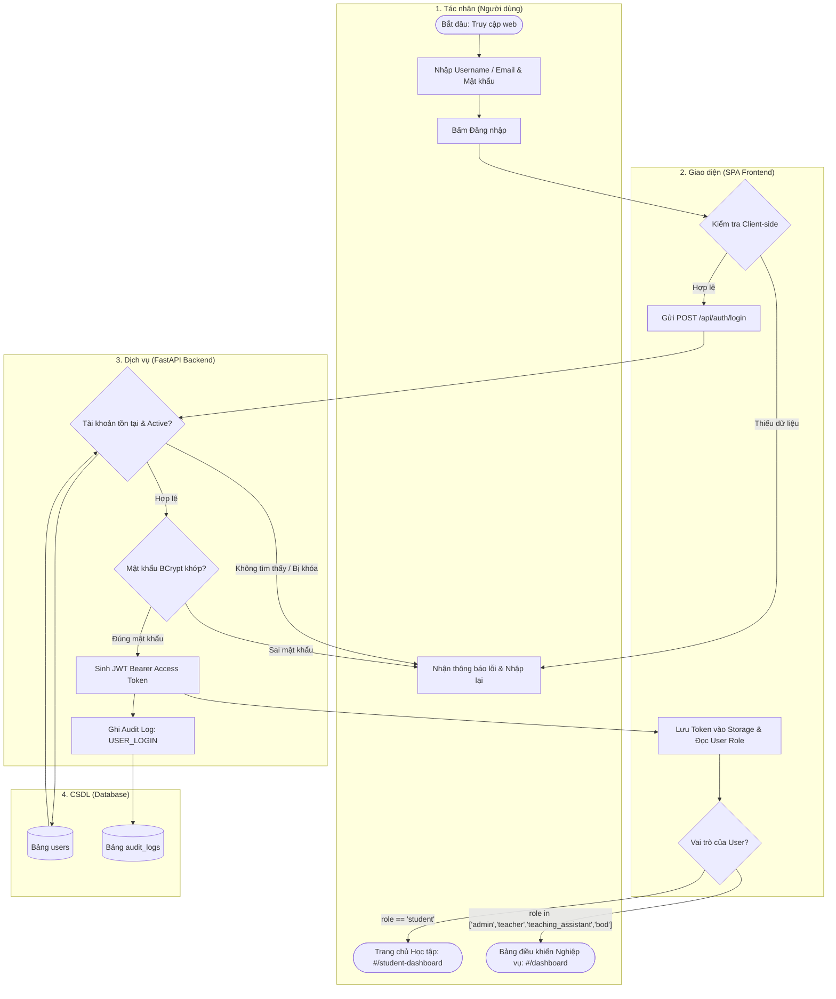

### Các bước Thực thi & Quy tắc Nghiệp vụ
1. **Kiểm tra đầu vào (Client Validation):** Bắt buộc trường Email/Username và Password không được rỗng.
2. **Xác thực BCrypt:** Backend băm mật khẩu với muối bảo mật và so khớp với bản ghi trong bảng `users`.
3. **Cấp phát Token:** Sinh chuỗi JWT Token chứa payload `{sub: user_id, role: role, exp: timestamp}`.
4. **Kiểm toán (Audit Trail):** Mọi lượt đăng nhập thành công hay thất bại liên tiếp đều được ghi nhận IP và thời gian để chống tấn công brute-force.

---

## BPMN 02: TIẾP NHẬN HỒ SƠ & XẾP LỚP HỌC VIÊN THỦ CÔNG

### Mô tả Quy trình
Quy trình dành cho Quản lý Học vụ hoặc Admin khi ghi nhận học viên mới đến đăng ký tại quầy hoặc qua kênh tuyển sinh, thực hiện kiểm tra đầu vào, tạo hồ sơ 360° và phân bổ vào lớp học phù hợp với sĩ số tối ưu.

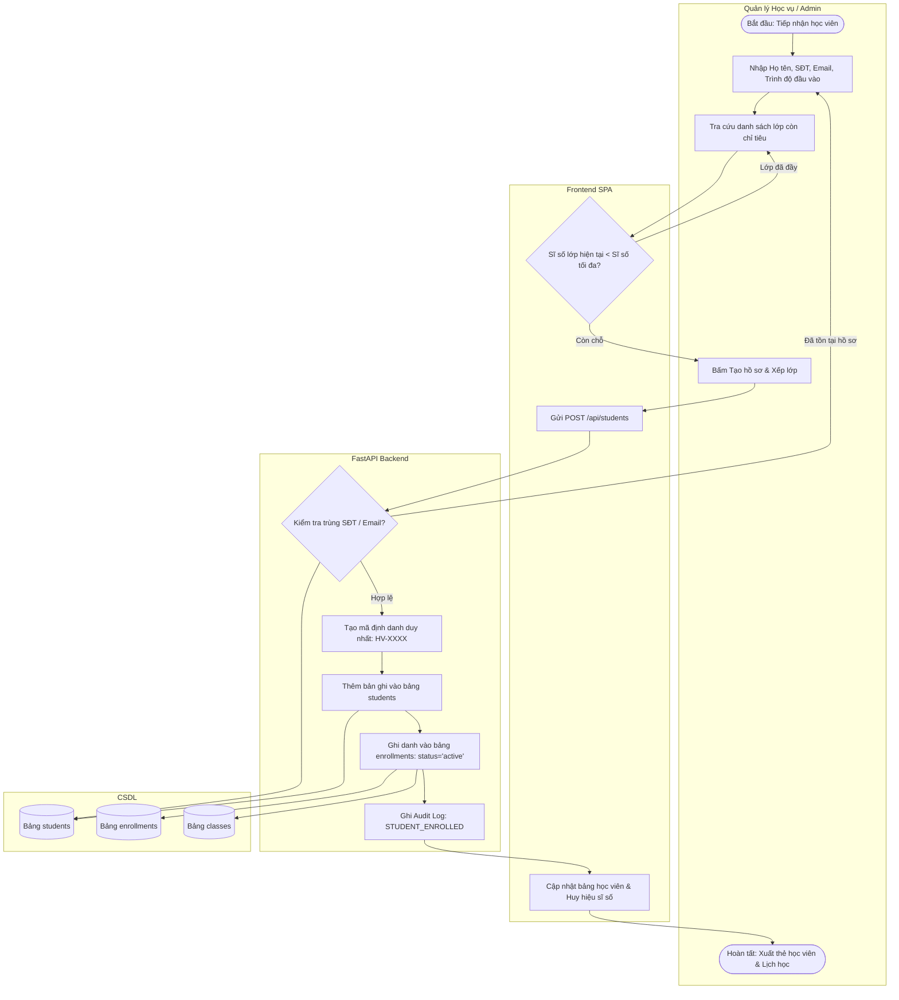

---

## BPMN 03: NHẬP DỮ LIỆU HỌC VIÊN HÀNG LOẠT (BATCH CSV IMPORT 3 TẦNG)

### Mô tả Quy trình
Quy trình nhập dữ liệu danh sách hàng loạt học viên đầu kỳ từ file Excel/CSV. Để bảo đảm toàn vẹn CSDL, hệ thống áp dụng cơ chế kiểm duyệt 3 tầng (Kiểm tra cấu trúc file $\rightarrow$ Xác thực từng dòng dữ liệu $\rightarrow$ Giao dịch ghi Database Transaction).

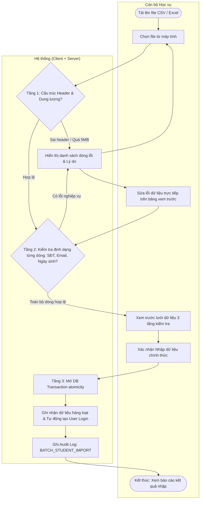

---

## BPMN 04: KHỞI TẠO LỚP HỌC, PHÂN CÔNG GIẢNG DẠY & SINH LỊCH TỰ ĐỘNG

### Mô tả Quy trình
Khi mở một lớp học mới thuộc lộ trình giảng dạy, hệ thống tự động phân tích khung chương trình của khóa học, đối chiếu thời khóa biểu của Giảng viên & Trợ giảng để tránh trùng lịch phòng học và tự động sinh toàn bộ danh sách 24 - 48 buổi học trong hệ thống.

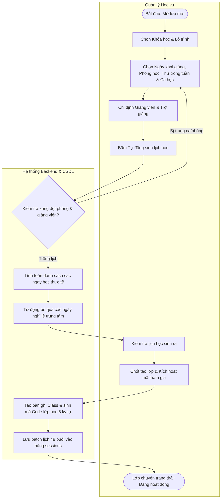

---

## BPMN 05: ĐIỂM DANH BUỔI HỌC, CẬP NHẬT CHUYÊN CẦN & CHỐT TIẾN ĐỘ LỚP

### Mô tả Quy trình
Vào mỗi buổi học, Giảng viên hoặc Trợ giảng mở giao diện Điểm danh (`#/attendance`), tích chọn trạng thái của từng học viên (Có mặt, Đi trễ, Vắng có phép, Vắng không phép), ghi chú và bấm Lưu điểm danh. Hệ thống tự động tính toán lại tỷ lệ chuyên cần và lũy kế tiến độ lớp học mà không cho phép đếm trùng tiến độ khi chỉnh sửa lại.

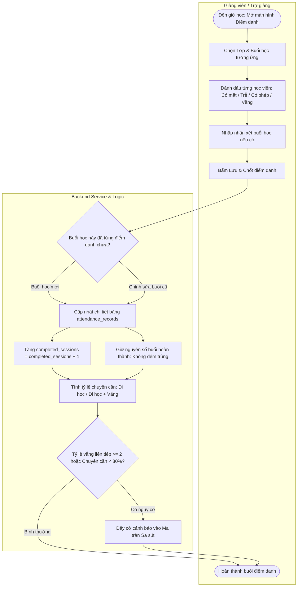

---

## BPMN 06: TỔ CHỨC KHẢO THÍ, NHẬP ĐIỂM RUBRIC & CẢNH BÁO ĐIỂM LIỆT

### Mô tả Quy trình
Quy trình tổ chức kỳ thi định kỳ (Mid-term, Final-term hoặc Đánh giá Speaking/Writing theo Rubric 4 tiêu chí chuẩn IELTS). Hệ thống kiểm soát tính hợp lệ của thang điểm (0 - 100) và tự động kích hoạt cờ cảnh báo đối với học viên có điểm dưới ngưỡng liệt (< 50 điểm).

```mermaid
flowchart TD
    subgraph LANET["Giảng viên / Khảo thí"]
        T_Start([Bắt đầu: Mở đợt chấm thi]) --> T_OpenGrading[Mở giao diện Bảng điểm & Rubric]
        T_OpenGrading --> T_InputScores[Nhập điểm theo 4 tiêu chí: Fluency, Lexical, Grammar, Pronunciation]
        T_InputScores --> T_AudioFeedback[Tải lên file ghi âm nhận xét hoặc nhập phản hồi chi tiết]
        T_AudioFeedback --> T_Submit[Bấm Lưu & Công bố điểm]
        T_Done([Bảng điểm cập nhật lên Cổng Học viên])
    end

    subgraph LANEB["Backend & Thuật toán Tính điểm"]
        B_ValidateRange{Điểm thành phần thuộc [0, 100]?}
        B_CalcWeighted[Tính điểm tổng kết: sum Điểm_i * Trọng_số_i]
        B_CheckFail{Điểm thi < 50 điểm?}
        B_RaiseAlert[Gắn nhãn: CẢNH BÁO ĐIỂM LIỆT - Chuyển sang Early Warning]
        B_SaveGrades[Lưu vào bảng grades & student_results]
        B_NotifyStudent[Phát thông báo điểm mới cho Học viên]
    end

    T_Submit --> B_ValidateRange
    B_ValidateRange -- Sai thang điểm --> T_InputScores
    B_ValidateRange -- Hợp lệ --> B_CalcWeighted
    B_CalcWeighted --> B_CheckFail
    B_CheckFail -- Điểm dưới 50 --> B_RaiseAlert
    B_CheckFail -- Đạt yêu cầu --> B_SaveGrades
    B_RaiseAlert --> B_SaveGrades
    B_SaveGrades --> B_NotifyStudent
    B_NotifyStudent --> T_Done
```

---

## BPMN 07: TẠO ĐỀ QUIZ & HỌC VIÊN THI TRẮC NGHIỆM TƯƠNG TÁC

### Mô tả Quy trình
Giảng viên biên soạn ngân hàng câu hỏi trắc nghiệm trực quan (có media âm thanh, hình ảnh), thiết lập thời gian làm bài đếm ngược. Khi học viên làm bài, hệ thống ghi nhận thời gian thực và tự động thu bài khi hết giờ.

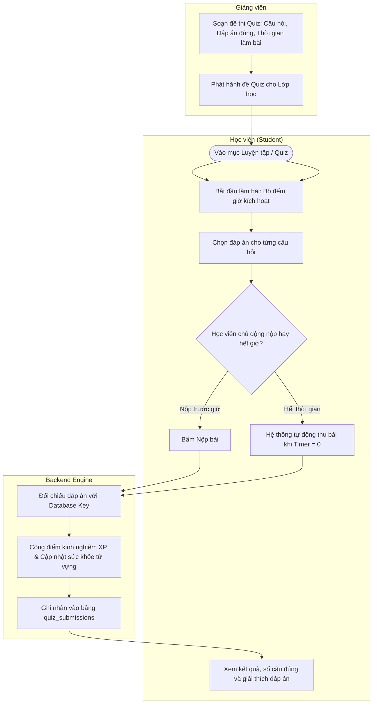

---

## BPMN 08: GIÁM SÁT SA SÚT HỌC TẬP (RISK MATRIX) & THỰC THI CAN THIỆP

### Mô tả Quy trình
Hệ thống chạy thuật toán quét tự động theo 6 bộ quy tắc sa sút học tập (Vắng 2 buổi liên tiếp, Chuyên cần <80%, Điểm kiểm tra giảm đột ngột >15%, Điểm <50, Chưa nộp bài tập >3 ngày, Ticket chưa xử lý). Quản lý Học vụ lập hồ sơ can thiệp và theo dõi tiến độ phục hồi của học viên.

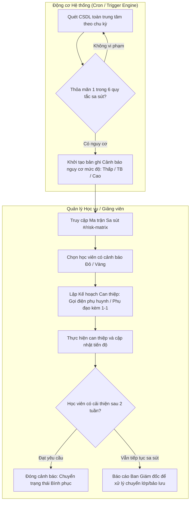

---

## BPMN 09: TIẾP NHẬN, PHÂN LUỒNG & XỬ LÝ TICKET HỖ TRỢ (SLA 4H / 12H)

### Mô tả Quy trình
Học viên gặp vướng mắc bài học hoặc thủ tục hành chính gửi vé hỗ trợ. Hệ thống phân luồng 2 cấp: Cấp 1 giao cho Trợ giảng xử lý với cam kết SLA $\le$ 4 giờ; nếu vượt thẩm quyền hoặc quá hạn, ticket tự động chuyển cấp 2 lên Giảng viên chính với hạn SLA $\le$ 12 giờ.

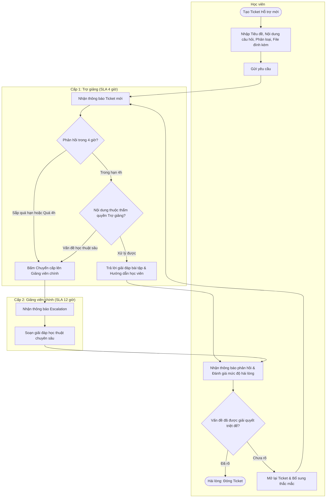

---

## BPMN 10: XUẤT BÁO CÁO HIỆU SUẤT TRUNG TÂM, IN PDF & AUDIT TRAIL

### Mô tả Quy trình
Ban Giám đốc (BOD) hoặc Quản lý Trung tâm cần số liệu tổng hợp định kỳ về tỷ lệ chuyên cần, phổ điểm trung bình, hiệu suất xử lý ticket SLA và nhật ký truy vết hệ thống. Hệ thống tạo báo cáo động, hỗ trợ tải file CSV và xuất bản in PDF chuẩn hóa.

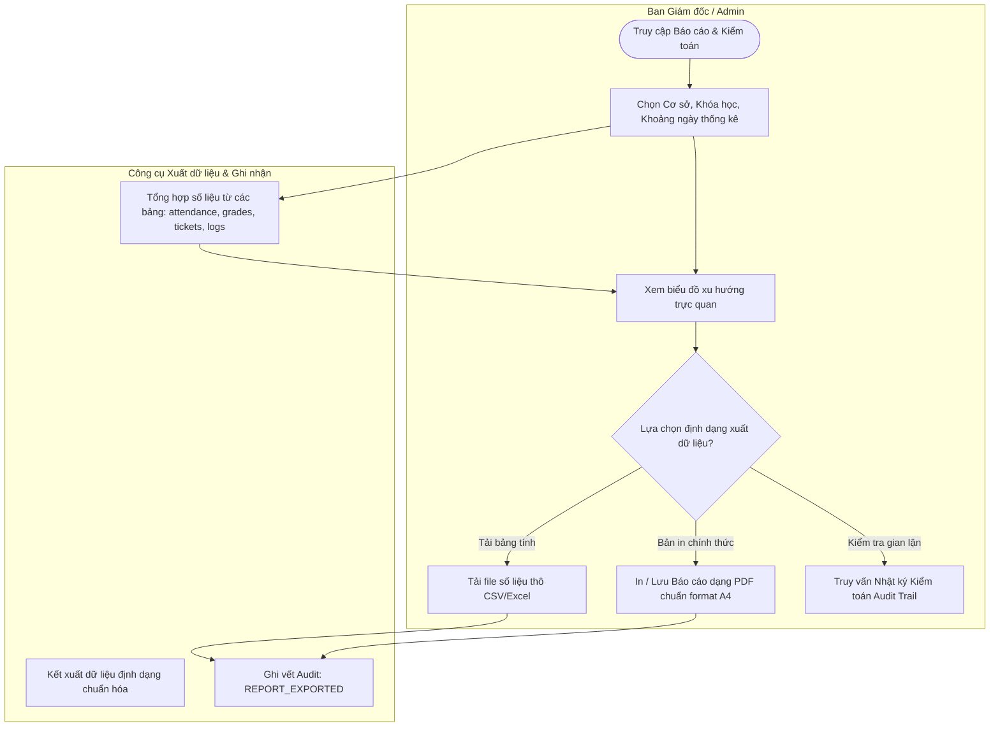

---

## BPMN 11: HỌC VIÊN VÀO LỚP BẰNG MÃ MỜI (JOIN CLASS BY CODE)

### Mô tả Quy trình
Học viên nhận được mã lớp 6 ký tự do Giảng viên hoặc Trung tâm cung cấp. Tại Không gian Học tập, học viên nhập mã để hệ thống kiểm tra và tự động liên kết học viên vào lớp ngay lập tức mà không cần chờ Admin thao tác thủ công.

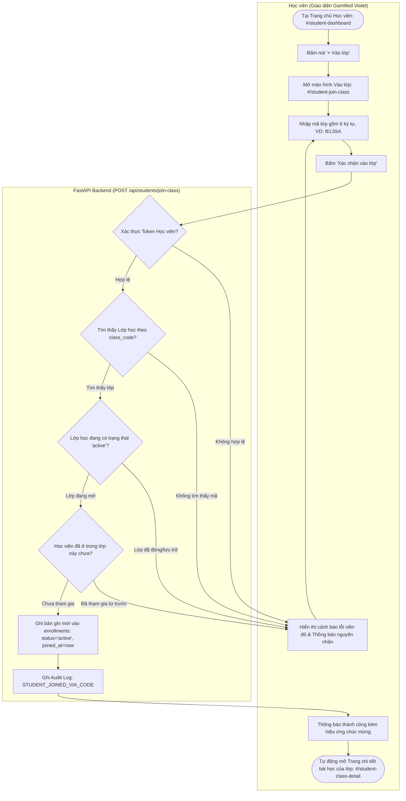

---

## BPMN 12: HỌC VIÊN HỌC UNIT BÀI GIẢNG, ÔN FLASHCARD & XIN NGHỈ BÙ

### Mô tả Quy trình
Học viên theo dõi lộ trình từng Unit trong lớp học, truy cập slide bài giảng, lật Flashcard từ vựng 2 mặt (từ, phiên âm, định nghĩa, ví dụ). Nếu có việc bận vào ngày học, học viên nộp đơn xin nghỉ và chọn ghép ca bù sang lớp song song tương đương.

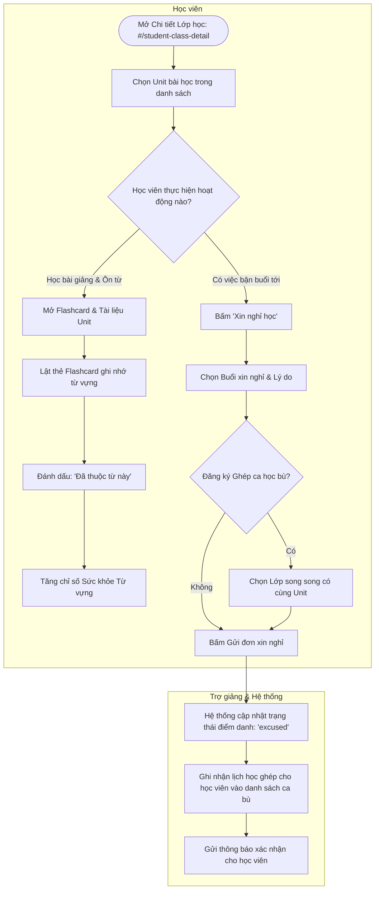

---

## BPMN 13: HỌC VIÊN NỘP BÀI TẬP TRỰC TUYẾN & GIẢNG VIÊN CHẤM ĐIỂM 4 TIÊU CHÍ

### Mô tả Quy trình
Giảng viên giao bài tập (Assignment). Học viên làm bài và nộp trực tuyến qua 3 hình thức (đính kèm file, dán liên kết Google Docs/Drive, nhập văn bản trực tiếp). Giảng viên mở giao diện Chấm bài (`#/grading`), nghe file ghi âm hoặc đọc bài, chấm điểm theo Rubric 4 tiêu chí và gửi phản hồi 2 chiều cho học viên.

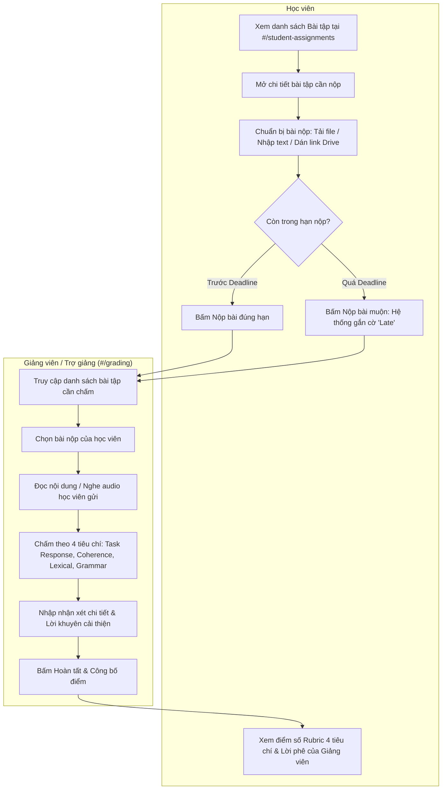

---

## BPMN 14: ĐIỂM DANH CHUỖI (STREAK) & HOÀN THÀNH NHIỆM VỤ NGÀY (GAMIFICATION)

### Mô tả Quy trình
Hệ thống tạo động lực học tập cho học viên thông qua cơ chế Gamification: Mỗi ngày đăng nhập học tập, học viên giữ vững Chuỗi ngày (Streak). Khi hoàn thành các nhiệm vụ ngày (ôn từ vựng, làm quiz, nộp bài), hệ thống tự động cộng Thóc và Điểm kinh nghiệm (XP) để vinh danh trên Bảng xếp hạng trung tâm.

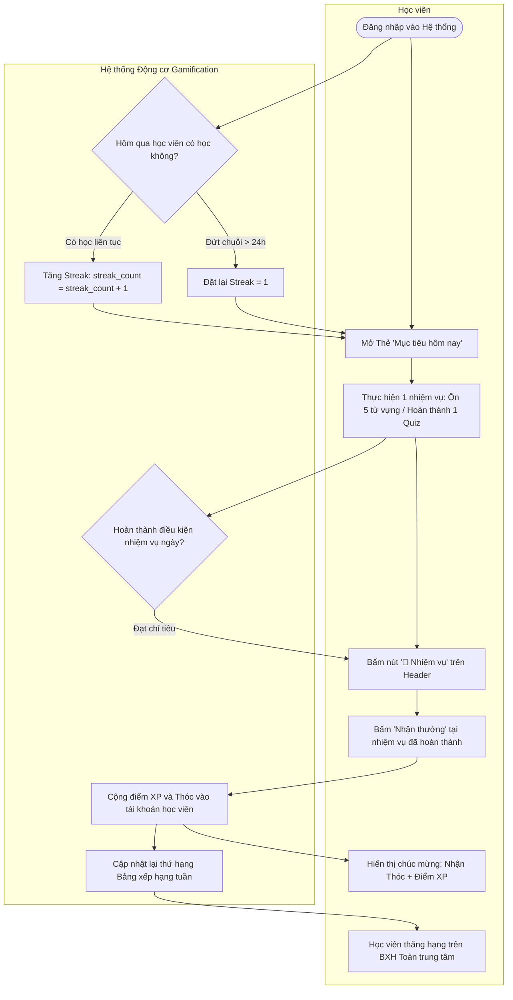

---
*Tài liệu Quy trình Nghiệp vụ BPMN 2.0 Toàn diện được chuẩn hóa cho hệ thống quản lý đào tạo tiếng Anh EduTrack English.*
