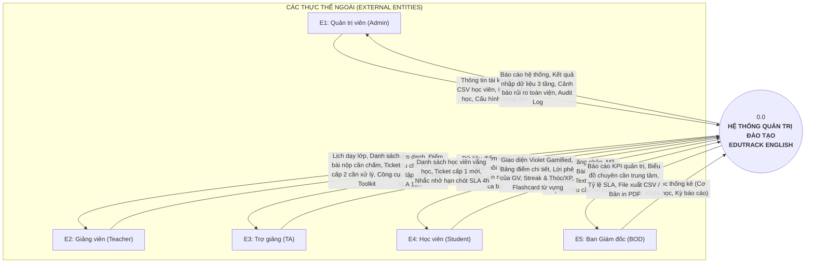

# TÀI LIỆU SƠ ĐỒ LUỒNG DỮ LIỆU TOÀN DIỆN (DFD SYSTEM SPECIFICATION)
## HỆ THỐNG QUẢN TRỊ ĐÀO TẠO & HỌC TẬP EDUTRACK ENGLISH

> **Tiêu chuẩn thiết kế:** Mô hình Phân tích Cấu trúc (Structured Analysis & Design Technique - SADT)  
> **Ký pháp chuẩn:** Gane & Sarson / Yourdon & DeMarco Notation  
> **Phiên bản:** 4.0 — Chuẩn hóa Toàn bộ Phân quyền (Admin, Giảng viên, Trợ giảng, Học viên, Ban Giám đốc)  
> **Phạm vi tài liệu:** Sơ đồ Ngữ cảnh (Context Diagram), Sơ đồ Mức 0 (DFD Level 0), Sơ đồ Mức 1 (DFD Level 1 cho 11 Phân hệ), Từ điển Dữ liệu (Data Dictionary) & Ma trận CRUD Lưu trữ.

---

## MỤC LỤC
1. [Phần 1: Nguyên tắc Thiết kế & Danh mục Thực thể Ngoài (External Entities)](#phần-1-nguyên-tắc-thiết-kế--danh-mục-thực-thể-ngoài)
2. [Phần 2: Sơ đồ Luồng Dữ liệu Mức Ngữ Cảnh (DFD Context Diagram - Mức 0)](#phần-2-sơ-đồ-luồng-dữ-liệu-mức-ngữ-cảnh-dfd-context-diagram)
3. [Phần 3: Sơ đồ Luồng Dữ liệu Mức Đỉnh (DFD Level 0 - Toàn Hệ Thống)](#phần-3-sơ-đồ-luồng-dữ-liệu-mức-đỉnh-dfd-level-0)
4. [Phần 4: Sơ đồ Luồng Dữ liệu Mức 1 (DFD Level 1 - Chi tiết từng Phân hệ)](#phần-4-sơ-đồ-luồng-dữ-liệu-mức-1-dfd-level-1)
   - [4.1. Phân hệ 1.0: Xác thực, Phân quyền RBAC & Quản trị Phiên](#41-tiến-trình-10-xác-thực-phân-quyền-rbac--quản-trị-phiên)
   - [4.2. Phân hệ 2.0: Tiếp nhận Hồ sơ, Nhập CSV 3 Tầng & Xếp lớp](#42-tiến-trình-20-tiếp-nhận-hồ-sơ-nhập-csv-3-tầng--xếp-lớp)
   - [4.3. Phân hệ 3.0: Quản trị Khóa học, Mở lớp & Tự động Sinh Lịch 48 Buổi](#43-tiến-trình-30-quản-trị-khóa-học-mở-lớp--sinh-lịch-48-buổi)
   - [4.4. Phân hệ 4.0: Điểm danh Buổi học, Chuyên cần & Chốt Tiến độ](#44-tiến-trình-40-điểm-danh-buổi-học-chuyên-cần--chốt-tiến-độ)
   - [4.5. Phân hệ 5.0: Khảo thí, Nhập điểm Rubric 4 Tiêu chí & Cảnh báo Liệt](#45-tiến-trình-50-khảo-thí-nhập-điểm-rubric--cảnh-báo-liệt)
   - [4.6. Phân hệ 6.0: Ngân hàng Đề & Khảo thí Trắc nghiệm (Quiz Engine)](#46-tiến-trình-60-ngân-hàng-đề--khảo-thí-trắc-nghiệm-quiz-engine)
   - [4.7. Phân hệ 7.0: Quản lý Bài tập Trực tuyến & Chấm bài 2 Chiều](#47-tiến-trình-70-quản-lý-bài-tập-trực-tuyến--chấm-bài-2-chiều)
   - [4.8. Phân hệ 8.0: Giám sát Sa sút Học tập (Risk Matrix) & Can thiệp](#48-tiến-trình-80-giám-sát-sa-sút-học-tập-risk-matrix--can-thiệp)
   - [4.9. Phân hệ 9.0: Phân luồng & Xử lý Yêu cầu Hỗ trợ (SLA Kép 4h/12h)](#49-tiến-trình-90-phân-luồng--xử-lý-ticket-hỗ-trợ-sla-kép-4h12h)
   - [4.10. Phân hệ 10.0: Báo cáo Thống kê Đa chiều & Kiểm toán Audit Trail](#410-tiến-trình-100-báo-cáo-thống-kê-đa-chiều--kiểm-toán-audit-trail)
   - [4.11. Phân hệ 11.0: Cổng Học tập Gamified (Vào lớp, Streak, Quest & Từ vựng)](#411-tiến-trình-110-cổng-học-tập-gamified-violet-portal)
5. [Phần 5: Từ điển Luồng Dữ liệu (Data Flow Dictionary)](#phần-5-từ-điển-luồng-dữ-liệu-data-flow-dictionary)
6. [Phần 6: Ma trận Tương tác Kho Dữ liệu (CRUD Process-to-Data-Store Matrix)](#phần-6-ma-trận-tương-tác-kho-dữ-liệu-crud-matrix)

---

## PHẦN 1: NGUYÊN TẮC THIẾT KẾ & DANH MỤC THỰC THỂ NGOÀI

### 1.1. Nguyên tắc Bảo toàn Dữ liệu (Conservation of Data / Law of Balance)
* **Quy tắc Black Hole (Lỗ đen):** Mọi tiến trình không được chỉ nhận dữ liệu vào mà không sinh ra dữ liệu ra.
* **Quy tắc Miracle (Phép màu):** Mọi tiến trình không được tự nhiên sinh ra dữ liệu mà không có dòng dữ liệu đầu vào.
* **Quy tắc Gray Hole (Xám):** Dữ liệu ra của tiến trình phải được tổng hợp, biến đổi hoặc suy luận hợp lý từ dữ liệu vào.
* **Quy tắc Kho dữ liệu:** Dữ liệu không thể tự chuyển dịch giữa hai Thực thể ngoài, giữa hai Kho dữ liệu, hoặc trực tiếp từ Thực thể ngoài vào Kho dữ liệu mà không thông qua một Tiến trình (Process) xử lý hoặc kiểm soát hợp lệ.

### 1.2. Danh mục Thực thể Ngoài (External Entities)

| Ký hiệu | Tên Thực thể Ngoài | Mô tả & Ranh giới Trách nhiệm |
| :---: | :--- | :--- |
| **E1** | **Quản trị viên (Admin)** | Người dùng tối cao quản lý người dùng, nhập dữ liệu hàng loạt CSV, thiết lập khóa học, giám sát ma trận rủi ro đào tạo, cấu hình trung tâm và tra cứu nhật ký kiểm toán. |
| **E2** | **Giảng viên (Teacher)** | Người trực tiếp giảng dạy: điểm danh buổi học, tạo đề thi trắc nghiệm, chấm bài nộp theo Rubric 4 tiêu chí, gửi phản hồi âm thanh/văn bản, giải quyết ticket học thuật cấp 2 (SLA 12h) và sử dụng Class Toolkit trên lớp. |
| **E3** | **Trợ giảng (Teaching Assistant)** | Nhân sự hỗ trợ học vụ: phối hợp điểm danh, đôn đốc nộp bài, tiếp nhận và giải quyết ticket cấp 1 (SLA 4h), phối hợp chấm bài và quản lý ca học bù. |
| **E4** | **Học viên (Student)** | Người học sử dụng Không gian Tím Gamified: nhập mã vào lớp, nộp bài tập trực tuyến, làm Quiz trắc nghiệm đếm giờ, tích lũy Chuỗi (Streak) & Thóc/XP, ôn Flashcard và tra cứu bảng điểm. |
| **E5** | **Ban Giám đốc (BOD / Executive)** | Cán bộ quản lý chiến lược cấp cao: tiếp nhận các báo cáo KPI định kỳ về tỷ lệ chuyên cần, phổ điểm, tỷ lệ vi phạm SLA, doanh thu và kiểm toán vận hành. |

### 1.3. Danh mục Kho Dữ liệu (Data Stores)

| Ký hiệu | Tên Kho Dữ liệu | Bảng CSDL Thực tế tương ứng | Mô tả Lưu trữ |
| :---: | :--- | :--- | :--- |
| **D1** | **Hồ sơ Người dùng & Nhân sự** | `users`, `staff` | Thông tin tài khoản, mật khẩu băm BCrypt, vai trò RBAC, cơ sở. |
| **D2** | **Hồ sơ Học viên & Ghi danh** | `students`, `enrollments` | Thông tin cá nhân 360°, mã học viên, lớp đang theo học, trạng thái. |
| **D3** | **Khóa học & Lớp học** | `courses`, `classes`, `class_assignments` | Khung giáo trình, thông tin lớp, giảng viên phụ trách, sĩ số. |
| **D4** | **Lịch học & Buổi học** | `sessions` | Danh mục 48 buổi học, ngày giờ học, phòng học, tiến độ hoàn thành. |
| **D5** | **Dữ liệu Điểm danh & Chuyên cần**| `attendance_records` | Trạng thái có mặt/trễ/vắng/phép của từng học viên trong mỗi buổi. |
| **D6** | **Khảo thí & Bảng điểm Rubric** | `assessments`, `grades`, `student_results`| Thang điểm, 4 tiêu chí Rubric, điểm thi giữa kỳ/cuối kỳ/bài tập. |
| **D7** | **Ngân hàng Đề & Bài nộp Quiz** | `quizzes`, `quiz_questions`, `quiz_submissions`| Ngân hàng câu hỏi, đáp án, thời gian đếm giờ, lịch sử làm bài. |
| **D8** | **Bài tập Về nhà & Chấm bài 2 chiều**| `student_assignments`, `student_submissions`| Đề bài tập, tệp đính kèm học viên nộp, nhận xét âm thanh, lời phê. |
| **D9** | **Ma trận Rủi ro & Can thiệp** | `risk_alerts`, `intervention_records` | Cờ cảnh báo sa sút 6 quy tắc, nhật ký phụ đạo kèm 1-1, gọi phụ huynh. |
| **D10** | **Hỗ trợ Học viên (Ticketing SLA)**| `support_tickets`, `support_messages` | Vé thắc mắc, phân loại, bộ đếm ngược SLA 4h/12h, lịch sử trao đổi. |
| **D11** | **Gamification & Sức khỏe Từ vựng**| `student_gamification`, `vocabulary_health` | Chuỗi Streak, Thóc tích lũy, XP, thẻ Flashcard, tỷ lệ từ thuộc. |
| **D12** | **Nhật ký Kiểm toán Hệ thống** | `audit_logs` | Bảng bất biến (Append-Only) lưu dấu toàn bộ thao tác CRUD và IP. |

---

## PHẦN 2: SƠ ĐỒ LUỒNG DỮ LIỆU MỨC NGỮ CẢNH (DFD CONTEXT DIAGRAM)

Sơ đồ Ngữ cảnh xem toàn bộ hệ thống EduTrack English như **Tiến trình trung tâm 0.0**. Mọi luồng thông tin vào/ra giữa 5 Thực thể Ngoài và Hệ thống được mô hình hóa tổng thể.



---

## PHẦN 3: SƠ ĐỒ LUỒNG DỮ LIỆU MỨC ĐỈNH (DFD LEVEL 0)

Sơ đồ Mức 0 phân rã Hệ thống 0.0 thành **11 Tiến trình Nghiệp vụ Cốt lõi (1.0 đến 11.0)**, làm rõ mối liên kết giữa các Thực thể ngoài và 12 Kho dữ liệu tập trung.

```mermaid
flowchart TD
    %% Entities
    E1["E1: Quản trị viên"]
    E2["E2: Giảng viên"]
    E3["E3: Trợ giảng"]
    E4["E4: Học viên"]
    E5["E5: Ban Giám đốc"]

    %% Processes
    P1(("1.0<br/>Xác thực &<br/>Phân quyền RBAC"))
    P2(("2.0<br/>Tuyển sinh &<br/>Xếp lớp CSV"))
    P3(("3.0<br/>Quản trị Khóa học &<br/>Sinh lịch 48 buổi"))
    P4(("4.0<br/>Điểm danh &<br/>Chuyên cần"))
    P5(("5.0<br/>Khảo thí &<br/>Chấm điểm Rubric"))
    P6(("6.0<br/>Ngân hàng Đề &<br/>Khảo thí Quiz"))
    P7(("7.0<br/>Quản lý Bài tập &<br/>Chấm 2 chiều"))
    P8(("8.0<br/>Giám sát Sa sút &<br/>Can thiệp"))
    P9(("9.0<br/>Hỗ trợ Học vụ &<br/>SLA 4h/12h"))
    P10(("10.0<br/>Báo cáo Quản trị &<br/>Audit Trail"))
    P11(("11.0<br/>Cổng Học tập<br/>Gamified Violet"))

    %% Data Stores
    D1[("D1: Người dùng & Nhân sự")]
    D2[("D2: Học viên & Ghi danh")]
    D3[("D3: Khóa học & Lớp học")]
    D4[("D4: Lịch học 48 buổi")]
    D5[("D5: Điểm danh & Chuyên cần")]
    D6[("D6: Khảo thí & Rubric")]
    D7[("D7: Đề thi & Bài nộp Quiz")]
    D8[("D8: Bài tập & Bài nộp 2 chiều")]
    D9[("D9: Ma trận Sa sút & Can thiệp")]
    D10[("D10: Hỗ trợ Ticket & SLA")]
    D11[("D11: Gamification & Từ vựng")]
    D12[("D12: Nhật ký Audit Logs")]

    %% Process 1.0 Connections
    E1 & E2 & E3 & E4 & E5 -->|Thông tin đăng nhập| P1
    P1 <-->|Xác thực tài khoản & Phân quyền| D1
    P1 -->|Cấp JWT Token & Phân vùng UI| E1 & E2 & E3 & E4 & E5
    P1 -->|Ghi log đăng nhập| D12

    %% Process 2.0 Connections
    E1 -->|Upload File CSV / Nhập học viên| P2
    P2 <-->|Kiểm tra trùng Email/SĐT| D2
    P2 -->|Tạo User login tự động| D1
    P2 -->|Ghi danh học viên| D3
    P2 -->|Ghi log nhập dữ liệu| D12

    %% Process 3.0 Connections
    E1 -->|Tạo khóa, cấu hình lớp, phân công| P3
    P3 -->|Lưu khóa học & lớp| D3
    P3 -->|Sinh 48 buổi học tự động| D4

    %% Process 4.0 Connections
    E2 & E3 -->|Tích chọn điểm danh buổi học| P4
    P4 <-->|Đọc lịch buổi & Chốt tiến độ| D4
    P4 -->|Lưu bản ghi điểm danh| D5
    P4 -.->|Kích hoạt cờ vắng học >=2 buổi| P8

    %% Process 5.0 Connections
    E2 -->|Nhập điểm 4 tiêu chí Rubric| P5
    P5 <-->|Cấu hình trọng số điểm| D3
    P5 -->|Lưu bảng điểm & Điểm tổng kết| D6
    P5 -.->|Kích hoạt cảnh báo điểm <50| P8

    %% Process 6.0 Connections
    E2 -->|Soạn ngân hàng đề Quiz| P6
    P6 -->|Lưu câu hỏi & thời gian| D7
    E4 -->|Nộp bài thi Quiz đếm giờ| P6
    P6 -->|Cộng điểm XP & Cập nhật từ vựng| D11

    %% Process 7.0 Connections
    E2 -->|Giao bài tập mới| P7
    E4 -->|Nộp file / dán link bài làm| P7
    P7 -->|Lưu bài nộp| D8
    E2 -->|Chấm bài, ghi âm nhận xét| P7
    P7 -->|Gửi phản hồi 2 chiều| E4

    %% Process 8.0 Connections
    P8 <-->|Quét dữ liệu vắng học & điểm thấp| D5 & D6 & D8
    P8 -->|Cập nhật Ma trận cảnh báo Đỏ/Vàng| D9
    E1 & E2 -->|Lập kế hoạch can thiệp / phụ đạo| P8
    P8 -->|Lưu tiến độ can thiệp| D9

    %% Process 9.0 Connections
    E4 -->|Tạo Ticket hỗ trợ| P9
    P9 -->|Gán mã & Đếm giờ SLA| D10
    E3 -->|Xử lý cấp 1 trong 4h| P9
    E2 -->|Xử lý cấp 2 trong 12h| P9
    P9 -->|Gửi phản hồi cho học viên| E4

    %% Process 10.0 Connections
    E1 & E5 -->|Lọc tiêu chí thống kê| P10
    P10 <-->|Tổng hợp dữ liệu báo cáo| D2 & D3 & D5 & D6 & D10
    P10 -->|Xuất CSV & Bản in PDF chuẩn A4| E1 & E5
    P10 <-->|Truy soát lịch sử thao tác| D12

    %% Process 11.0 Connections
    E4 -->|Nhập mã 6 ký tự vào lớp| P11
    P11 <-->|Kiểm tra mã lớp & Ghi danh| D3 & D2
    E4 -->|Điểm danh chuỗi & Hoàn thành Quest| P11
    P11 <-->|Tăng Streak, Thóc, XP & Sức khỏe từ| D11
```



---

## PHẦN 4: SƠ ĐỒ LUỒNG DỮ LIỆU MỨC 1 (DFD LEVEL 1)

---

### 4.1. TIẾN TRÌNH 1.0: XÁC THỰC, PHÂN QUYỀN RBAC & QUẢN TRỊ PHIÊN

Tiến trình 1.0 đảm bảo an toàn truy cập, băm mật khẩu, cấp phát JSON Web Token (JWT) và bảo vệ hệ thống trước tấn công brute-force.

```mermaid
flowchart TD
    User["Người dùng (E1, E2, E3, E4, E5)"]

    P11(("1.1<br/>Kiểm tra Cú pháp &<br/>Chống Brute-force"))
    P12(("1.2<br/>Xác thực Mật khẩu<br/>BCrypt Hash"))
    P13(("1.3<br/>Tạo JWT Token &<br/>Phân quyền RBAC"))
    P14(("1.4<br/>Đăng xuất &<br/>Hủy bỏ Phiên"))

    D1[("D1: Người dùng & Nhân sự")]
    D12[("D12: Nhật ký Audit Logs")]

    User -- "Tên đăng nhập / Email & Mật khẩu" --> P11
    P11 -- "Tài khoản hợp lệ" --> P12
    P11 -- "Quá 5 lần sai -> Khóa tạm 30p" --> User
    
    P12 <--> "Truy vấn mật khẩu băm & trạng thái active" --> D1
    P12 -- "Xác thực thành công" --> P13
    P12 -- "Sai mật khẩu -> Báo lỗi HTTP 401" --> User
    
    P13 --> "Ghi vết đăng nhập thành công" --> D12
    P13 -- "Trả về JWT Bearer Token & User State" --> User

    User -- "Yêu cầu đăng xuất" --> P14
    P14 --> "Xóa Token localStorage & Ghi Audit Log" --> D12
```

* **Dữ liệu vào (Inputs):** `credentials` (Username/Email, Password thuần, Địa chỉ IP client).
* **Dữ liệu ra (Outputs):** `jwt_token` (Access token thời hạn 24h chứa `sub`, `role`), `user_profile`, thông báo lỗi bảo mật.
* **Quy tắc chuyển hóa:** Mật khẩu thuần được băm với Salt 12 vòng qua thư viện Passlib/BCrypt trước khi so khớp với `users.password_hash`.

---

### 4.2. TIẾN TRÌNH 2.0: TIẾP NHẬN HỒ SƠ, NHẬP CSV 3 TẦNG & XẾP LỚP

Tiến trình 2.0 kiểm soát tính toàn vẹn dữ liệu học viên, hỗ trợ nhập thủ công và nhập hàng loạt từ bảng tính qua cơ chế kiểm duyệt 3 tầng (Client syntax $\rightarrow$ Business Rules $\rightarrow$ Database Transaction Atomicity).

```mermaid
flowchart TD
    Admin["E1: Quản trị viên"]

    P21(("2.1<br/>Kiểm duyệt Tầng 1:<br/>Cấu trúc File & Dung lượng"))
    P22(("2.2<br/>Kiểm duyệt Tầng 2:<br/>Quy tắc SĐT & Email"))
    P23(("2.3<br/>Kiểm duyệt Tầng 3:<br/>Giao dịch DB Atomic"))
    P24(("2.4<br/>Phân bổ Lớp &<br/>Cấp Thẻ Học viên"))

    D1[("D1: Người dùng & Nhân sự")]
    D2[("D2: Học viên & Ghi danh")]
    D3[("D3: Khóa học & Lớp học")]
    D12[("D12: Nhật ký Audit Logs")]

    Admin -- "Tải lên File CSV / Excel danh sách" --> P21
    P21 -- "Kiểm tra Header bắt buộc & Dung lượng <= 5MB" --> P22
    P21 -- "Sai định dạng -> Báo lỗi cấu trúc" --> Admin

    P22 <--> "Đối chiếu trùng lặp SĐT / Email trong hệ thống" --> D2
    P22 -- "Xuất bảng Preview Grid có đánh dấu dòng lỗi" --> Admin
    Admin -- "Chỉnh sửa trực tiếp ô lỗi & Bấm Xác nhận" --> P23

    P23 --> "Mở Transaction: Tạo bản ghi Student" --> D2
    P23 --> "Tự động tạo tài khoản đăng nhập mặc định" --> D1
    P23 --> "Ghi log BATCH_STUDENT_IMPORT" --> D12
    P23 -- "Dữ liệu học viên hợp lệ" --> P24

    P24 <--> "Kiểm tra sĩ số lớp đích < max_students" --> D3
    P24 --> "Ghi danh học viên (status = active)" --> D2
    P24 -- "Xuất thẻ học viên & Mã định danh HV-XXXX" --> Admin
```

---

### 4.3. TIẾN TRÌNH 3.0: QUẢN TRỊ KHÓA HỌC, MỞ LỚP & SINH LỊCH 48 BUỔI

Tiến trình 3.0 tự động hóa việc lập kế hoạch giảng dạy, phát hiện xung đột lịch phòng học và sinh toàn bộ các buổi học trong chu kỳ khóa học.

```mermaid
flowchart TD
    Admin["E1: Quản trị viên"]

    P31(("3.1<br/>Định nghĩa Khung<br/>Khóa học & Giáo trình"))
    P32(("3.2<br/>Kiểm tra Xung đột<br/>Phòng & Giảng viên"))
    P33(("3.3<br/>Thuật toán Sinh Lịch<br/>48 Buổi Tự động"))
    P34(("3.4<br/>Kích hoạt Lớp &<br/>Sinh Mã Code 6 Ký tự"))

    D1[("D1: Người dùng & Nhân sự")]
    D3[("D3: Khóa học & Lớp học")]
    D4[("D4: Lịch học 48 buổi")]

    Admin -- "Tên khóa, Lộ trình, Số buổi (24-48), Cấu hình đầu điểm" --> P31
    P31 --> "Lưu cấu hình khóa học" --> D3

    Admin -- "Ngày khai giảng, Ca học (2-4-6/3-5-7), Phòng, GV phụ trách" --> P32
    P32 <--> "Quét thời khóa biểu hiện tại của GV & Phòng học" --> D3 & D4
    P32 -- "Trùng ca/phòng -> Cảnh báo xung đột lịch" --> Admin
    P32 -- "Lịch trống hợp lệ" --> P33

    P33 --> "Tính toán mốc ngày thực tế (Bỏ qua ngày Lễ)" --> D4
    P33 -- "Hiển thị 48 buổi học kèm ngày giờ cụ thể" --> Admin
    Admin -- "Xác nhận kích hoạt" --> P34

    P34 --> "Tạo lớp (status = in_progress) & Sinh Class Code (VD: IEL55A)" --> D3
    P34 -- "Trả về Mã lớp & Lịch học chính thức" --> Admin
```

---

### 4.4. TIẾN TRÌNH 4.0: ĐIỂM DANH BUỔI HỌC, CHUYÊN CẦN & CHỐT TIẾN ĐỘ

Tiến trình 4.0 phụ trách việc điểm danh hàng ngày, cập nhật tiến độ lớp học và chống đếm trùng số buổi khi người dùng chỉnh sửa điểm danh cũ.

```mermaid
flowchart TD
    Teacher["E2: Giảng viên"]
    TA["E3: Trợ giảng"]
    Student["E4: Học viên"]

    P41(("4.1<br/>Tải Danh sách Học viên<br/>theo Buổi học"))
    P42(("4.2<br/>Ghi nhận Trạng thái<br/>& Nhận xét Buổi học"))
    P43(("4.3<br/>Cập nhật Tiến độ Lớp<br/>(Chống Đếm Trùng)"))
    P44(("4.4<br/>Tính Tỷ lệ Chuyên cần<br/>(Loại trừ Có phép)"))

    D3[("D3: Khóa học & Lớp học")]
    D4[("D4: Lịch học 48 buổi")]
    D5[("D5: Điểm danh & Chuyên cần")]
    D9[("D9: Ma trận Sa sút")]

    Teacher & TA -- "Chọn Lớp & Chọn Buổi học cần điểm danh" --> P41
    P41 <--> "Lấy danh sách học viên active & Đơn xin nghỉ" --> D3 & D5
    P41 -- "Danh sách học viên mặc định trạng thái Có mặt" --> Teacher & TA

    Teacher & TA -- "Tích chọn: present / late / excused / absent & Ghi chú" --> P42
    P42 --> "Lưu bản ghi điểm danh chi tiết" --> D5

    P42 --> P43
    P43 <--> "Kiểm tra session.is_completed" --> D4
    P43 -- "Buổi học mới: completed_sessions = completed_sessions + 1" --> D4
    P43 -- "Chỉnh sửa buổi cũ: Giữ nguyên số buổi hoàn thành" --> D4

    P42 --> P44
    P44 --> "Tính Chuyên cần = Đi học / (Đi học + Vắng không phép)" --> D5
    P44 -- "Đồng bộ tỷ lệ % chuyên cần lên bảng kết quả" --> Student
    P44 -.-> "Nếu Vắng >= 2 buổi liên tiếp hoặc Chuyên cần < 80% -> Bắn cờ rủi ro" --> D9
```

---

### 4.5. TIẾN TRÌNH 5.0: KHẢO THÍ, NHẬP ĐIỂM RUBRIC & CẢNH BÁO ĐIỂM LIỆT

Tiến trình 5.0 xử lý việc chấm điểm các kỹ năng Speaking/Writing theo Rubric chuẩn 4 tiêu chí quốc tế, tính điểm trung bình có trọng số và phát hiện điểm liệt $<50$.

```mermaid
flowchart TD
    Teacher["E2: Giảng viên"]
    Student["E4: Học viên"]

    P51(("5.1<br/>Mở Bảng điểm &<br/>Cấu hình Rubric"))
    P52(("5.2<br/>Kiểm tra Hợp lệ Thang điểm<br/>& Ghi âm Phản hồi"))
    P53(("5.3<br/>Tính Điểm Tổng kết<br/>theo Trọng số Lớp"))
    P54(("5.4<br/>Phát hiện Điểm Liệt<br/>& Phát Cảnh báo Đỏ"))

    D3[("D3: Khóa học & Lớp học")]
    D6[("D6: Khảo thí & Rubric")]
    D9[("D9: Ma trận Sa sút")]

    Teacher -- "Chọn Lớp & Bài kiểm tra (Speaking / Writing / Midterm)" --> P51
    P51 <--> "Đọc cấu hình tỷ trọng điểm của lớp (10% CC, 30% BTVN, 30% GK, 30% CK)" --> D3
    P51 -- "Hiển thị lưới nhập điểm 4 tiêu chí: Fluency, Lexical, Grammar, Pronunciation" --> Teacher

    Teacher -- "Nhập điểm thành phần [0, 100] & Tải file ghi âm nhận xét (.mp3)" --> P52
    P52 -- "Điểm ngoài [0, 100] -> Cảnh báo lỗi nhập liệu" --> Teacher
    P52 -- "Điểm hợp lệ -> Lưu chi tiết điểm rubric & audio" --> D6

    P52 --> P53
    P53 --> "Tính Điểm tổng kết tạm tính = Sum(Điểm_i * Trọng_số_i)" --> D6
    P53 -- "Công bố điểm & Lời phê cho học viên" --> Student

    P52 --> P54
    P54 <--> "Kiểm tra nếu Điểm thi < 50 điểm" --> D6
    P54 -- "Kích hoạt Cảnh báo Điểm liệt (Mức độ CAO)" --> D9
```

---

### 4.6. TIẾN TRÌNH 6.0: NGÂN HÀNG ĐỀ & KHẢO THÍ TRẮC NGHIỆM (QUIZ ENGINE)

Tiến trình 6.0 quản lý ngân hàng câu hỏi, thực hiện thi trắc nghiệm trực tuyến có đếm ngược thời gian và tự động nộp bài (Auto-Submit) khi hết giờ.

```mermaid
flowchart TD
    Teacher["E2: Giảng viên"]
    Student["E4: Học viên"]

    P61(("6.1<br/>Soạn Đề thi &<br/>Thiết lập Timer"))
    P62(("6.2<br/>Phục vụ Bài thi &<br/>Đếm ngược Thời gian"))
    P63(("6.3<br/>Thu bài &<br/>Chấm điểm Tự động"))
    P64(("6.4<br/>Cộng Thưởng Gamification<br/>& Cập nhật Từ vựng"))

    D7[("D7: Đề thi & Bài nộp Quiz")]
    D11[("D11: Gamification & Từ vựng")]

    Teacher -- "Nội dung câu hỏi, file nghe, hình ảnh, 4 lựa chọn, đáp án đúng & thời gian (VD: 15p)" --> P61
    P61 --> "Lưu đề thi trắc nghiệm (status = published)" --> D7

    Student -- "Bấm Bắt đầu làm Quiz" --> P62
    P62 <--> "Lấy danh sách câu hỏi & Ghi nhận start_time" --> D7
    P62 -- "Giao diện làm bài tập trung & Đồng hồ đếm ngược" --> Student

    Student -- "Lựa chọn đáp án A, B, C, D" --> P63
    P63 -- "Điều kiện nộp: Học viên bấm Nộp HOẶC Timer = 0:00 (Auto-submit)" --> P63
    P63 <--> "Đối chiếu đáp án với key trong CSDL" --> D7
    P63 --> "Lưu số câu đúng, tỷ lệ % và thời gian làm bài" --> D7
    P63 -- "Trả về kết quả, số câu đúng và lời giải chi tiết" --> Student

    P63 --> P64
    P64 --> "Cộng điểm kinh nghiệm XP & Thóc" --> D11
    P64 --> "Tăng chỉ số từ vựng đúng vào Sức khỏe Từ vựng" --> D11
```

---

### 4.7. TIẾN TRÌNH 7.0: QUẢN LÝ BÀI TẬP TRỰC TUYẾN & CHẤM BÀI 2 CHIỀU

Tiến trình 7.0 hỗ trợ học viên nộp bài tập về nhà đa định dạng (tệp đính kèm, đường dẫn drive, văn bản) và giảng viên chấm bài, phản hồi âm thanh hai chiều.

```mermaid
flowchart TD
    Teacher["E2: Giảng viên"]
    TA["E3: Trợ giảng"]
    Student["E4: Học viên"]

    P71(("7.1<br/>Giao Bài tập &<br/>Thiết lập Deadline"))
    P72(("7.2<br/>Tiếp nhận Bài nộp<br/>Đa Định dạng"))
    P73(("7.3<br/>Kiểm tra Hạn chót<br/>& Gắn cờ Nộp Muộn"))
    P74(("7.4<br/>Chấm bài Rubric &<br/>Gửi Nhận xét 2 Chiều"))

    D8[("D8: Bài tập & Bài nộp 2 chiều")]
    D9[("D9: Ma trận Sa sút")]

    Teacher -- "Tiêu đề bài tập, Hướng dẫn, File mẫu, Deadline" --> P71
    P71 --> "Lưu bài tập mới cho lớp" --> D8
    P71 -- "Thông báo bài tập mới cần hoàn thành" --> Student

    Student -- "Tải file PDF/Word/Audio HOẶC Dán link Google Drive HOẶC Nhập Text" --> P72
    P72 --> P73
    P73 <--> "So sánh submission_time với deadline" --> D8
    P73 -- "Trước hạn -> Gắn nhãn Đúng hạn" --> D8
    P73 -- "Quá hạn -> Gắn nhãn Nộp muộn (Late)" --> D8
    P73 -.-> "Chưa nộp quá 3 ngày -> Bắn cờ nợ bài tập sang Risk Matrix" --> D9

    Teacher & TA -- "Mở bài nộp của học viên để chấm" --> P74
    P74 <--> "Đọc nội dung bài nộp & File đính kèm" --> D8
    Teacher & TA -- "Nhập điểm Rubric, lời phê chi tiết và file audio nhận xét" --> P74
    P74 --> "Cập nhật kết quả chấm bài (status = graded)" --> D8
    P74 -- "Gửi thông báo điểm & Lời phê của giáo viên" --> Student
```

---

### 4.8. TIẾN TRÌNH 8.0: GIÁM SÁT SA SÚT HỌC TẬP (RISK MATRIX) & CAN THIỆP

Tiến trình 8.0 quét tự động toàn bộ CSDL theo 6 bộ quy tắc sa sút, phân loại mức độ rủi ro (Đỏ, Vàng, Xanh) và quản lý tiến trình can thiệp học vụ.

```mermaid
flowchart TD
    Engine["Động cơ Quét Ngầm (Cron Trigger)"]
    Admin["E1: Quản trị viên"]
    Teacher["E2: Giảng viên"]

    P81(("8.1<br/>Quét 6 Quy tắc<br/>Sa sút Định kỳ"))
    P82(("8.2<br/>Phân loại Mức độ Rủi ro<br/>& Cập nhật Ma trận"))
    P83(("8.3<br/>Khởi tạo Hồ sơ<br/>Kế hoạch Can thiệp"))
    P84(("8.4<br/>Theo dõi Tiến độ &<br/>Đóng Rủi ro"))

    D5[("D5: Điểm danh")]
    D6[("D6: Khảo thí")]
    D8[("D8: Bài tập")]
    D9[("D9: Ma trận Sa sút & Can thiệp")]

    Engine -- "Kích hoạt quét toàn trung tâm định kỳ" --> P81
    P81 <--> "Quét: Vắng >=2 buổi (R1), Chuyên cần <80% (R2)" --> D5
    P81 <--> "Quét: Điểm tụt >15% (R3), Điểm liệt <50 (R4)" --> D6
    P81 <--> "Quét: Nợ bài tập >3 ngày (R5)" --> D8

    P81 --> P82
    P82 --> "Lưu cờ cảnh báo: ĐỎ (Nguy cấp), VÀNG (Cần theo dõi)" --> D9
    P82 -- "Hiển thị Ma trận Rủi ro tại #/risk-matrix" --> Admin & Teacher

    Admin & Teacher -- "Bấm chọn học viên rủi ro -> Chọn phương án can thiệp (Kèm 1:1 / Gọi PH)" --> P83
    P83 --> "Tạo bản ghi Kế hoạch can thiệp mới" --> D9

    Admin & Teacher -- "Ghi nhận nhật ký trao đổi & Đánh giá cải thiện sau 2 tuần" --> P84
    P84 <--> "Cập nhật trạng thái can thiệp (In Progress -> Resolved / Dropped)" --> D9
    P84 -- "Đóng rủi ro khi học viên đã phục hồi phong độ" --> D9
```

---

### 4.9. TIẾN TRÌNH 9.0: PHÂN LUỒNG & XỬ LÝ YÊU CẦU HỖ TRỢ (SLA KÉP 4H/12H)

Tiến trình 9.0 quản lý vòng đời ticket hỗ trợ với cam kết SLA hai cấp: Cấp 1 Trợ giảng giải quyết trong 4 giờ; nếu quá hạn hoặc câu hỏi chuyên sâu, tự động chuyển cấp 2 Giảng viên chính xử lý trong 12 giờ.

```mermaid
flowchart TD
    Student["E4: Học viên"]
    TA["E3: Trợ giảng"]
    Teacher["E2: Giảng viên"]
    Admin["E1: Quản trị viên"]

    P91(("9.1<br/>Tiếp nhận Ticket &<br/>Kích hoạt SLA Cấp 1"))
    P92(("9.2<br/>Xử lý Cấp 1 (TA)<br/>Cam kết <= 4 Giờ"))
    P93(("9.3<br/>Chuyển cấp Lên GV<br/>Cam kết <= 12 Giờ"))
    P94(("9.4<br/>Phê duyệt Override &<br/>Đóng / Mở lại Ticket"))

    D10[("D10: Hỗ trợ Ticket & SLA")]

    Student -- "Tiêu đề, Loại thắc mắc, Nội dung câu hỏi, Ảnh minh chứng" --> P91
    P91 --> "Tạo Ticket mới (Mã #TK-XXXX) & Bắt đầu đếm ngược 4 giờ" --> D10
    P91 -- "Thông báo Ticket mới cho Trợ giảng lớp" --> TA

    TA -- "Xem ticket & Nhập nội dung giải đáp bài tập" --> P92
    P92 <--> "Kiểm tra thời gian phản hồi <= 4h" --> D10
    P92 -- "Giải quyết xong -> Trạng thái: Waiting for Student" --> D10
    P92 -- "Gửi phản hồi cho học viên" --> Student

    P92 -- "Vấn đề học thuật sâu HOẶC Quá hạn 4h chưa trả lời" --> P93
    P93 --> "Chuyển trạng thái: escalated & Đếm ngược SLA 12 giờ" --> D10
    P93 -- "Thông báo cần can thiệp cho Giảng viên chính" --> Teacher
    Teacher -- "Soạn giải đáp học thuật chuyên sâu" --> P93
    P93 --> "Chuyển trạng thái: resolved" --> D10

    Admin -- "Quá hạn cả 2 cấp -> Quản trị viên can thiệp Override SLA" --> P94
    P94 --> "Cưỡng chế chuyển trạng thái & Ghi nhận lý do" --> D10
    
    Student -- "Hài lòng -> Bấm Đóng ticket & Đánh giá 5 sao" --> P94
    Student -- "Chưa rõ -> Bấm Mở lại (Reopen trong 48h)" --> P94
    P94 --> "Cập nhật trạng thái cuối cùng" --> D10
```

---

### 4.10. TIẾN TRÌNH 10.0: BÁO CÁO THỐNG KÊ ĐA CHIỀU & KIỂM TOÁN AUDIT TRAIL

Tiến trình 10.0 tổng hợp số liệu quản trị toàn trung tâm, hỗ trợ kết xuất bảng tính CSV, tối ưu hóa bản in PDF và kiểm soát vết gian lận qua bảng Audit Log Append-Only.

```mermaid
flowchart TD
    BOD["E5: Ban Giám đốc"]
    Admin["E1: Quản trị viên"]

    P101(("10.1<br/>Tiếp nhận Bộ lọc<br/>& Tổng hợp Số liệu"))
    P102(("10.2<br/>Kết xuất Bảng tính<br/>Định dạng CSV"))
    P103(("10.3<br/>Định dạng Bản in<br/>Chuẩn PDF A4"))
    P104(("10.4<br/>Truy vấn & Tra soát<br/>Nhật ký Audit Log"))

    D2[("D2: Học viên")]
    D3[("D3: Lớp học")]
    D5[("D5: Điểm danh")]
    D6[("D6: Khảo thí")]
    D10[("D10: Hỗ trợ Ticket")]
    D12[("D12: Nhật ký Audit Logs")]

    BOD & Admin -- "Chọn Cơ sở, Khóa học, Khoảng thời gian thống kê" --> P101
    P101 <--> "Tổng hợp số liệu: Sĩ số, Tỷ lệ chuyên cần, Phổ điểm, Tỷ lệ vi phạm SLA" --> D2 & D3 & D5 & D6 & D10
    P101 -- "Hiển thị 4 biểu đồ trực quan trên Bảng điều khiển" --> BOD & Admin

    BOD & Admin -- "Yêu cầu Tải dữ liệu thô" --> P102
    P102 --> "Sinh file CSV báo cáo chi tiết từng học viên" --> BOD & Admin
    P102 --> "Ghi vết REPORT_EXPORTED" --> D12

    BOD & Admin -- "Yêu cầu In / Lưu báo cáo PDF" --> P103
    P103 --> "Kích hoạt CSS Print Engine định dạng A4" --> BOD & Admin
    P103 --> "Ghi vết REPORT_PRINTED" --> D12

    Admin -- "Tìm kiếm hành vi bất thường theo User ID / Action / IP" --> P104
    P104 <--> "Đọc dữ liệu bất biến từ bảng audit_logs" --> D12
    P104 -- "Hiển thị dòng thời gian kiểm toán chi tiết đến mili-giây" --> Admin
```

---

### 4.11. TIẾN TRÌNH 11.0: CỔNG HỌC TẬP GAMIFIED (VIOLET PORTAL)

Tiến trình 11.0 phụ trách toàn bộ trải nghiệm học tập gamified của học viên: tự vào lớp qua mã, học bài giảng Unit, ôn Flashcard ghi nhớ từ vựng, điểm danh Streak chuỗi ngày và nhận thưởng Thóc/XP.

```mermaid
flowchart TD
    Student["E4: Học viên"]

    P111(("11.1<br/>Vào Lớp bằng Mã<br/>(Join Class Code)"))
    P112(("11.2<br/>Học Unit Bài giảng &<br/>Lật Flashcard Từ vựng"))
    P113(("11.3<br/>Nộp Đơn Xin Nghỉ &<br/>Đăng ký Ghép Ca Bù"))
    P114(("11.4<br/>Nuôi Trứng Streak &<br/>Nhận Thưởng Nhiệm vụ"))

    D2[("D2: Học viên & Ghi danh")]
    D3[("D3: Khóa học & Lớp học")]
    D5[("D5: Điểm danh")]
    D11[("D11: Gamification & Từ vựng")]

    Student -- "Nhập mã lớp 6 ký tự (VD: IEL55A) tại #/student-join-class" --> P111
    P111 <--> "Kiểm tra mã lớp tồn tại, trạng thái active & chưa tham gia" --> D3 & D2
    P111 --> "Tự động ghi danh học viên vào lớp (status = active)" --> D2
    P111 -- "Chuyển hướng vào Màn hình Chi tiết Bài học của Lớp" --> Student

    Student -- "Mở Unit bài học -> Lật thẻ Flashcard (Từ, Phiên âm, Định nghĩa, Ví dụ)" --> P112
    Student -- "Bấm 'Đã thuộc từ này' (>= 5 từ)" --> P112
    P112 --> "Mở khóa & Cập nhật Chỉ số Sức khỏe Từ vựng (%)" --> D11
    P112 -- "Hiển thị sức khỏe từ vựng trên Bảng kết quả" --> Student

    Student -- "Chọn buổi học tương lai xin nghỉ & Chọn lớp song song ghép ca bù" --> P113
    P113 --> "Ghi nhận trạng thái nghỉ có phép (excused) & Ca học bù" --> D5
    P113 -- "Thông báo xác nhận không bị trừ điểm chuyên cần" --> Student

    Student -- "Đăng nhập hàng ngày & Hoàn thành 1 bài học / quiz" --> P114
    P114 <--> "Kiểm tra điều kiện chuỗi ngày liên tục" --> D11
    P114 --> "Tăng Chuỗi ngày học tập (Streak) & Nuôi trứng trong rơm" --> D11
    Student -- "Bấm nút '🎯 Nhiệm vụ' -> Bấm 'Nhận thưởng'" --> P114
    P114 --> "Cộng Thóc & Điểm kinh nghiệm XP" --> D11
    P114 -- "Vinh danh thứ hạng trên Bảng xếp hạng toàn trung tâm" --> Student
```

---

## PHẦN 5: TỪ ĐIỂN LUỒNG DỮ LIỆU (DATA FLOW DICTIONARY)

| Tên Luồng Dữ liệu | Xuất phát | Đích đến | Cấu trúc Dữ liệu Chi tiết |
| :--- | :---: | :---: | :--- |
| `user_credentials` | E1, E2, E3, E4, E5 | 1.1 | `username_or_email` + `password` + `client_ip` + `timestamp` |
| `jwt_token_payload` | 1.3 | Client Storage | `access_token` + `token_type` + `user_id` + `role` + `full_name` + `campus` + `expires_in` |
| `batch_student_file` | E1 | 2.1 | `file_name` + `file_size` + `mime_type` + Danh sách bản ghi: (`full_name`, `phone`, `email`, `target_course`, `dob`) |
| `class_creation_req` | E1 | 3.2 | `course_id` + `class_name` + `max_students` + `teacher_id` + `ta_id` + `campus` + `room` + `start_date` + `weekly_schedule` |
| `session_list_48` | 3.3 | D4 | 48 $\times$ (`session_id`, `class_id`, `session_number`, `scheduled_date`, `start_time`, `end_time`, `room`, `is_completed`) |
| `attendance_submission` | E2, E3 | 4.2 | `class_id` + `session_id` + `recorded_by` + Danh sách học viên: (`student_id`, `status: present/late/excused/absent`, `notes`) |
| `rubric_grade_entry` | E2 | 5.2 | `class_id` + `assessment_id` + `student_id` + 4 tiêu chí: (`fluency_coherence`, `lexical_resource`, `grammatical_accuracy`, `pronunciation`) + `overall_score` + `audio_feedback_url` + `text_notes` |
| `quiz_submission` | E4 | 6.3 | `quiz_id` + `student_id` + `start_time` + `submit_time` + Danh sách câu trả lời: (`question_id`, `chosen_option_index`) |
| `student_task_upload` | E4 | 7.2 | `assignment_id` + `student_id` + `submission_type: file/link/text` + `attachment_url` + `submission_text` + `submitted_at` |
| `risk_flag_signal` | 4.4, 5.4, 7.3 | 8.2 | `student_id` + `class_id` + `rule_code: R1..R6` + `severity_level: high/medium/low` + `trigger_value` + `detected_at` |
| `support_ticket_req` | E4 | 9.1 | `ticket_code` + `student_id` + `class_id` + `category` + `priority` + `title` + `description` + `attachment_urls` + `created_at` |
| `sla_escalate_signal`| 9.2 | 9.3 | `ticket_id` + `previous_assignee` + `escalated_to: teacher` + `elapsed_hours: 4` + `escalation_reason` |
| `join_class_code_req`| E4 | 11.1 | `student_id` + `class_code: 6_chars_uppercase` + `request_timestamp` |
| `gamified_reward_evt`| 11.4 | D11 | `student_id` + `streak_count` + `xp_gained` + `seeds_gained` + `completed_quest_ids` + `reward_claimed_at` |

---

## PHẦN 6: MA TRẬN TƯƠNG TÁC KHO DỮ LIỆU (CRUD MATRIX)

Bảng đối chiếu toàn diện giữa 11 Tiến trình và 12 Kho dữ liệu:
* **C (Create):** Khởi tạo bản ghi mới.
* **R (Read):** Truy vấn, đọc dữ liệu.
* **U (Update):** Cập nhật dữ liệu hiện có.
* **D (Delete):** Xóa bản ghi (hoặc chuyển trạng thái hủy bỏ).

| Tiến trình (Process) | D1<br/>Users | D2<br/>Students | D3<br/>Classes | D4<br/>Sessions | D5<br/>Attendance | D6<br/>Grades | D7<br/>Quizzes | D8<br/>Assignments | D9<br/>Risk | D10<br/>Tickets | D11<br/>Gamify | D12<br/>Audit |
| :--- | :---: | :---: | :---: | :---: | :---: | :---: | :---: | :---: | :---: | :---: | :---: | :---: |
| **1.0 Xác thực & RBAC** | **R** | — | — | — | — | — | — | — | — | — | — | **C** |
| **2.0 Tuyển sinh & CSV** | **C** | **C, U** | **R, U** | — | — | — | — | — | — | — | — | **C** |
| **3.0 Khóa học & Lịch 48 buổi** | **R** | — | **C, U** | **C** | — | — | — | — | — | — | — | **C** |
| **4.0 Điểm danh & Chuyên cần** | — | **R** | **R** | **R, U** | **C, U** | — | — | — | **C** | — | — | **C** |
| **5.0 Khảo thí & Điểm Rubric**| — | **R** | **R** | — | — | **C, U** | — | — | **C** | — | — | **C** |
| **6.0 Ngân hàng Đề & Quiz** | — | **R** | **R** | — | — | — | **C, R, U**| — | — | — | **U** | **C** |
| **7.0 Bài tập & Chấm 2 chiều**| — | **R** | **R** | — | — | **U** | — | **C, R, U**| **C** | — | **U** | **C** |
| **8.0 Ma trận Sa sút & Can thiệp**| — | **R** | **R** | — | **R** | **R** | — | **R** | **C, R, U**| **R** | — | **C** |
| **9.0 Hỗ trợ Học sinh SLA** | — | **R** | **R** | — | — | — | — | — | **C** | **C, R, U**| — | **C** |
| **10.0 Báo cáo & Audit Log** | **R** | **R** | **R** | **R** | **R** | **R** | **R** | **R** | **R** | **R** | **R** | **C, R** |
| **11.0 Cổng Học tập Gamified** | — | **R, U** | **R, U** | **R** | **C, U** | **R** | **R** | **R** | — | **C** | **C, R, U**| **C** |

---
*Tài liệu Đặc tả Luồng Dữ liệu Toàn diện Hệ thống Quản trị Đào tạo EduTrack English — Đáp ứng đầy đủ chuẩn thiết kế kỹ nghệ phần mềm quốc tế.*
