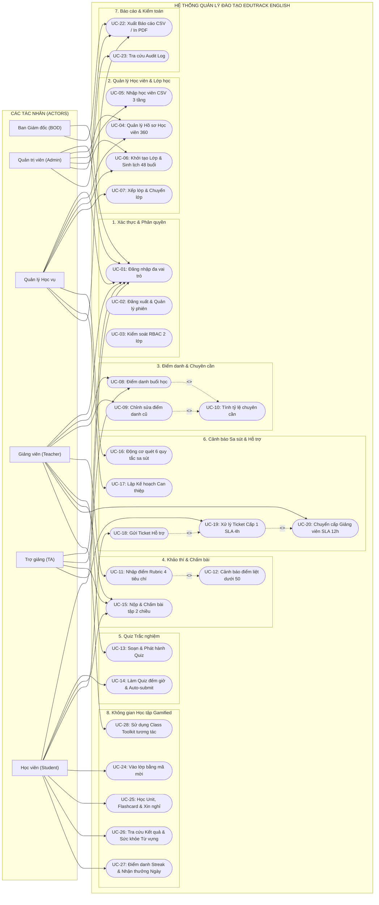

# TÀI LIỆU ĐẶC TẢ USE CASE TOÀN DIỆN HỆ THỐNG EDUTRACK ENGLISH
> **Tiêu chuẩn tài liệu:** UML 2.5 & ISO/IEC/IEEE 29148:2018 (Systems and software engineering — Requirements engineering)  
> **Phiên bản:** 3.0 — Bản Phát hành Toàn Quyền Hệ Thống  
> **Phạm vi tác nhân (Actors):** Ban Giám đốc (BOD), Quản trị viên (Admin), Quản lý Học vụ (Academic Manager), Giảng viên (Teacher), Trợ giảng (Teaching Assistant), Học viên (Student).  
> **Kiến trúc:** SPA Frontend (TypeScript + Vite) kết nối Backend RESTful API (FastAPI Python) với kiểm soát phân quyền RBAC 2 lớp và cơ sở dữ liệu quan hệ (SQLite/PostgreSQL).

---

## MỤC LỤC
1. [Phần 1: Tổng quan Hệ thống, Sơ đồ Use Case & Ma trận Tác nhân](#phần-1-tổng-quan-hệ-thống-sơ-đồ-use-case--ma-trận-tác-nhân)
   - 1.1. Danh sách & Vai trò của các Tác nhân (Actors)
   - 1.2. Sơ đồ Use Case Tổng quát (Mermaid Diagram)
   - 1.3. Ma trận Phân quyền Use Case vs Tác nhân (Actor-to-Use-Case Matrix)
2. [Phần 2: Đặc tả Chi tiết Các Use Case Nghiệp vụ (UC-01 đến UC-28)](#phần-2-đặc-tả-chi-tiết-các-use-case-nghiệp-vụ)
   - **Phân hệ 1: Xác thực & Quản trị Phiên (UC-01 $\rightarrow$ UC-03)**
   - **Phân hệ 2: Quản lý Học viên & Xếp lớp (UC-04 $\rightarrow$ UC-07)**
   - **Phân hệ 3: Điểm danh & Chuyên cần (UC-08 $\rightarrow$ UC-10)**
   - **Phân hệ 4: Khảo thí & Chấm điểm Rubric (UC-11 $\rightarrow$ UC-12)**
   - **Phân hệ 5: Khảo thí Trắc nghiệm (Quiz Engine) (UC-13 $\rightarrow$ UC-14)**
   - **Phân hệ 6: Quản lý Bài tập Trực tuyến & Chấm bài 2 chiều (UC-15)**
   - **Phân hệ 7: Giám sát Sa sút & Hồ sơ Can thiệp (UC-16 $\rightarrow$ UC-17)**
   - **Phân hệ 8: Hệ thống Hỗ trợ Học sinh (Ticketing SLA 4h/12h) (UC-18 $\rightarrow$ UC-21)**
   - **Phân hệ 9: Báo cáo & Kiểm toán Hệ thống (UC-22 $\rightarrow$ UC-23)**
   - **Phân hệ 10: Không gian Học tập Học viên (Student Portal & Gamification) (UC-24 $\rightarrow$ UC-28)**
3. [Phần 3: Bảng Rà soát Lỗi Nghiệp vụ & Cơ chế Phòng ngừa (Error Review Matrix)](#phần-3-bảng-rà-soát-lỗi-nghiệp-vụ--cơ-chế-phòng-ngừa)

---

## PHẦN 1: TỔNG QUAN HỆ THỐNG, SƠ ĐỒ USE CASE & MA TRẬN TÁC NHÂN

### 1.1. Danh sách & Vai trò của các Tác nhân (Actors)
1. **Ban Giám đốc (Executive Board - BOD):** Người sử dụng cấp cao, có quyền xem tổng quan các chỉ số KPI vận hành toàn trung tâm: tỷ lệ chuyên cần trung bình, doanh thu học vụ, phân bố điểm kiểm tra, tỷ lệ vi phạm SLA hỗ trợ, và xuất báo cáo PDF phục vụ cuộc họp chiến lược. (Quyền chỉ đọc - Read-only).
2. **Quản trị viên Hệ thống (System Admin):** Nắm toàn quyền quản trị (`super-user`): khởi tạo tài khoản, phân bổ vai trò, nhập dữ liệu hàng loạt bằng file CSV/Excel 3 tầng kiểm duyệt, cấu hình thông số trung tâm, quản lý cơ sở và tra soát nhật ký kiểm toán (Audit Log).
3. **Quản lý Học vụ (Academic Manager):** Phụ trách vận hành đào tạo: thiết kế khung chương trình khóa học, tạo lớp học, phân công giảng viên & trợ giảng, điều phối sinh viên, giám sát ma trận cảnh báo sa sút (Risk Matrix) và khởi tạo kế hoạch can thiệp học tập.
4. **Giảng viên chính (Teacher / Lecturer):** Trực tiếp đứng lớp: phụ trách điểm danh, giảng dạy theo giáo án, tổ chức thi định kỳ, chấm bài nộp và phản hồi theo Rubric 4 tiêu chí chuẩn IELTS, xử lý các ticket chuyên môn cấp 2 (SLA 12h), sử dụng bộ công cụ Class Toolkit trên lớp học.
5. **Trợ giảng (Teaching Assistant - TA):** Hỗ trợ học vụ: phối hợp điểm danh buổi học, giải đáp ticket thắc mắc của học sinh cấp 1 (SLA 4h), hỗ trợ chấm bài tập về nhà theo hướng dẫn, nhắc nhở học viên vắng học hoặc chưa nộp bài.
6. **Học viên (Student):** Người học tham gia vào không gian học tập Gamified Violet pastel: nhập mã vào lớp, theo dõi lịch học, lật thẻ Flashcard ôn từ vựng, nộp bài tập trực tuyến, thi trắc nghiệm Quiz đếm giờ, tích lũy điểm kinh nghiệm (XP) & chuỗi ngày học tập (Streak).

---

### 1.2. Sơ đồ Use Case Tổng quát (System Use Case Diagram)

---

### 1.3. Ma trận Phân quyền Use Case vs Tác nhân (Actor-to-Use-Case Matrix)

| Mã Use Case | Tên Use Case | BOD | Admin | QL Học vụ | Giảng viên | Trợ giảng | Học viên |
| :--- | :--- | :---: | :---: | :---: | :---: | :---: | :---: |
| **UC-01** | Đăng nhập Đa vai trò | X | X | X | X | X | X |
| **UC-02** | Đăng xuất & Quản lý Phiên | X | X | X | X | X | X |
| **UC-03** | Kiểm soát Quyền RBAC 2 Lớp | Hệ thống | Hệ thống | Hệ thống | Hệ thống | Hệ thống | Hệ thống |
| **UC-04** | Quản lý Hồ sơ Học viên 360° | Xem | Toàn quyền | Toàn quyền | Xem lớp mình | Xem lớp mình | Xem hồ sơ mình |
| **UC-05** | Nhập Học viên CSV 3 Tầng | — | Toàn quyền | Toàn quyền | — | — | — |
| **UC-06** | Khởi tạo Lớp & Sinh lịch 48 buổi | Xem | Toàn quyền | Toàn quyền | Xem | Xem | — |
| **UC-07** | Xếp lớp & Chuyển lớp Học viên | — | Toàn quyền | Toàn quyền | Đề xuất | — | — |
| **UC-08** | Điểm danh Buổi học Mới | Xem | Toàn quyền | Toàn quyền | Lớp phụ trách | Lớp trợ giảng | Xem kết quả |
| **UC-09** | Chỉnh sửa Điểm danh Cũ | Xem | Toàn quyền | Toàn quyền | Lớp phụ trách | Lớp trợ giảng | Xem kết quả |
| **UC-10** | Tự động Tính Tỷ lệ Chuyên cần | Xem | Hệ thống | Hệ thống | Hệ thống | Hệ thống | Xem kết quả |
| **UC-11** | Nhập Điểm Rubric 4 Tiêu chí | Xem | Toàn quyền | Toàn quyền | Lớp phụ trách | Chấm phân công | Xem điểm mình |
| **UC-12** | Cảnh báo Điểm Liệt < 50 | Xem | Nhận cờ | Nhận cờ | Nhận cờ | Nhận cờ | Nhận thông báo |
| **UC-13** | Soạn Đề & Phát hành Quiz | — | Toàn quyền | Toàn quyền | Lớp phụ trách | Phối hợp | — |
| **UC-14** | Học viên Làm Quiz Đếm giờ | — | — | — | Xem bài nộp | Xem bài nộp | Làm bài |
| **UC-15** | Nộp Bài & Chấm Bài Tập 2 Chiều | — | Toàn quyền | Giám sát | Chấm & Phản hồi | Chấm hỗ trợ | Nộp & Đọc nhận xét |
| **UC-16** | Động cơ Quét 6 Quy tắc Sa sút | Xem | Cấu hình | Toàn quyền | Nhận cảnh báo | Nhận cảnh báo | — |
| **UC-17** | Lập & Thực thi Kế hoạch Can thiệp | Xem | Giám sát | Toàn quyền | Thực thi | Phối hợp | — |
| **UC-18** | Gửi Vé Hỗ trợ Học vụ (Ticket) | — | Giám sát | Giám sát | — | — | Tạo yêu cầu |
| **UC-19** | Xử lý Ticket Cấp 1 (SLA 4h) | — | Điều phối | Điều phối | — | Trực tiếp xử lý | Nhận phản hồi |
| **UC-20** | Chuyển cấp Giảng viên (SLA 12h) | — | Giám sát | Giám sát | Trực tiếp xử lý | Chuyển cấp | Nhận phản hồi |
| **UC-21** | Trao đổi, Resolved & Reopen Ticket| — | Quản trị | Quản trị | Tham gia | Tham gia | Quyết định đóng/mở |
| **UC-22** | Xuất Báo cáo CSV / In PDF | Tải / In | Toàn quyền | Khối đào tạo | Lớp phụ trách | — | — |
| **UC-23** | Tra soát Nhật ký Audit Log | Xem | Toàn quyền | — | — | — | — |
| **UC-24** | Vào Lớp bằng Mã Mời | — | Cấp mã | Cấp mã | Cấp mã | Xem mã | Nhập mã tham gia |
| **UC-25** | Học Unit, Flashcard & Xin nghỉ bù | — | — | — | Giảng dạy | Hỗ trợ ca bù | Tự học & Xin nghỉ |
| **UC-26** | Tra cứu Kết quả & Sức khỏe Từ vựng | — | — | — | Theo dõi lớp | Theo dõi lớp | Tra cứu cá nhân |
| **UC-27** | Điểm danh Streak & Nhận Thóc/XP | — | — | — | — | — | Nhận thưởng ngày |
| **UC-28** | Sử dụng Class Toolkit Tương tác | — | — | — | Sử dụng trên lớp| Phối hợp | Tham gia |

---

## PHẦN 2: ĐẶC TẢ CHI TIẾT CÁC USE CASE NGHIỆP VỤ

### PHÂN HỆ 1: XÁC THỰC & QUẢN TRỊ PHIÊN

#### UC-01: ĐĂNG NHẬP ĐA VAI TRÒ
* **Mã Use Case:** UC-01
* **Tên Use Case:** Đăng nhập Đa vai trò (Multi-Role Authentication)
* **Tác nhân chính:** Ban Giám đốc, Admin, Quản lý Học vụ, Giảng viên, Trợ giảng, Học viên.
* **Tiền điều kiện:** Người dùng đã được cấp tài khoản hoạt động (`status = 'active'`) trong hệ thống.
* **Kích hoạt (Trigger):** Người dùng truy cập đường dẫn web và gửi biểu mẫu đăng nhập.
* **Luồng sự kiện chính (Main Flow):**
  1. Người dùng nhập Tên đăng nhập/Email và Mật khẩu.
  2. Người dùng nhấn nút "Đăng nhập".
  3. Frontend kiểm tra tính hợp lệ cơ bản của dữ liệu (không được để trống).
  4. Frontend gửi yêu cầu `POST /api/auth/login` kèm payload đăng nhập.
  5. Backend truy vấn CSDL bảng `users` theo email/username.
  6. Backend băm mật khẩu nhập vào bằng BCrypt và so khớp với chuỗi mã hóa trong CSDL.
  7. Backend xác thực trạng thái tài khoản: `status == 'active'`.
  8. Backend tạo mã JWT Token chứa thông tin `user_id`, `role`, thời hạn sống (24 giờ).
  9. Backend ghi bản ghi `USER_LOGIN_SUCCESS` vào bảng `audit_logs`.
  10. Backend trả về JWT Token và thông tin đối tượng User.
  11. Frontend lưu Token vào `localStorage` và chuyển hướng giao diện:
      * Nếu `role == 'student'`: Chuyển hướng sang `#/student-dashboard` (Gamified Violet).
      * Nếu `role in ['admin', 'teacher', 'teaching_assistant', 'bod']`: Chuyển hướng sang `#/dashboard` (Warm Minimalist).
* **Luồng thay thế (Alternative Flows):**
  * *Alt-1: Tài khoản có cờ cần đổi mật khẩu lần đầu (`force_pwd_change = true`):* Hệ thống chuyển sang màn hình bắt buộc đổi mật khẩu trước khi vào giao diện chính.
* **Luồng ngoại lệ (Exception Flows):**
  * *Exc-1: Tên đăng nhập không tồn tại hoặc sai mật khẩu:* Backend trả mã HTTP 401 Unauthorized. Frontend hiển thị cảnh báo viền đỏ "Tên đăng nhập hoặc mật khẩu không chính xác".
  * *Exc-2: Tài khoản bị khóa (`status = 'suspended'`):* Backend trả mã HTTP 403 Forbidden. Frontend hiển thị thông báo "Tài khoản của bạn đã bị tạm dừng, vui lòng liên hệ Admin".
* **Hậu điều kiện:** Người dùng được cấp phiên làm việc hợp lệ; mọi API call tiếp theo đều đính kèm Header `Authorization: Bearer <token>`.
* **Quy tắc nghiệp vụ (Business Rules):** 
  * BR-01: Mật khẩu tối thiểu 6 ký tự.
  * BR-02: Sau 5 lần nhập sai liên tiếp trong 15 phút, tài khoản bị tạm khóa 30 phút để chống Brute-force.

---

#### UC-02: ĐĂNG XUẤT & QUẢN LÝ PHIÊN AN TOÀN
* **Mã Use Case:** UC-02
* **Tác nhân chính:** Mọi tác nhân.
* **Tiền điều kiện:** Người dùng đang đăng nhập và có phiên làm việc hợp lệ.
* **Luồng sự kiện chính:**
  1. Người dùng nhấn nút "Đăng xuất" tại thanh Sidebar hoặc Menu người dùng.
  2. Frontend hiển thị thông báo xác nhận: "Bạn có chắc chắn muốn đăng xuất?".
  3. Người dùng xác nhận.
  4. Frontend gửi yêu cầu `POST /api/auth/logout`.
  5. Backend đưa Token hiện tại vào danh sách Blacklist (nếu sử dụng Redis) hoặc cập nhật `last_logout_at`, ghi Audit Log.
  6. Frontend xóa toàn bộ Token, User State trong `localStorage` và `sessionStorage`.
  7. Chuyển hướng người dùng về trang đăng nhập `#/login`.
* **Hậu điều kiện:** Không thể sử dụng Token cũ để gọi API; nút "Back" trên trình duyệt không tải lại được dữ liệu cũ.

---

#### UC-03: KIỂM SOÁT QUYỀN TRUY CẬP RBAC 2 LỚP
* **Mã Use Case:** UC-03
* **Tác nhân:** Động cơ Bảo mật Hệ thống.
* **Mô tả:** Cơ chế phi chức năng hoạt động ngầm để chặn triệt để mọi hành vi leo thang đặc quyền (Privilege Escalation):
  1. **Lớp 1 (SPA Client Guard):** Router kiểm tra `user.role` trước mỗi sự kiện chuyển trang (`window.addEventListener('hashchange')`). Nếu Học viên cố tình gõ link Admin (`#/risk-matrix`), hệ thống tự động cưỡng chế quay về `#/student-dashboard`.
  2. **Lớp 2 (FastAPI Server Dependency):** Mọi router nhạy cảm đều có dependency `get_current_active_user` và `require_roles(['admin'])`. Nếu role của Token không khớp, Backend từ chối ngay lập tức với HTTP 403 Forbidden.

---

### PHÂN HỆ 2: QUẢN LÝ HỌC VIÊN & XẾP LỚP

#### UC-04: QUẢN LÝ HỒ SƠ HỌC VIÊN 360°
* **Mã Use Case:** UC-04
* **Tác nhân chính:** Quản trị viên, Quản lý Học vụ (Toàn quyền); Giảng viên, Trợ giảng (Xem lớp mình phụ trách); Học viên (Xem hồ sơ cá nhân).
* **Tiền điều kiện:** Người dùng đã đăng nhập và có quyền truy cập vào phân hệ Học viên (`#/students`).
* **Luồng sự kiện chính:**
  1. Người dùng mở danh sách học viên.
  2. Hệ thống tải dữ liệu qua `GET /api/students` kèm bộ lọc (Lớp, Chi nhánh, Tình trạng rủi ro).
  3. Người dùng chọn 1 học viên để mở Hồ sơ 360° bao gồm 5 thẻ thông tin:
     * Thông tin định danh (Họ tên, Mã HV, SĐT, Email, Phụ huynh).
     * Lịch sử lớp học và tình trạng ghi danh (Active, Dropped, Completed).
     * Lũy kế chuyên cần (Số buổi học, số buổi vắng, tỷ lệ %).
     * Bảng điểm chi tiết các kỳ thi và bài tập.
     * Dòng thời gian can thiệp học vụ và nhật ký trao đổi.
  4. Quản lý Học vụ chỉnh sửa thông tin hoặc bấm "Lưu thay đổi".
  5. Hệ thống xác thực và cập nhật vào bảng `students`, ghi Audit Log.
* **Hậu điều kiện:** Dữ liệu hồ sơ học viên được đồng bộ xuyên suốt trên các phân hệ Điểm danh, Bảng điểm và Ma trận sa sút.

---

#### UC-05: NHẬP HỌC VIÊN HÀNG LOẠT QUA FILE CSV 3 TẦNG KIỂM DUYỆT
* **Mã Use Case:** UC-05
* **Tác nhân:** Quản trị viên, Quản lý Học vụ.
* **Tiền điều kiện:** Có file danh sách mẫu dạng `.csv` hoặc `.xlsx`.
* **Luồng sự kiện chính:**
  1. Người dùng truy cập phân hệ `#/import-data`.
  2. Người dùng kéo thả file danh sách học viên vào vùng tải lên.
  3. **Tầng 1 - Client Validation:** Trình duyệt kiểm tra dung lượng file ($\le 5\text{MB}$), phần mở rộng hợp lệ, và đối chiếu tên các cột Header bắt buộc (`full_name`, `phone`, `email`, `target_course`).
  4. **Tầng 2 - Data Syntax & Business Rules Check:** Hệ thống phân tích từng dòng:
     * Kiểm tra cú pháp Email regex, định dạng Số điện thoại Việt Nam (10 chữ số).
     * Đối chiếu với CSDL xem Email/SĐT đã tồn tại chưa.
     * Hiển thị bảng xem trước (Preview Grid) với các dòng lỗi được đánh dấu đỏ kèm lý do cụ thể. Người dùng có thể bấm trực tiếp vào ô để sửa dữ liệu sai.
  5. **Tầng 3 - Database Atomic Transaction:** Người dùng bấm "Xác nhận nhập". Backend mở một Transaction duy nhất:
     * Tạo tài khoản User đăng nhập tự động.
     * Tạo bản ghi Student.
     * Nếu chọn xếp lớp luôn: tạo bản ghi Enrollment.
     * Nếu xảy ra bất kỳ lỗi database nào ở giữa chừng, toàn bộ thao tác tự động Rollback hoàn toàn để không để lại dữ liệu rác.
  6. Hệ thống hiển thị bảng thống kê: "Nhập thành công N học viên".
* **Quy tắc nghiệp vụ:** BR-03: Không cho phép nhập trùng Số điện thoại hoặc Email đã tồn tại trong hệ thống.

---

#### UC-06: KHỞI TẠO LỚP HỌC & TỰ ĐỘNG SINH LỊCH 48 BUỔI
* **Mã Use Case:** UC-06
* **Tác nhân:** Quản lý Học vụ, Quản trị viên.
* **Luồng sự kiện chính:**
  1. Người dùng bấm nút "+ Tạo Lớp Học Mới" tại `#/classes`.
  2. Nhập các thông tin bắt buộc:
     * Chọn Khóa học gốc (VD: IELTS Foundation 5.5).
     * Tên lớp (VD: IEL-55-K24).
     * Sĩ số tối đa (Mặc định 15 - 20 học viên).
     * Chọn Giảng viên chính và Trợ giảng.
     * Chọn Phòng học và Chi nhánh.
     * Chọn Ngày khai giảng và Lịch học định kỳ trong tuần (VD: Thứ 2 - Thứ 4 - Thứ 6; Ca: 18h00 - 19h30).
  3. Người dùng bấm nút "Tự động sinh lịch học".
  4. Hệ thống chạy thuật toán tạo lịch:
     * Quét lịch của Giảng viên và Phòng học để đảm bảo không bị trùng lặp với các lớp đang chạy khác.
     * Lấy cấu hình số buổi của Khóa học (VD: 24 hoặc 48 buổi).
     * Tự động tính toán các mốc ngày học thực tế, tự động nhảy qua các ngày lễ quốc gia trong danh mục Nghỉ lễ của trung tâm.
     * Tạo mã tham gia lớp học độc nhất gồm 6 ký tự ngẫu nhiên (VD: `IEL55A`).
  5. Hệ thống hiển thị danh sách 48 buổi học kèm ngày giờ cụ thể cho người dùng rà soát.
  6. Người dùng xác nhận "Kích hoạt Lớp học".
* **Hậu điều kiện:** Lớp học chuyển trạng thái `active`, 48 bản ghi buổi học được tạo trong bảng `sessions`, mã lớp được kích hoạt để học viên có thể tự nhập mã tham gia.

---

#### UC-07: XẾP LỚP & CHUYỂN LỚP HỌC VIÊN
* **Mã Use Case:** UC-07
* **Tác nhân:** Quản lý Học vụ.
* **Mô tả:** Cho phép chuyển học viên từ Lớp A sang Lớp B khi học viên có nguyện đổi ca hoặc nâng trình độ:
  1. Chọn học viên và chọn chức năng "Chuyển lớp".
  2. Chọn lớp đích. Hệ thống kiểm tra xem lớp đích còn chỗ trống hay không (`current_students < max_capacity`).
  3. Lựa chọn bảo lưu kết quả chuyên cần và điểm thi đã học tại Lớp A hay tính lại từ đầu.
  4. Hệ thống cập nhật bản ghi tại Lớp A thành `status = 'transferred'` và tạo bản ghi mới tại Lớp B với `status = 'active'`.

---

### PHÂN HỆ 3: ĐIỂM DANH & CHUYÊN CẦN

#### UC-08: ĐIỂM DANH BUỔI HỌC MỚI
* **Mã Use Case:** UC-08
* **Tác nhân:** Giảng viên chính, Trợ giảng.
* **Tiền điều kiện:** Lớp học đang hoạt động, buổi học đã đến giờ hoặc nằm trong ngày học.
* **Luồng sự kiện chính:**
  1. Giảng viên mở giao diện `#/attendance` và chọn Lớp, chọn Buổi học trong danh sách.
  2. Hệ thống tải danh sách toàn bộ học viên đang ghi danh (`active`) trong lớp.
  3. Mặc định hệ thống để trạng thái "Có mặt (Present)" cho toàn bộ danh sách để tối ưu thời gian thao tác.
  4. Giảng viên tích chọn các học viên vắng mặt hoặc đi trễ:
     * `present`: Có mặt đúng giờ.
     * `late`: Đi học muộn.
     * `excused`: Nghỉ học có phép (đã nộp đơn xin nghỉ).
     * `absent`: Vắng mặt không phép.
  5. Nhập ghi chú nhận xét về tình hình lớp học hôm nay.
  6. Giảng viên bấm "Lưu & Chốt Điểm Danh".
  7. Backend nhận yêu cầu, cập nhật chi tiết vào bảng `attendance_records`.
  8. Hệ thống tăng số buổi học đã hoàn thành của lớp: `completed_sessions = completed_sessions + 1`.
  9. Hệ thống kích hoạt Use Case UC-10 để tính lại tỷ lệ chuyên cần cho từng học viên.
* **Hậu điều kiện:** Dữ liệu điểm danh được chốt, tỷ lệ chuyên cần cập nhật ngay lập tức trên màn hình học viên.

---

#### UC-09: CHỈNH SỬA ĐIỂM DANH CŨ (CHỐNG ĐẾM TRÙNG TIẾN ĐỘ)
* **Mã Use Case:** UC-09
* **Tác nhân:** Giảng viên, Trợ giảng, Quản lý Học vụ.
* **Mô tả & Quy tắc chống lỗi:**
  * Khi phát hiện điểm danh nhầm buổi học đã qua, người dùng có quyền mở lại buổi cũ để sửa trạng thái.
  * **Quy tắc BR-04 (Chống đếm trùng tiến độ):** Hệ thống kiểm tra cờ `session.is_completed`. Nếu buổi học này ĐÃ từng được điểm danh trước đó, Backend CHỈ cập nhật lại bảng `attendance_records` và tính lại tỷ lệ chuyên cần, TUYỆT ĐỐI KHÔNG tăng thêm biến `completed_sessions` của lớp.

---

#### UC-10: TỰ ĐỘNG TÍNH TỶ LỆ CHUYÊN CẦN
* **Mã Use Case:** UC-10
* **Tác nhân:** Hệ thống tính toán tự động (Included trong UC-08 và UC-09).
* **Công thức toán học chuẩn nghiệp vụ:**
  $$\text{Tỷ lệ Chuyên cần (\%)} = \frac{\text{Số buổi Có mặt} + \text{Số buổi Đi trễ}}{\text{Số buổi Có mặt} + \text{Số buổi Đi trễ} + \text{Số buổi Vắng không phép}} \times 100\%$$
* **Quy tắc đặc thù:**
  * Buổi nghỉ học có phép (`excused`): **KHÔNG** tính vào mẫu số tỷ lệ để đảm bảo quyền lợi chính đáng cho học viên đã xin nghỉ và ghép ca học bù.
  * Nếu tổng số buổi tham gia tính toán bằng 0: Tỷ lệ hiển thị là `—` (Chưa có dữ liệu).

---

### PHÂN HỆ 4: KHẢO THÍ & CHẤM ĐIỂM RUBRIC

#### UC-11: QUẢN LÝ BÀI KIỂM TRA & NHẬP ĐIỂM RUBRIC 4 TIÊU CHÍ
* **Mã Use Case:** UC-11
* **Tác nhân:** Giảng viên, Khảo thí, Quản lý Học vụ.
* **Tiền điều kiện:** Lớp học đã được cấu hình các đầu điểm trong Tab Cấu hình (VD: Chuyên cần 10%, Mini Test 20%, Mid-term 30%, Final 40%).
* **Luồng sự kiện chính:**
  1. Người dùng vào giao diện `#/assessments` hoặc `#/grading`.
  2. Chọn Lớp học và chọn Bài kiểm tra cần nhập điểm.
  3. Đối với bài thi Kỹ năng Speaking/Writing: Hệ thống mở Bảng điểm chuẩn Rubric 4 tiêu chí (Thang điểm 0 - 100 hoặc Thang điểm 9 Band IELTS):
     * Tiêu chí 1: Task Achievement / Fluency & Coherence.
     * Tiêu chí 2: Lexical Resource (Vốn từ vựng).
     * Tiêu chí 3: Grammatical Range & Accuracy (Ngữ pháp).
     * Tiêu chí 4: Pronunciation (Phát âm) / Cohesion.
  4. Giảng viên nhập điểm thành phần cho từng tiêu chí, hệ thống tự động tính điểm trung bình bài thi.
  5. Giảng viên có thể tải lên file ghi âm nhận xét `.mp3` hoặc nhập văn bản nhận xét 2 chiều.
  6. Bấm "Lưu Bảng Điểm".
  7. Backend xác thực dữ liệu điểm thuộc đoạn $[0, 100]$. Nếu hợp lệ, lưu vào bảng `grades` và tính điểm tổng kết tạm thời.

---

#### UC-12: CẢNH BÁO ĐIỂM LIỆT DƯỚI 50 NỘI BỘ
* **Mã Use Case:** UC-12 (Extends UC-11)
* **Tác nhân:** Động cơ Cảnh báo Sớm (Early Warning Engine).
* **Mô tả:**
  * Khi lưu điểm bài kiểm tra, nếu điểm tổng của học viên $< 50$ điểm (trên thang 100):
    1. Hệ thống tự động đánh dấu cờ màu đỏ `FLAG_FAILING_GRADE` trên hồ sơ học viên.
    2. Tự động sinh một cảnh báo mức độ "Cao" vào phân hệ Ma trận Sa sút `#/risk-matrix`.
    3. Gửi thông báo nội bộ cho Quản lý Học vụ và Trợ giảng để lên lịch phụ đạo tăng cường.

---

### PHÂN HỆ 5: KHẢO THÍ TRẮC NGHIỆM (QUIZ ENGINE)

#### UC-13: SOẠN ĐỀ & PHÁT HÀNH QUIZ TRẮC NGHIỆM
* **Mã Use Case:** UC-13
* **Tác nhân:** Giảng viên, Quản lý Học vụ.
* **Mô tả:**
  1. Giảng viên vào `#/quizzes` bấm "Tạo đề thi mới".
  2. Thiết lập tiêu đề, thời gian làm bài đếm ngược (VD: 15 phút), điểm đạt, số lần làm tối đa.
  3. Thêm các câu hỏi: nhập nội dung câu hỏi, file âm thanh nghe (Listening), hình ảnh minh họa, danh sách 4 lựa chọn A, B, C, D và tích chọn đáp án đúng kèm lời giải thích chi tiết.
  4. Chọn lớp áp dụng và bấm "Phát hành (Publish)".

---

#### UC-14: HỌC VIÊN LÀM QUIZ ĐẾM GIỜ & BACKEND AUTO-SUBMIT
* **Mã Use Case:** UC-14
* **Tác nhân:** Học viên.
* **Tiền điều kiện:** Đề Quiz đang ở trạng thái `published`.
* **Luồng sự kiện chính:**
  1. Học viên vào mục "Luyện tập" trên giao diện Tím pastel, chọn đề Quiz.
  2. Học viên bấm "Bắt đầu làm bài". Màn hình chuyển sang chế độ tập trung (Focus Mode), đồng hồ đếm ngược bắt đầu chạy.
  3. Học viên chọn đáp án cho từng câu hỏi. Hệ thống tự động lưu tạm lựa chọn vào Local State để phòng ngừa mất kết nối mạng.
  4. **Nộp bài:**
     * *Trường hợp 1 (Chủ động):* Học viên làm xong bấm nút "Nộp bài". Hệ thống hỏi xác nhận và gửi dữ liệu lên server.
     * *Trường hợp 2 (Hết giờ):* Đồng hồ đếm ngược về 0:00. Hệ thống khóa toàn bộ lựa chọn và tự động kích hoạt hàm nộp bài cưỡng chế (Auto-submit).
  5. Backend nhận câu trả lời, so khớp với đáp án gốc trong CSDL, tính điểm số thực tế.
  6. Backend cộng điểm kinh nghiệm Gamification XP, cập nhật chỉ số "Sức khỏe từ vựng".
  7. Màn hình hiển thị kết quả ngay lập tức: Điểm số, số câu đúng/sai, đáp án chi tiết và huy hiệu chúc mừng.

---

### PHÂN HỆ 6: QUẢN LÝ BÀI TẬP TRỰC TUYẾN & CHẤM BÀI 2 CHIỀU

#### UC-15: NỘP BÀI TẬP ĐA ĐỊNH DẠNG & CHẤM BÀI 2 CHIỀU
* **Mã Use Case:** UC-15
* **Tác nhân:** Học viên (Nộp bài), Giảng viên & Trợ giảng (Chấm bài).
* **Luồng sự kiện chính:**
  1. **Học viên:**
     * Truy cập danh sách bài tập tại `#/student-assignments`.
     * Chọn bài tập cần nộp, xem yêu cầu đề bài và hạn chót (Deadline).
     * Chọn phương thức nộp bài: (a) Tải lên file PDF/Word/Audio; (b) Dán đường link Google Docs/Drive; (c) Nhập trực tiếp văn bản trả lời.
     * Bấm "Nộp bài". Nếu nộp sau thời gian Deadline, hệ thống tự động gắn nhãn "Nộp muộn (Late)".
  2. **Giảng viên / Trợ giảng:**
     * Truy cập giao diện Chấm bài `#/grading`.
     * Lọc danh sách theo lớp và trạng thái "Chờ chấm (Pending)".
     * Nhấp chọn bài nộp của học viên: Mở xem trực tiếp file/link/audio.
     * Chấm điểm theo rubric và nhập nhận xét chi tiết từng đoạn văn/phát âm.
     * Bấm "Hoàn tất chấm & Công bố".
  3. **Học viên:** Nhận thông báo có điểm, mở lại bài tập để đọc phản hồi 2 chiều của thầy cô.

---

### PHÂN HỆ 7: GIÁM SÁT SA SÚT & HỒ SƠ CAN THIỆP

#### UC-16: ĐỘNG CƠ QUÉT 6 QUY TẮC SA SÚT HỌC TẬP (EARLY WARNING RISK MATRIX)
* **Mã Use Case:** UC-16
* **Tác nhân:** Động cơ Quét Ngầm Hệ thống (Background Engine) & Quản lý Học vụ.
* **Chi tiết 6 Quy tắc Nhận diện Nguy cơ Sa sút:**
  1. **Quy tắc R1 (Vắng học liên tiếp):** Học viên vắng mặt không phép liên tiếp $\ge 2$ buổi học. $\rightarrow$ Cảnh báo Mức độ CAO.
  2. **Quy tắc R2 (Tỷ lệ chuyên cần thấp):** Chuyên cần lũy kế $< 80\%$. $\rightarrow$ Cảnh báo Mức độ CAO.
  3. **Quy tắc R3 (Điểm số sụt giảm đột ngột):** Điểm bài kiểm tra gần nhất thấp hơn bài trước đó $\ge 15\%$ điểm. $\rightarrow$ Cảnh báo Mức độ TRUNG BÌNH.
  4. **Quy tắc R4 (Điểm liệt):** Điểm kiểm tra định kỳ $< 50/100$. $\rightarrow$ Cảnh báo Mức độ CAO.
  5. **Quy tắc R5 (Nợ bài tập kéo dài):** Chưa nộp bài tập quá hạn $> 3$ ngày. $\rightarrow$ Cảnh báo Mức độ TRUNG BÌNH.
  6. **Quy tắc R6 (Ticket tồn đọng):** Có thắc mắc hỗ trợ học vụ bị quá hạn SLA mà chưa được giải quyết. $\rightarrow$ Cảnh báo Mức độ THẤP.
* **Hành vi hệ thống:** Tự động gom các chỉ số thành Ma trận rủi ro với 3 cấp độ màu: Đỏ (Nguy cấp), Vàng (Cần theo dõi), Xanh (An toàn).

---

#### UC-17: QUẢN LÝ HỒ SƠ CAN THIỆP HỌC VIÊN
* **Mã Use Case:** UC-17
* **Tác nhân:** Quản lý Học vụ, Giảng viên.
* **Mô tả:**
  1. Người dùng mở Ma trận Sa sút `#/risk-matrix`, bấm vào học viên có cờ Đỏ/Vàng.
  2. Bấm "Tạo Kế hoạch Can thiệp (Intervention Plan)".
  3. Lựa chọn hình thức can thiệp:
     * Gọi điện trao đổi trực tiếp với Phụ huynh / Học viên.
     * Xếp lịch phụ đạo 1 kèm 1 với Trợ giảng (Tutoring session).
     * Điều chỉnh lớp học hoặc gia hạn nộp bài.
  4. Người phụ trách ghi chép nhật ký trao đổi và cập nhật trạng thái: `Đang can thiệp` $\rightarrow$ `Đã cải thiện / Đóng rủi ro`.

---

### PHÂN HỆ 8: HỆ THỐNG HỖ TRỢ HỌC SINH (TICKETING SLA 4H / 12H)

#### UC-18: GỬI VÉ HỖ TRỢ HỌC VỤ (TICKET)
* **Mã Use Case:** UC-18
* **Tác nhân:** Học viên.
* **Mô tả:** Học viên tại giao diện cá nhân tạo yêu cầu hỗ trợ: nhập Tiêu đề, Loại thắc mắc (Học thuật, Điểm danh, Đổi lịch, Học phí, Kỹ thuật), Nội dung và Đính kèm hình ảnh minh chứng. Hệ thống tự động gán mã ticket (VD: `#TK-1082`) và kích hoạt bộ đếm thời gian SLA.

---

#### UC-19: XỬ LÝ TICKET CẤP 1 & GIÁM SÁT SLA TRỢ GIẢNG (4 GIỜ)
* **Mã Use Case:** UC-19
* **Tác nhân:** Trợ giảng (Teaching Assistant).
* **Quy tắc SLA:** Thời gian phản hồi lần đầu tiên phải $\le 4\text{ giờ}$ kể từ lúc tạo vé.
* **Luồng sự kiện:**
  1. Trợ giảng mở giao diện Hỗ trợ `#/support`.
  2. Xem danh sách ticket mới của lớp mình phụ trách. Đồng hồ đếm ngược SLA hiển thị thời gian còn lại (màu xanh $\rightarrow$ cam $\rightarrow$ đỏ nhấp nháy nếu quá hạn).
  3. Trợ giảng soạn câu trả lời hướng dẫn bài tập và giải quyết thắc mắc cho học viên.
  4. Trợ giảng bấm "Gửi phản hồi". Trạng thái ticket chuyển thành `Waiting for Student`. Bộ đếm SLA Cấp 1 dừng thành công.

---

#### UC-20: CHUYỂN CẤP GIẢNG VIÊN CHÍNH & GIÁM SÁT SLA CẤP 2 (12 GIỜ)
* **Mã Use Case:** UC-20
* **Tác nhân:** Trợ giảng (Người chuyển cấp), Giảng viên chính (Người xử lý).
* **Điều kiện kích hoạt:**
  * Vấn đề học thuật chuyên sâu vượt thẩm quyền của Trợ giảng.
  * Hoặc Ticket cấp 1 đã chạm mốc 4 giờ mà Trợ giảng chưa phản hồi (Hệ thống tự động Escalate).
* **Quy tắc SLA Cấp 2:** Giảng viên chính có thời hạn $\le 12\text{ giờ}$ để đưa ra phương án xử lý dứt điểm. Giảng viên soạn nội dung chuyên sâu và cập nhật trạng thái `Resolved`.

---

#### UC-21: TRAO ĐỔI 2 CHIỀU, CHỐT RESOLVED & REOPEN TICKET
* **Mã Use Case:** UC-21
* **Tác nhân:** Học viên, Giảng viên, Trợ giảng.
* **Mô tả:** Sau khi nhận phản hồi, nếu học viên hài lòng, học viên bấm "Đóng Ticket" và đánh giá 5 sao. Nếu câu trả lời chưa giải quyết được vấn đề, học viên bấm "Mở lại (Reopen)" và bổ sung câu hỏi để tiếp tục phiên đối thoại.

---

### PHÂN HỆ 9: BÁO CÁO & KIỂM TOÁN HỆ THỐNG

#### UC-22: XUẤT BÁO CÁO HIỆU SUẤT TRUNG TÂM (CSV / PDF)
* **Mã Use Case:** UC-22
* **Tác nhân:** Ban Giám đốc (BOD), Quản trị viên, Quản lý Học vụ.
* **Mô tả:**
  1. Người dùng mở phân hệ `#/reports`.
  2. Chọn bộ lọc: Cơ sở, Khóa học, Khoảng ngày bắt đầu và kết thúc.
  3. Hệ thống hiển thị 4 biểu đồ tổng quan: Tỷ lệ chuyên cần toàn trung tâm, Phổ điểm phân bố chuẩn, Tỷ lệ ticket đạt chuẩn SLA, Thống kê học viên có nguy cơ sa sút.
  4. **Xuất báo cáo:**
     * Nút "Xuất CSV": Tải về file bảng tính chứa toàn bộ số liệu chi tiết từng lớp và từng học viên.
     * Nút "In / Lưu PDF": Hệ thống kích hoạt stylesheet `@media print` đã tối ưu hóa, ẩn các thành phần điều hướng, định dạng trang A4 chuẩn để in trực tiếp hoặc lưu file PDF gửi báo cáo hội đồng quản trị.

---

#### UC-23: TRA SOÁT NHẬT KÝ HỆ THỐNG (AUDIT TRAIL APPEND-ONLY)
* **Mã Use Case:** UC-23
* **Tác nhân:** Quản trị viên (Admin).
* **Đặc tính kỹ thuật:** Bảng `audit_logs` là bảng chỉ ghi thêm (Append-Only), không ai (kể cả Admin) có quyền cập nhật (`UPDATE`) hoặc xóa (`DELETE`) bản ghi log.
* **Mô tả:** Cho phép Admin tìm kiếm toàn bộ hành vi trong hệ thống theo: ID người dùng, Loại hành vi (`USER_LOGIN`, `GRADE_MODIFIED`, `ATTENDANCE_OVERWRITTEN`, `STUDENT_IMPORTED`), Địa chỉ IP và Mốc thời gian chính xác tới mili-giây.

---

### PHÂN HỆ 10: KHÔNG GIAN HỌC TẬP HỌC VIÊN (STUDENT PORTAL & GAMIFICATION)

#### UC-24: HỌC VIÊN VÀO LỚP BẰNG MÃ MỜI (JOIN CLASS BY CODE)
* **Mã Use Case:** UC-24
* **Tác nhân:** Học viên.
* **Tiền điều kiện:** Học viên đã đăng nhập vào Không gian Học tập Gamified Violet.
* **Luồng sự kiện chính:**
  1. Tại Trang chủ Học viên `#/student-dashboard`, học viên nhấn vào nút tím "+ Vào lớp" tại mục "LỚP CỦA TÔI".
  2. Màn hình chuyển sang giao diện Vào lớp `#/student-join-class` nền tím nhạt `#F8F6FF`, thẻ trắng bo góc lớn viền tím nhạt `#E8E2F8`.
  3. Học viên nhập mã lớp gồm 6 ký tự (VD: `IEL55A`) do giáo viên cung cấp vào ô nhập liệu lớn.
  4. Học viên bấm "Xác nhận vào lớp".
  5. Frontend gửi yêu cầu `POST /api/students/join-class` kèm Token và `{class_code: "IEL55A"}`.
  6. Backend kiểm tra: Mã lớp có tồn tại không? Trạng thái lớp có đang mở không? Học viên đã từng tham gia lớp này chưa?
  7. Nếu hợp lệ: Backend tạo bản ghi mới trong `enrollments` với `status = 'active'`, trả về thông tin lớp học.
  8. Frontend hiển thị thông báo thành công và tự động chuyển hướng học viên vào Trang chi tiết bài học của lớp `#/student-class-detail`.
* **Luồng ngoại lệ:** Nếu mã lớp không đúng hoặc lớp đã đóng: Hiển thị thông báo lỗi viền đỏ rõ ràng, giữ nguyên mã đã nhập để học viên chỉnh sửa.

---

#### UC-25: HỌC UNIT BÀI GIẢNG, ÔN FLASHCARD & XIN NGHỈ HỌC GHÉP CA BÙ
* **Mã Use Case:** UC-25
* **Tác nhân:** Học viên.
* **Luồng sự kiện chính:**
  1. Học viên mở `#/student-class-detail` để xem tiến độ từng Unit bài giảng.
  2. **Học từ vựng qua Flashcard:** Học viên mở thẻ từ vựng của Unit, bấm để lật thẻ xem phát âm, nghĩa tiếng Việt, câu ví dụ thực tế. Khi bấm "Đã thuộc từ này", hệ thống tăng điểm chỉ số sức khỏe từ vựng.
  3. **Xin nghỉ học & Ghép ca bù:**
     * Nếu có việc đột xuất, học viên bấm nút "Xin nghỉ học".
     * Chọn buổi học tương lai cần xin nghỉ và nhập lý do.
     * Tích chọn "Đăng ký học bù": Hệ thống hiển thị các lớp song song khác cùng khóa học có buổi dạy Unit tương ứng trong tuần.
     * Học viên chọn ca bù mong muốn và bấm gửi đơn.
     * Hệ thống tự động ghi nhận trạng thái xin nghỉ có phép (`excused`) để không bị trừ điểm chuyên cần.

---

#### UC-26: TRA CỨU KẾT QUẢ HỌC TẬP & SỨC KHỎE TỪ VỰNG
* **Mã Use Case:** UC-26
* **Tác nhân:** Học viên.
* **Luồng sự kiện chính:**
  1. Học viên nhấp vào mục menu "Kết quả" trên Sidebar tím.
  2. Giao diện mở trang `#/student-results` chuẩn Violet Gamified:
     * **Mục Sức khỏe Từ vựng:** Hiển thị số từ vựng đã ôn luyện. Nếu chưa ôn đủ 5 từ, hiển thị dòng hướng dẫn "Chưa chấm · ôn 5 từ nữa để mở khoá chỉ số này" kèm liên kết "Ôn ngay →" dẫn sang mục Flashcard.
     * **Mục Kết quả theo Lớp:** Hiển thị thẻ kết quả của từng lớp học viên tham gia với 3 chỉ số ngang: "Điểm TB", "Chuyên cần", "Tổng kết".
     * Hiển thị chi tiết công thức chuyên cần minh bạch: `Chuyên cần = đi học / (đi học + vắng)`.
     * Hiển thị bảng 4 thành phần điểm tổng kết đồng bộ trực tiếp từ Tab Cấu hình của lớp.

---

#### UC-27: ĐIỂM DANH CHUỖI NGÀY (STREAK) & NHẬN THƯỞNG NHIỆM VỤ NGÀY
* **Mã Use Case:** UC-27
* **Tác nhân:** Học viên.
* **Mô tả Gamification:**
  1. Khi học viên đăng nhập mỗi ngày, thẻ "Mục tiêu hôm nay" ghi nhận ngày học tập liên tục để nuôi "Quả trứng trong ổ rơm".
  2. Khi học viên hoàn thành các hoạt động trong ngày: Ôn 5 thẻ từ vựng, Hoàn thành 1 bài Quiz, Nộp 1 bài tập.
  3. Nút pill "🎯 Nhiệm vụ" trên Header nhấp nháy báo hiệu hoàn thành.
  4. Học viên bấm vào nút để mở danh sách nhiệm vụ và bấm "Nhận thưởng".
  5. Hệ thống cộng Thóc và Điểm kinh nghiệm (XP), đồng thời thăng hạng học viên trên Bảng xếp hạng toàn trung tâm.

---

#### UC-28: SỬ DỤNG CLASS TOOLKIT HỖ TRỢ TƯƠNG TÁC TRÊN LỚP
* **Mã Use Case:** UC-28
* **Tác nhân:** Giảng viên chính, Trợ giảng.
* **Mô tả:** Bộ công cụ trợ giảng trực tiếp trên lớp học được tích hợp trong chi tiết lớp:
  1. **Random Student Picker (Bốc thăm ngẫu nhiên):** Quay số chọn học viên bất kỳ lên bảng trả lời câu hỏi, tránh thiên vị.
  2. **Class Timer (Đồng hồ đếm giờ thảo luận nhóm):** Cài đặt thời gian làm việc nhóm 5 - 10 phút có chuông báo kết thúc.
  3. **Dice Roller (Xúc xắc tương tác):** Tung xúc xắc phục vụ các trò chơi Board game tiếng Anh trên lớp.
  4. **Quick QR Code:** Tạo nhanh mã QR chia sẻ link bài học cho học viên quét bằng điện thoại tại chỗ.

---

## PHẦN 3: BẢNG RÀ SOÁT LỖI NGHIỆP VỤ & CƠ CHẾ PHÒNG NGỪA (ERROR REVIEW MATRIX)

Bảng tổng hợp các tình huống biên (Edge Cases), lỗi nghiệp vụ tiềm ẩn và cơ chế xử lý phòng ngừa đã được cài đặt trong kiến trúc hệ thống EduTrack:

| STT | Tình huống Lỗi Tiềm ẩn | Nguy cơ / Rủi ro Nghiệp vụ | Giải pháp Kỹ thuật & Cơ chế Phòng ngừa đã Triển khai |
| :---: | :--- | :--- | :--- |
| **01** | **Chỉnh sửa điểm danh buổi cũ làm tăng số buổi lớp** | Làm sai lệch tiến độ học của lớp (Ví dụ: lớp 24 buổi nhưng bị tăng lên 25 buổi do sửa điểm danh). | **Kiểm tra trạng thái `session.is_completed`:** Chỉ tăng biến `completed_sessions` khi điểm danh một buổi hoàn toàn mới. Khi chỉnh sửa buổi đã điểm danh, chỉ cập nhật bản ghi học viên. |
| **02** | **Nghỉ học có phép bị tính vào tỷ lệ vắng làm tụt chuyên cần** | Bất công cho học viên có lý do chính đáng và đã được xếp lịch học bù. | **Công thức chuyên cần thông minh:** Loại trừ hoàn toàn trạng thái `excused` khỏi cả tử số và mẫu số: $\frac{\text{Đi học}}{\text{Đi học} + \text{Vắng không phép}}$. |
| **03** | **Điểm danh chia cho 0 khi lớp mới mở chưa học buổi nào** | Lỗi toán học `ZeroDivisionError` (NaN%) làm sập giao diện web. | Kiểm tra điều kiện mẫu số $= 0$. Nếu chưa có buổi học nào, hệ thống trả về ký tự an toàn `—` (Chưa có dữ liệu). |
| **04** | **Học viên cố tình gõ URL để vào màn hình Admin/Giáo viên** | Rò rỉ thông tin mật, lộ đề thi, sửa điểm gian lận. | **Bảo mật 2 tầng (Client Route Guard + Backend Dependency):** Client tự động chuyển hướng ngược về `#student-dashboard`; Backend từ chối với HTTP 403 Forbidden. |
| **05** | **Nhập file CSV học viên bị lỗi ở dòng thứ 99 trên 100 dòng** | CSDL bị phân mảnh, một nửa học viên được nhập, một nửa bị sót không rõ nguyên nhân. | **Tầng 3 Database Transaction Atomicity:** Toàn bộ tiến trình nhập hàng loạt nằm trong 1 Transaction. Nếu 1 dòng lỗi nghiêm trọng, toàn bộ batch sẽ Rollback về trạng thái ban đầu. |
| **06** | **Học viên cố tình kéo dài thời gian làm Quiz bằng cách tắt mạng** | Gian lận bài thi trắc nghiệm, tra cứu tài liệu quá thời gian cho phép. | **Server-side Timer Validation:** Thời điểm bắt đầu được lưu tại Backend. Khi nộp bài, Backend tính khoảng cách `submit_time - start_time`. Nếu vượt quá thời gian tối đa cho phép $\ge 30$ giây, hệ thống tự động từ chối bài làm. |
| **07** | **Nhập trùng mã lớp khi tạo lớp hoặc nhập sai mã khi vào lớp** | Lỗi Foreign Key Constraint hoặc học viên vào nhầm lớp của giáo viên khác. | Mã lớp được kiểm tra tính duy nhất (`UNIQUE INDEX`) trong CSDL. Mã lớp gồm 6 ký tự in hoa dễ đọc, tự động kiểm tra trạng thái lớp đang mở (`active`) trước khi cho phép ghi danh. |
| **08** | **Ticket của học viên bị bỏ quên không ai xử lý** | Học viên bức xúc, dịch vụ hỗ trợ kém, vi phạm cam kết trung tâm. | **Bộ đếm SLA kép 4h/12h:** Cảnh báo nhấp nháy đỏ trên giao diện Trợ giảng khi còn dưới 1 giờ; tự động chuyển cấp lên Giảng viên chính nếu chạm mốc 4 giờ. |
| **09** | **Nhập điểm kiểm tra vượt quá thang điểm (VD: 150 điểm)** | Làm sai lệch toàn bộ trọng số điểm tổng kết và xếp loại học viên. | **Validation Range Constraint $[0, 100]$:** Kiểm tra chặt chẽ ở cả Frontend Input Mask và Backend Pydantic Schema. Báo lỗi ngay tại chỗ nếu nhập điểm ngoài khoảng hợp lệ. |
| **10** | **Xóa hoặc sửa nhật ký Audit Log để che giấu hành vi gian lận** | Mất dấu vết điều tra khi xảy ra tranh chấp học vụ hoặc gian lận điểm số. | **Kiến trúc Append-Only:** Bảng `audit_logs` không cấp quyền `UPDATE`/`DELETE` cho bất kỳ API endpoint nào. Dữ liệu chỉ được ghi thêm theo thời gian thực. |

---
*Tài liệu Đặc tả Use Case Toàn diện Hệ thống Quản trị Đào tạo EduTrack English — Tuân thủ tiêu chuẩn kỹ thuật phần mềm quốc tế.*
